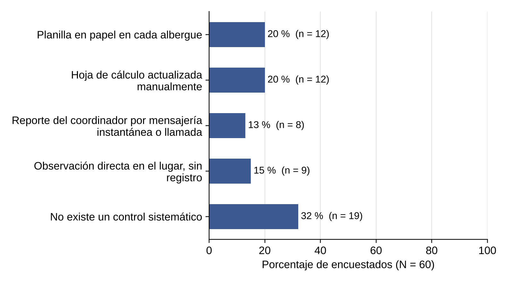
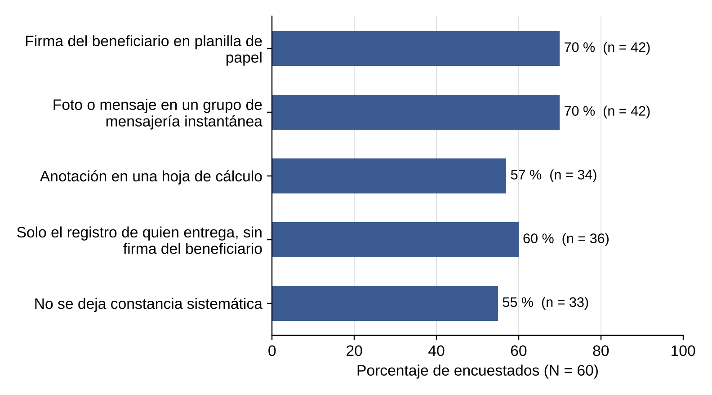
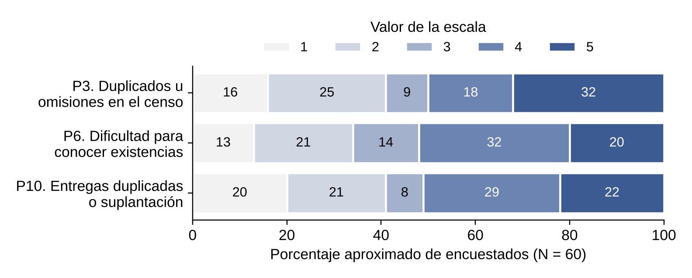
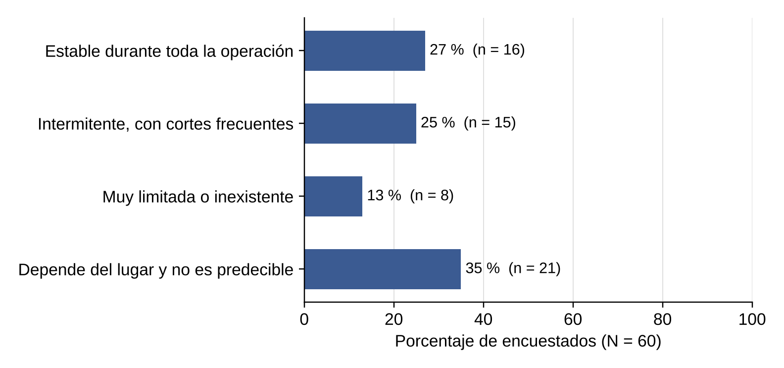
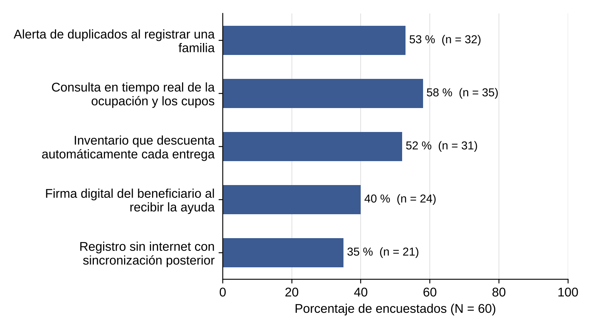

> Versión 1.2 (12 de noviembre de 2026). Las tablas y figuras conservan la numeración del documento Word de docs/entregas.

## 1.6 Metodología

El proyecto sigue un ciclo de vida iterativo e incremental basado en Scrum (Schwaber y Sutherland, 2020), adaptado a los hitos del curso. La Fase 0 concibe el problema y construye el modelo de datos de partida; la Fase 1 analiza las necesidades como historias de usuario con criterios de aceptación y deriva de ellas los requisitos, los casos de uso y los mockups; la Fase 2 diseña el comportamiento y la arquitectura por capas; la Fase 3 construye el sistema con control de versiones. La corrección de cada artefacto viaja hacia atrás: un error en una historia se corrige primero en su fuente (la sección 1.7 o el modelo) y después en lo que depende de ella.

La presentación del documento sigue las normas de la séptima edición del manual de la American Psychological Association (2020), y los formatos de las fichas siguen el material del curso (Lora Patiño, 2026).

## 1.7 Recolección de información

### 1.7.1 Fuentes de información

La información proviene de una fuente primaria, la entrevista estructurada de la sección 1.7.2, y de ocho fuentes documentales, que la Tabla 2 identifica con un código. Las historias de usuario citan estos códigos y los hallazgos de la entrevista en su campo «Origen de la necesidad».

**Tabla 2**  
*Fuentes documentales y lo que aportan al proyecto*

| **Código** | **Fuente**                                                                                                                               | **Qué aporta**                                                                                     |
|------------|------------------------------------------------------------------------------------------------------------------------------------------|----------------------------------------------------------------------------------------------------|
| D-01       | Ley 1523 de 2012 (Congreso de la República de Colombia, 2012a)                                                                           | Responsabilidad municipal en la respuesta; contexto de los roles.                                  |
| D-02       | Ley 1581 de 2012 y Decreto 1377 de 2013 (Congreso de la República de Colombia, 2012b; Ministerio de Comercio, Industria y Turismo, 2013) | Acceso restringido a los datos personales: sesión, roles y gestión de usuarios.                    |
| D-03       | Ley 1712 de 2014 (Congreso de la República de Colombia, 2014)                                                                            | Rendición de cuentas y conservación de registros: trazabilidad e inactivación en lugar de borrado. |
| D-04       | Manual Esfera (Asociación Esfera, 2018)                                                                                                  | Capacidad de los alojamientos y atención con enfoque diferencial.                                  |
| D-05       | Notas sobre el Registro Único de Damnificados (Redacción Medioambiente, 2022; Saavedra, 2026)                                            | Funcionamiento del registro nacional y sus límites operativos.                                     |
| D-06       | Prensa sobre Villatina y Granizal (Álvarez Correa, 2025; Redacción El Colombiano, 2025)                                                  | Evidencia local del censo manual y de los albergues temporales.                                    |
| D-07       | Documentación de KoboToolbox, ODK y Sahana Eden (Kobo, s. f.; Get ODK, s. f.; Sahana Software Foundation, s. f.)                         | Estado del arte y vacío que atiende el proyecto.                                                   |
| D-08       | Material del curso (Lora Patiño, 2026)                                                                                                   | Formato de las fichas y lineamiento de que las bajas son inactivaciones.                           |

*Nota.* Las referencias completas están en la lista de referencias. Elaboración propia.

### 1.7.2 Instrumento: entrevista estructurada

La entrevista se dirigió a quienes atienden emergencias en los municipios (funcionarios de gestión del riesgo, coordinadores de albergue, brigadistas y voluntarios). Se aplicó como formulario en línea de Microsoft Forms con 12 preguntas cerradas: listas, opción única, selección múltiple y escalas de 1 a 5. Este formato facilita responder desde el teléfono, permite medir la gravedad de cada falla y hace comparables las respuestas.

El guion partió de tres preguntas abiertas. La Tabla 3 muestra cómo se revisó cada una, y la Tabla 4 presenta las 12 preguntas finales con lo que cada una indaga y la razón para incluirla.

**Tabla 3**  
*Revisión de las tres preguntas iniciales del guion*

| **N.º** | **Pregunta inicial**                                                                                            | **Valoración**           | **Decisión**                                                                                                                     |
|---------|-----------------------------------------------------------------------------------------------------------------|--------------------------|----------------------------------------------------------------------------------------------------------------------------------|
| 1       | Cómo se realiza el censo en las primeras horas y qué dificultades hay para que sea completo, único y confiable. | Específica, pero abierta | Se reescribe como pregunta cerrada (pregunta 2).                                                                                 |
| 2       | Cómo se controla la ocupación de los albergues y la recepción, el almacenamiento y la entrega de ayudas.        | Específica, pero abierta | Se reescribe como pregunta cerrada sobre cupos (pregunta 5); el inventario y las entregas se preguntan aparte (preguntas 6 y 9). |
| 3       | Qué información, controles y funciones considera necesarios en una plataforma de seguimiento.                   | Genérica y abierta       | Se convierte en una priorización de las funciones propias del sistema (pregunta 12).                                             |

*Nota.* Elaboración propia.

**Tabla 4**  
*Guion final de la entrevista: 12 preguntas cerradas*

| **N.º** | **Pregunta (tema)**                                                                                                     | **Tipo**                         | **Qué busca indagar**                               | **Por qué se incluye**                                                      |
|---------|-------------------------------------------------------------------------------------------------------------------------|----------------------------------|-----------------------------------------------------|-----------------------------------------------------------------------------|
| P1      | Rol principal en la atención de emergencias                                                                             | Lista                            | Identificar desde qué rol responde cada persona.    | Permite segmentar las respuestas y relacionarlas con los roles del sistema. |
| P2      | Dificultad principal para que el censo sea completo, único y confiable                                                  | Opción única                     | El punto de falla más frecuente del censo.          | Valida el problema central y señala qué causa pesa más.                     |
| P3      | Frecuencia de familias registradas más de una vez o no censadas (1 = nunca, 5 = en casi todas las emergencias)          | Escala 1 a 5                     | La frecuencia de duplicados y omisiones.            | Dimensiona el efecto y justifica la unicidad del registro.                  |
| P4      | Verificación de identidad y control de duplicados al registrar                                                          | Opción única                     | El mecanismo actual de verificación de identidad.   | Valida la brecha de validación por documento y el riesgo de suplantación.   |
| P5      | Control de la ocupación y los cupos de los albergues                                                                    | Opción única                     | El mecanismo actual de control de cupos.            | Valida el sobrecupo y la falta de visibilidad en tiempo real.               |
| P6      | Dificultad para saber qué donaciones hay y cuántas quedan en las primeras 48 horas (1 = muy fácil, 5 = muy difícil)     | Escala 1 a 5                     | La dificultad para conocer las existencias.         | Respalda el inventario con descuento automático.                            |
| P7      | Criterios para asignar una familia a un albergue o decidir qué ayuda recibe                                             | Selección múltiple               | Los criterios reales de asignación y priorización.  | Documenta las reglas de negocio de la atención inmediata.                   |
| P8      | Tiempo entre el registro de una familia y la entrega de su primera ayuda                                                | Opción única                     | El tiempo entre el registro y la primera ayuda.     | Fija una línea base para medir la mejora.                                   |
| P9      | Constancia de quién recibió qué ayuda, cuándo y de manos de quién                                                       | Selección múltiple               | Cómo se documentan las entregas.                    | Valida la brecha de trazabilidad y de firma.                                |
| P10     | Frecuencia de entregas duplicadas, suplantación o promesas de inclusión en el censo (1 = nunca, 5 = muy frecuentemente) | Escala 1 a 5                     | La frecuencia percibida de fraude y suplantación.   | Justifica la verificación de identidad y la trazabilidad.                   |
| P11     | Conectividad a internet en los puntos de atención y albergues                                                           | Opción única                     | Si la operación puede depender de internet.         | Valida el registro sin conexión.                                            |
| P12     | Funciones consideradas indispensables (máximo tres)                                                                     | Selección múltiple (máximo tres) | Las funciones que los usuarios consideran críticas. | Prioriza los elementos diferenciadores del sistema.                         |

*Nota.* Las opciones de respuesta de cada pregunta aparecen con sus resultados en la Tabla 5, la Tabla 6 y la Tabla 7. Elaboración propia.

### 1.7.3 Resultados y análisis de la entrevista

El formulario registró 60 respuestas con corte al 10 de noviembre de 2026. La Tabla 5 presenta las preguntas de opción única, la Tabla 6 las de selección múltiple y la Tabla 7 las de escala. Los porcentajes se calculan sobre las 60 personas encuestadas.

**Tabla 5**  
*Resultados de las preguntas de opción única*

| **Pregunta y opción de respuesta**                                               | **n** | **%** |
|----------------------------------------------------------------------------------|-------|-------|
| **P1. Rol principal en la atención de emergencias**                              |       |       |
| Funcionario de gestión del riesgo (alcaldía / consejo municipal)                 | 0     | 0 %   |
| Coordinador de albergue                                                          | 15    | 25 %  |
| Brigadista u organismo de socorro                                                | 17    | 28 %  |
| Voluntario                                                                       | 16    | 27 %  |
| Otro                                                                             | 12    | 20 %  |
| **P2. Dificultad principal para que el censo sea completo, único y confiable**   |       |       |
| Familias que no llegan al punto de registro o no se logran ubicar                | 7     | 12 %  |
| Registro de una misma familia más de una vez                                     | 15    | 25 %  |
| Datos incompletos o ilegibles                                                    | 16    | 27 %  |
| Información dispersa en varias planillas, hojas de cálculo o chats               | 9     | 15 %  |
| Falta de personal o de tiempo para registrar                                     | 13    | 22 %  |
| **P4. Verificación de identidad y control de duplicados al registrar**           |       |       |
| Se revisa físicamente el documento y se anota en planilla                        | 11    | 18 %  |
| Se compara manualmente con listados o planillas anteriores                       | 11    | 18 %  |
| Se consulta una base de datos oficial                                            | 12    | 20 %  |
| Se acepta la información declarada por la persona                                | 11    | 18 %  |
| No existe un procedimiento definido                                              | 15    | 25 %  |
| **P5. Control de la ocupación y los cupos de los albergues**                     |       |       |
| Planilla en papel en cada albergue                                               | 12    | 20 %  |
| Hoja de cálculo actualizada manualmente                                          | 12    | 20 %  |
| Reporte del coordinador por mensajería instantánea o llamada                     | 8     | 13 %  |
| Observación directa en el lugar, sin registro                                    | 9     | 15 %  |
| No existe un control sistemático                                                 | 19    | 32 %  |
| **P8. Tiempo entre el registro de una familia y la entrega de su primera ayuda** |       |       |
| Menos de 6 horas                                                                 | 14    | 23 %  |
| Entre 6 y 24 horas                                                               | 9     | 15 %  |
| Entre 1 y 3 días                                                                 | 18    | 30 %  |
| Más de 3 días                                                                    | 12    | 20 %  |
| No lo sé / varía mucho                                                           | 7     | 12 %  |
| **P11. Conectividad a internet en los puntos de atención y albergues**           |       |       |
| Estable durante toda la operación                                                | 16    | 27 %  |
| Intermitente, con cortes frecuentes                                              | 15    | 25 %  |
| Muy limitada o inexistente                                                       | 8     | 13 %  |
| Depende del lugar y no es predecible                                             | 21    | 35 %  |

*Nota.* N = 60. Datos del resumen de respuestas de Microsoft Forms. Elaboración propia.

**Tabla 6**  
*Resultados de las preguntas de selección múltiple*

| **Pregunta y opción de respuesta**                                                  | **Menciones** | **% de encuestados** |
|-------------------------------------------------------------------------------------|---------------|----------------------|
| **P7. Criterios para asignar una familia a un albergue o decidir qué ayuda recibe** |               |                      |
| Número de integrantes del hogar                                                     | 28            | 47 %                 |
| Presencia de niños, adultos mayores, gestantes o personas con discapacidad          | 36            | 60 %                 |
| Cupos disponibles en el albergue                                                    | 32            | 53 %                 |
| Orden de llegada                                                                    | 36            | 60 %                 |
| Decisión del funcionario o coordinador en el momento                                | 37            | 62 %                 |
| **P9. Constancia de quién recibió qué ayuda, cuándo y de manos de quién**           |               |                      |
| Firma del beneficiario en planilla de papel                                         | 42            | 70 %                 |
| Foto o mensaje en un grupo de mensajería instantánea                                | 42            | 70 %                 |
| Anotación en una hoja de cálculo                                                    | 34            | 57 %                 |
| Solo el registro de quien entrega, sin firma del beneficiario                       | 36            | 60 %                 |
| No se deja constancia sistemática                                                   | 33            | 55 %                 |
| **P12. Funciones consideradas indispensables (máximo tres)**                        |               |                      |
| Alerta de duplicados al registrar una familia                                       | 32            | 53 %                 |
| Consulta en tiempo real de la ocupación y los cupos                                 | 35            | 58 %                 |
| Inventario que descuenta automáticamente cada entrega                               | 31            | 52 %                 |
| Firma digital del beneficiario al recibir la ayuda                                  | 24            | 40 %                 |
| Registro sin internet con sincronización posterior                                  | 21            | 35 %                 |

*Nota.* N = 60. Cada persona pudo marcar varias opciones, por lo que los porcentajes no suman 100. Elaboración propia.

**Tabla 7**  
*Resultados de las preguntas de escala de 1 a 5 (porcentaje aproximado)*

| **Pregunta**                                                                                                                 | **1** | **2** | **3** | **4** | **5** | **4 y 5** |
|------------------------------------------------------------------------------------------------------------------------------|-------|-------|-------|-------|-------|-----------|
| P3. Frecuencia de familias registradas más de una vez o no censadas (1 = nunca, 5 = en casi todas las emergencias)           | 16 %  | 25 %  | 9 %   | 18 %  | 32 %  | 50 %      |
| P6. Dificultad para saber qué donaciones hay y cuántas quedan en las primeras 48 horas (1 = muy fácil, 5 = muy difícil)      | 13 %  | 21 %  | 14 %  | 32 %  | 20 %  | 52 %      |
| P10. Frecuencia de entregas duplicadas, suplantación o promesas de inclusión en el censo (1 = nunca, 5 = muy frecuentemente) | 20 %  | 21 %  | 8 %   | 29 %  | 22 %  | 51 %      |

*Nota.* N = 60. El resumen de Microsoft Forms muestra estas preguntas como barras sin el conteo exacto; los porcentajes se obtuvieron midiendo cada segmento de la barra, con un margen de error de unos tres puntos porcentuales. Elaboración propia.

**Perfil de quienes respondieron (P1).** Respondieron brigadistas u organismos de socorro (28 %), voluntarios (27 %), coordinadores de albergue (25 %) y personas con otro rol (20 %). Ninguna se identificó como funcionario de gestión del riesgo. La muestra describe bien la operación en campo, pero no recoge la mirada de quien administra el censo municipal; esa es la principal limitación del análisis y se atiende con el protocolo de la sección 1.7.4.

**Censo (P2, P3 y P4).** La dificultad no está en llegar a las familias (12 %), sino en la calidad y la unicidad del dato: datos incompletos o ilegibles (27 %) y registros repetidos (25 %). Cerca de la mitad de los encuestados encuentra duplicados u omisiones con frecuencia alta. La causa aparece en P4: solo uno de cada cinco consulta una base oficial, y el 43 % acepta lo declarado o no tiene procedimiento. De aquí nacen el registro por documento, la alerta de duplicados y la validación del formato.

**Albergues (P5 y P7).** Como muestra la Figura 1, ningún encuestado cuenta con un control centralizado de cupos y un tercio no tiene ningún control sistemático. La asignación es discrecional: la decisión del momento (62 %) y el orden de llegada (60 %) pesan más que los cupos disponibles (53 %) y el número de integrantes (47 %), que son justamente los criterios que evitan el sobrecupo. Esta diferencia explica que haya albergues saturados junto a otros con espacio.

**Figura 1**  
*Mecanismo actual de control de la ocupación y los cupos de los albergues (P5)*

*Nota.* N = 60. Elaboración propia.

**Inventario y entregas (P6, P8, P9 y P10).** Para cerca de la mitad es difícil o muy difícil saber qué donaciones hay disponibles. La Figura 2 muestra que la constancia de las entregas existe, pero repartida en medios que no se consolidan: el 70 % firma en planillas de papel y el 70 % envía fotos o mensajes; al mismo tiempo, el 55 % reconoce que no hay constancia sistemática. Con ese panorama, no sorprende que cerca de la mitad conozca casos frecuentes de entregas duplicadas o suplantación (Figura 3), ni que para la mitad de los encuestados pase más de un día entre el registro y la primera ayuda.

**Figura 2**  
*Formas actuales de dejar constancia de las entregas de ayuda (P9)*

*Nota.* N = 60. Selección múltiple. Elaboración propia.

**Figura 3**  
*Distribución de las respuestas a las preguntas de escala (P3, P6 y P10)*

*Nota.* N = 60. Porcentajes aproximados, leídos de la gráfica de Microsoft Forms. Elaboración propia.

**Conectividad y prioridades (P11 y P12).** La Figura 4 muestra que tres de cada cuatro encuestados trabajan sin conectividad estable. La Figura 5 ordena las funciones: la consulta de ocupación y cupos (58 %), la alerta de duplicados (53 %) y el inventario con descuento automático (52 %) superan la mitad de las menciones. El registro sin internet es la función menos votada (35 %) aunque el 73 % reporta mala conectividad; se interpreta que los encuestados la perciben como una condición técnica y no como una función, y por eso se conserva con prioridad alta.

**Figura 4**  
*Conectividad a internet en los puntos de atención y albergues (P11)*

*Nota.* N = 60. Elaboración propia.

**Figura 5**  
*Funciones consideradas indispensables en la herramienta (P12)*

*Nota.* N = 60. Selección múltiple, máximo tres opciones. Elaboración propia.

**Síntesis.** La Tabla 8 resume los doce hallazgos, su implicación para el sistema y las historias de usuario que cada uno origina. Es el puente entre la Fase 0 y la Fase 1: ninguna historia de la sección 2.1 carece de un hallazgo o de una fuente documental de esta sección.

**Tabla 8**  
*Hallazgos de la entrevista, implicación para el sistema e historias de usuario que originan*

| **Código** | **Hallazgo**                                                                                                                                                                                                                                                                                                         | **Implicación para el sistema**                                                                                                                   | **HU que origina**                                     |
|------------|----------------------------------------------------------------------------------------------------------------------------------------------------------------------------------------------------------------------------------------------------------------------------------------------------------------------|---------------------------------------------------------------------------------------------------------------------------------------------------|--------------------------------------------------------|
| H-01 (P2)  | La dificultad principal del censo es la calidad y la unicidad del dato: datos incompletos o ilegibles (27 %) y registro repetido de una misma familia (25 %) suman el 52 %; siguen la falta de personal o de tiempo (22 %), la información dispersa (15 %) y las familias que no llegan al punto de registro (12 %). | Registro estructurado del hogar y de cada integrante, con datos obligatorios y un único lugar de consulta.                                        | HU-04, HU-05, HU-06, HU-08, HU-09, HU-11               |
| H-02 (P3)  | Cerca de la mitad califica con 4 o 5 la frecuencia con que encuentra familias registradas más de una vez o no censadas.                                                                                                                                                                                              | Control automático de duplicados por documento y depuración del censo sin borrar registros.                                                       | HU-04, HU-06, HU-28, HU-29                             |
| H-03 (P4)  | No hay verificación sistemática de identidad: el 25 % no tiene un procedimiento definido, el 18 % acepta lo que declara la persona, el 18 % compara a mano con listados y solo el 20 % consulta una base oficial.                                                                                                    | Identificación de cada integrante por tipo y número de documento, con formato validado, y verificación del beneficiario antes de entregar.        | HU-05, HU-08, HU-18                                    |
| H-04 (P5)  | Ningún encuestado dispone de un control centralizado de cupos: el 32 % no tiene control sistemático y el 68 % restante usa planilla (20 %), hoja de cálculo (20 %), observación directa (15 %) o mensajes y llamadas (13 %).                                                                                         | Registro de albergues con capacidad, asignación y salida de hogares, y consulta de ocupación y cupos.                                             | HU-12, HU-13, HU-14, HU-15, HU-30, HU-31               |
| H-05 (P6)  | Cerca de la mitad califica con 4 o 5 la dificultad para saber qué donaciones hay y cuántas quedan en las primeras 48 horas.                                                                                                                                                                                          | Inventario por tipo de ayuda, alimentado por las donaciones y con existencias consultables.                                                       | HU-16, HU-17, HU-20, HU-32, HU-33                      |
| H-06 (P7)  | La asignación es discrecional: los criterios más usados son la decisión del momento (62 %), el orden de llegada (60 %) y el enfoque diferencial (60 %); los que evitan el sobrecupo, cupos disponibles (53 %) y número de integrantes (47 %), son los menos aplicados.                                               | Reglas explícitas: cada hogar ocupa tantos cupos como integrantes, se prohíbe el sobrecupo y se registra el enfoque diferencial.                  | HU-07, HU-13                                           |
| H-07 (P8)  | Para el 50 % pasa más de un día entre el registro de una familia y su primera ayuda (30 % entre 1 y 3 días; 20 % más de 3 días); solo el 23 % reporta menos de 6 horas.                                                                                                                                              | Línea base para medir la mejora; respalda las metas de usabilidad y rendimiento.                                                                  | HU-19                                                  |
| H-08 (P9)  | La constancia de las entregas está dispersa y es incompleta: firma en planilla de papel (70 %), foto o mensaje (70 %), hoja de cálculo (57 %); el 60 % indica que a veces solo queda el registro de quien entrega y el 55 % que no se deja constancia sistemática.                                                   | Registro único de cada entrega con beneficiario, tipo, cantidad, fecha, responsable y firma digital; consulta del historial y de la trazabilidad. | HU-19, HU-21, HU-22, HU-23                             |
| H-09 (P10) | Cerca de la mitad califica con 4 o 5 la frecuencia de entregas duplicadas, suplantación o promesas de inclusión en el censo.                                                                                                                                                                                         | Acceso por usuario y rol, verificación de identidad del beneficiario e historial de entregas por hogar.                                           | HU-01, HU-03, HU-18, HU-22, HU-29                      |
| H-10 (P11) | El 73 % no cuenta con conectividad estable: impredecible según el lugar (35 %), intermitente (25 %) o muy limitada (13 %); solo el 27 % la reporta estable.                                                                                                                                                          | Registro del censo sin conexión y sincronización posterior sin pérdida ni duplicación.                                                            | HU-10, HU-11                                           |
| H-11 (P12) | Las funciones consideradas indispensables son la consulta en tiempo real de ocupación y cupos (58 %), la alerta de duplicados (53 %) y el inventario con descuento automático (52 %); siguen la firma digital (40 %) y el registro sin internet (35 %).                                                              | Orden de prioridad de las historias de usuario.                                                                                                   | HU-06, HU-10, HU-15, HU-16, HU-17, HU-20, HU-21, HU-32 |
| H-12 (P1)  | Respondieron brigadistas u organismos de socorro (28 %), voluntarios (27 %), coordinadores de albergue (25 %) y otros (20 %); ningún encuestado se identificó como funcionario de gestión del riesgo.                                                                                                                | Diferenciar el acceso por rol; registrar a los voluntarios; validar con funcionarios municipales en la siguiente recolección.                     | HU-02, HU-14, HU-24, HU-26, HU-35, HU-36, HU-37        |

*Nota.* P = pregunta del guion. Elaboración propia.

### 1.7.4 Limitaciones y protocolo de subsanación

El análisis tiene tres limitaciones: ningún funcionario de gestión del riesgo respondió; las preguntas de escala se leyeron de la gráfica y no del conteo exacto; y el guion no preguntó por la administración de usuarios ni por lo que ocurre con los registros que dejan de ser válidos. Las historias que no tienen respaldo directo en la entrevista se sustentan provisionalmente en una fuente documental y quedan sujetas al protocolo de subsanación de la Tabla 9: una pregunta concreta que se aplicará a funcionarios municipales antes de cerrar la Fase 2.

**Tabla 9**  
*Protocolo de subsanación para las historias sin respaldo directo en la entrevista*

| **Código** | **HU**                                   | **Vacío**                                                                             | **Sustento provisional** | **Pregunta de subsanación**                                                                                                                                  |
|------------|------------------------------------------|---------------------------------------------------------------------------------------|--------------------------|--------------------------------------------------------------------------------------------------------------------------------------------------------------|
| PS-01      | HU-25, HU-26                             | La entrevista no indagó la administración de usuarios.                                | D-02                     | ¿Quién autoriza hoy el acceso a los listados de familias y cómo se retira ese acceso cuando una persona cambia de función?                                   |
| PS-02      | HU-27, HU-28, HU-29, HU-31, HU-34, HU-37 | No se preguntó qué ocurre con los registros que dejan de ser válidos.                 | D-03, D-08               | Cuando un hogar, una persona, un albergue o un voluntario deja de hacer parte de la atención, ¿su registro se borra, se tacha o se conserva? ¿Qué se pierde? |
| PS-03      | HU-30, HU-33, HU-36                      | No se preguntó por la corrección de datos de albergues, tipos de ayuda y voluntarios. | D-04; H-04, H-05, H-12   | ¿Con qué frecuencia cambia la capacidad de un albergue o los datos de contacto de un voluntario durante una emergencia, y quién los actualiza?               |

*Nota.* Responsable: Maddox Lasciche. Aplicación: semana 13 del cronograma (Tabla 22). Elaboración propia.
