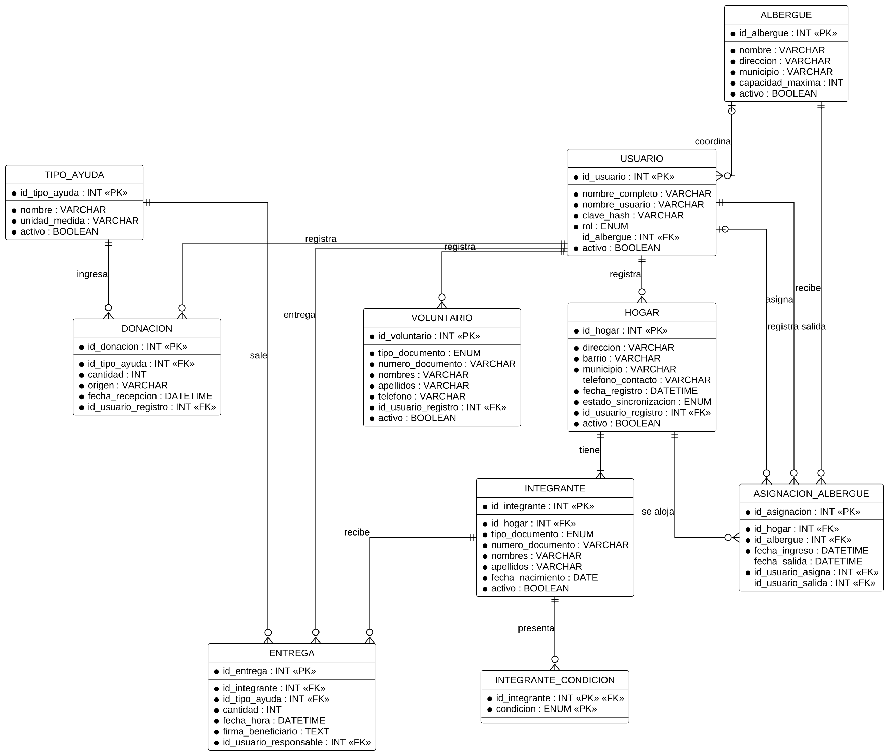
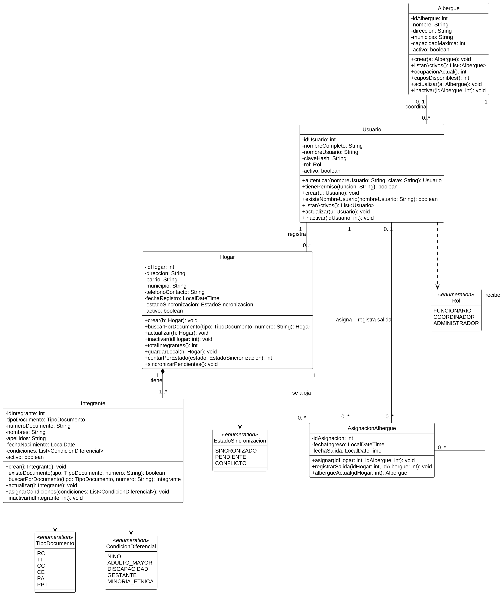
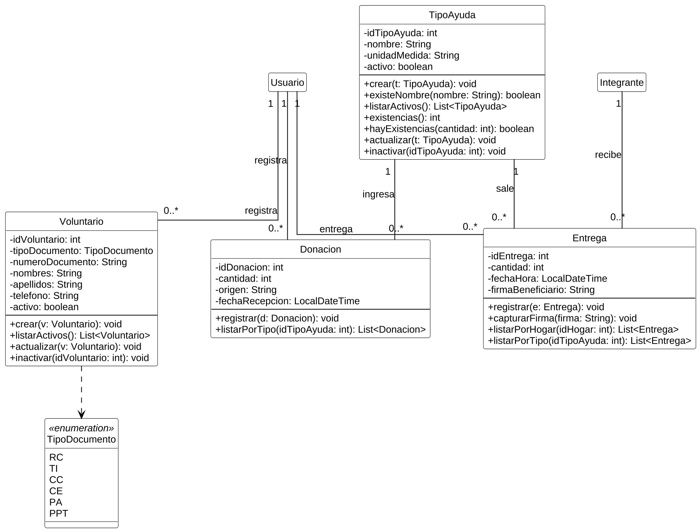

> Versión 1.2 (12 de noviembre de 2026). Las tablas y figuras conservan la numeración del documento Word de docs/entregas.

## 1.8 Modelo de datos de partida

El modelo de datos es el punto de partida de la Fase 1: cada entidad tiene al menos una historia de usuario y cada método del diagrama de clases tiene una historia y un requisito funcional que lo exigen. Se compone del diccionario de datos, el modelo entidad-relación y el diagrama de clases.

### 1.8.1 Diccionario de datos

El diccionario está en tercera forma normal (Elmasri y Navathe, 2016): todo atributo depende únicamente de la clave de su tabla. Por eso la ocupación de un albergue y las existencias de un tipo de ayuda no se almacenan, sino que se calculan (RN-14 y RN-20), y la entrega no repite el hogar, que se obtiene del integrante. Las Tabla 10 a Tabla 19 describen las diez tablas; la columna «De dónde nace» amarra cada atributo a la historia o a la regla que lo exige.

**Tabla 10**  
*Diccionario de datos de la tabla USUARIO*

| **Atributo**    | **Tipo (BD / Java)**                                    | **Restricción**                                                    | **De dónde nace**                                  |
|-----------------|---------------------------------------------------------|--------------------------------------------------------------------|----------------------------------------------------|
| id_usuario      | INT / int                                               | PK, autoincremental                                                | Doctrina del curso: identidad técnica (sin setter) |
| nombre_completo | VARCHAR(120) / String                                   | No nulo                                                            | HU-02                                              |
| nombre_usuario  | VARCHAR(40) / String                                    | No nulo; único (RN-02)                                             | HU-02 (identificador de acceso)                    |
| clave_hash      | VARCHAR(255) / String                                   | No nulo                                                            | HU-01                                              |
| rol             | ENUM('FUNCIONARIO','COORDINADOR','ADMINISTRADOR') / Rol | No nulo (RN-03)                                                    | HU-02, HU-03                                       |
| id_albergue     | INT / Integer                                           | FK a ALBERGUE; admite nulo; solo aplica al rol Coordinador (RN-16) | HU-14                                              |
| activo          | BOOLEAN / boolean                                       | No nulo; por defecto TRUE                                          | Doctrina del curso: eliminación lógica (RN-27)     |

*Nota.* Persona que opera el sistema con uno de los tres roles. PK = clave primaria; FK = clave foránea. Elaboración propia.

**Tabla 11**  
*Diccionario de datos de la tabla HOGAR*

| **Atributo**          | **Tipo (BD / Java)**                                                | **Restricción**                   | **De dónde nace**                                                                         |
|-----------------------|---------------------------------------------------------------------|-----------------------------------|-------------------------------------------------------------------------------------------|
| id_hogar              | INT / int                                                           | PK, autoincremental               | Doctrina del curso: identidad técnica (sin setter); es el identificador único del CA-04.1 |
| direccion             | VARCHAR(120) / String                                               | No nulo                           | HU-04                                                                                     |
| barrio                | VARCHAR(80) / String                                                | No nulo                           | HU-04                                                                                     |
| municipio             | VARCHAR(60) / String                                                | No nulo                           | HU-04                                                                                     |
| telefono_contacto     | VARCHAR(10) / String                                                | Opcional (admite nulo)            | HU-04                                                                                     |
| fecha_registro        | DATETIME / LocalDateTime                                            | No nulo; la asigna el sistema     | HU-04; RNF-03                                                                             |
| estado_sincronizacion | ENUM('SINCRONIZADO','PENDIENTE','CONFLICTO') / EstadoSincronizacion | No nulo; por defecto SINCRONIZADO | HU-10, HU-11                                                                              |
| id_usuario_registro   | INT / int                                                           | FK a USUARIO; no nulo             | RNF-03 (trazabilidad)                                                                     |
| activo                | BOOLEAN / boolean                                                   | No nulo; por defecto TRUE         | Doctrina del curso: eliminación lógica (RN-27)                                            |

*Nota.* Unidad familiar afectada; unidad básica del censo. PK = clave primaria; FK = clave foránea. Elaboración propia.

**Tabla 12**  
*Diccionario de datos de la tabla INTEGRANTE*

| **Atributo**     | **Tipo (BD / Java)**                                 | **Restricción**                                                         | **De dónde nace**                                  |
|------------------|------------------------------------------------------|-------------------------------------------------------------------------|----------------------------------------------------|
| id_integrante    | INT / int                                            | PK, autoincremental                                                     | Doctrina del curso: identidad técnica (sin setter) |
| id_hogar         | INT / int                                            | FK a HOGAR; no nulo (RN-09)                                             | HU-05                                              |
| tipo_documento   | ENUM('RC','TI','CC','CE','PA','PPT') / TipoDocumento | No nulo                                                                 | HU-05                                              |
| numero_documento | VARCHAR(15) / String                                 | No nulo; único junto con el tipo (RN-07); formato según el tipo (RN-08) | HU-05, HU-06                                       |
| nombres          | VARCHAR(60) / String                                 | No nulo                                                                 | HU-05                                              |
| apellidos        | VARCHAR(60) / String                                 | No nulo                                                                 | HU-05                                              |
| fecha_nacimiento | DATE / LocalDate                                     | No nulo                                                                 | HU-05                                              |
| activo           | BOOLEAN / boolean                                    | No nulo; por defecto TRUE                                               | Doctrina del curso: eliminación lógica (RN-27)     |

*Nota.* Persona que pertenece a un hogar censado. PK = clave primaria; FK = clave foránea. Elaboración propia.

**Tabla 13**  
*Diccionario de datos de la tabla INTEGRANTE_CONDICION*

| **Atributo**  | **Tipo (BD / Java)**                                                                          | **Restricción**                         | **De dónde nace** |
|---------------|-----------------------------------------------------------------------------------------------|-----------------------------------------|-------------------|
| id_integrante | INT / int                                                                                     | PK compuesta; FK a INTEGRANTE           | HU-07             |
| condicion     | ENUM('NINO','ADULTO_MAYOR','DISCAPACIDAD','GESTANTE','MINORIA_ETNICA') / CondicionDiferencial | PK compuesta; valor de la lista (RN-10) | HU-07             |

*Nota.* Condiciones de enfoque diferencial de un integrante (ninguna, una o varias). PK = clave primaria; FK = clave foránea. Elaboración propia.

**Tabla 14**  
*Diccionario de datos de la tabla ALBERGUE*

| **Atributo**     | **Tipo (BD / Java)**  | **Restricción**                                                    | **De dónde nace**                                  |
|------------------|-----------------------|--------------------------------------------------------------------|----------------------------------------------------|
| id_albergue      | INT / int             | PK, autoincremental                                                | Doctrina del curso: identidad técnica (sin setter) |
| nombre           | VARCHAR(80) / String  | No nulo                                                            | HU-12                                              |
| direccion        | VARCHAR(120) / String | No nulo                                                            | HU-12                                              |
| municipio        | VARCHAR(60) / String  | No nulo                                                            | HU-12                                              |
| capacidad_maxima | INT / int             | No nulo; mayor que cero (RN-11); no menor que la ocupación (RN-32) | HU-12, HU-30                                       |
| activo           | BOOLEAN / boolean     | No nulo; por defecto TRUE                                          | Doctrina del curso: eliminación lógica (RN-27)     |

*Nota.* Alojamiento temporal habilitado para recibir hogares. PK = clave primaria; FK = clave foránea. Elaboración propia.

**Tabla 15**  
*Diccionario de datos de la tabla ASIGNACION_ALBERGUE*

| **Atributo**      | **Tipo (BD / Java)**     | **Restricción**                                                | **De dónde nace**                                  |
|-------------------|--------------------------|----------------------------------------------------------------|----------------------------------------------------|
| id_asignacion     | INT / int                | PK, autoincremental                                            | Doctrina del curso: identidad técnica (sin setter) |
| id_hogar          | INT / int                | FK a HOGAR; no nulo (RN-12)                                    | HU-13                                              |
| id_albergue       | INT / int                | FK a ALBERGUE; no nulo                                         | HU-13                                              |
| fecha_ingreso     | DATETIME / LocalDateTime | No nulo; la asigna el sistema                                  | HU-13; RNF-03                                      |
| fecha_salida      | DATETIME / LocalDateTime | Admite nulo; nulo significa que el hogar sigue alojado (RN-13) | HU-14                                              |
| id_usuario_asigna | INT / int                | FK a USUARIO; no nulo                                          | RNF-03 (trazabilidad)                              |
| id_usuario_salida | INT / Integer            | FK a USUARIO; admite nulo                                      | HU-14; RNF-03                                      |

*Nota.* Estancia de un hogar en un albergue, desde su ingreso hasta su salida. PK = clave primaria; FK = clave foránea. Elaboración propia.

**Tabla 16**  
*Diccionario de datos de la tabla TIPO_AYUDA*

| **Atributo**  | **Tipo (BD / Java)** | **Restricción**           | **De dónde nace**                                  |
|---------------|----------------------|---------------------------|----------------------------------------------------|
| id_tipo_ayuda | INT / int            | PK, autoincremental       | Doctrina del curso: identidad técnica (sin setter) |
| nombre        | VARCHAR(60) / String | No nulo; único (RN-19)    | HU-32, HU-16                                       |
| unidad_medida | VARCHAR(20) / String | No nulo                   | HU-32                                              |
| activo        | BOOLEAN / boolean    | No nulo; por defecto TRUE | Doctrina del curso: eliminación lógica (RN-27)     |

*Nota.* Catálogo de tipos de ayuda del inventario. Las existencias no se almacenan: se calculan (RN-20). PK = clave primaria; FK = clave foránea. Elaboración propia.

**Tabla 17**  
*Diccionario de datos de la tabla DONACION*

| **Atributo**        | **Tipo (BD / Java)**     | **Restricción**                  | **De dónde nace**                                  |
|---------------------|--------------------------|----------------------------------|----------------------------------------------------|
| id_donacion         | INT / int                | PK, autoincremental              | Doctrina del curso: identidad técnica (sin setter) |
| id_tipo_ayuda       | INT / int                | FK a TIPO_AYUDA; no nulo (RN-18) | HU-16                                              |
| cantidad            | INT / int                | No nulo; mayor que cero (RN-17)  | HU-16                                              |
| origen              | VARCHAR(120) / String    | No nulo (RN-18)                  | HU-16                                              |
| fecha_recepcion     | DATETIME / LocalDateTime | No nulo; la asigna el sistema    | HU-16; RNF-03                                      |
| id_usuario_registro | INT / int                | FK a USUARIO; no nulo            | RNF-03 (trazabilidad)                              |

*Nota.* Ingreso de ayuda al inventario con su procedencia. No se modifica ni se inactiva. PK = clave primaria; FK = clave foránea. Elaboración propia.

**Tabla 18**  
*Diccionario de datos de la tabla ENTREGA*

| **Atributo**           | **Tipo (BD / Java)**     | **Restricción**                                                                     | **De dónde nace**                                  |
|------------------------|--------------------------|-------------------------------------------------------------------------------------|----------------------------------------------------|
| id_entrega             | INT / int                | PK, autoincremental                                                                 | Doctrina del curso: identidad técnica (sin setter) |
| id_integrante          | INT / int                | FK a INTEGRANTE (beneficiario); no nulo (RN-22). El hogar se obtiene del integrante | HU-18, HU-19                                       |
| id_tipo_ayuda          | INT / int                | FK a TIPO_AYUDA; no nulo (RN-23)                                                    | HU-19                                              |
| cantidad               | INT / int                | No nulo; mayor que cero (RN-17); no mayor que las existencias (RN-21)               | HU-19, HU-20                                       |
| fecha_hora             | DATETIME / LocalDateTime | No nulo; la asigna el sistema                                                       | HU-19; RNF-03                                      |
| firma_beneficiario     | TEXT / String            | No nulo (RN-24)                                                                     | HU-21                                              |
| id_usuario_responsable | INT / int                | FK a USUARIO; no nulo (RN-23)                                                       | HU-19; RNF-03                                      |

*Nota.* Ayuda entregada a un beneficiario censado. No se modifica ni se inactiva. PK = clave primaria; FK = clave foránea. Elaboración propia.

**Tabla 19**  
*Diccionario de datos de la tabla VOLUNTARIO*

| **Atributo**        | **Tipo (BD / Java)**                                 | **Restricción**           | **De dónde nace**                                  |
|---------------------|------------------------------------------------------|---------------------------|----------------------------------------------------|
| id_voluntario       | INT / int                                            | PK, autoincremental       | Doctrina del curso: identidad técnica (sin setter) |
| tipo_documento      | ENUM('RC','TI','CC','CE','PA','PPT') / TipoDocumento | No nulo                   | HU-24                                              |
| numero_documento    | VARCHAR(15) / String                                 | No nulo                   | HU-24                                              |
| nombres             | VARCHAR(60) / String                                 | No nulo                   | HU-24                                              |
| apellidos           | VARCHAR(60) / String                                 | No nulo                   | HU-24                                              |
| telefono            | VARCHAR(10) / String                                 | No nulo                   | HU-24                                              |
| id_usuario_registro | INT / int                                            | FK a USUARIO; no nulo     | RNF-03 (trazabilidad)                              |
| activo              | BOOLEAN / boolean                                    | No nulo; por defecto TRUE | Doctrina del curso: eliminación lógica (RN-27)     |

*Nota.* Persona voluntaria identificada durante la emergencia. PK = clave primaria; FK = clave foránea. Elaboración propia.

Los cuatro tipos enumerados del modelo se listan en la Tabla 20.

**Tabla 20**  
*Tipos enumerados del modelo*

| **Enumeración**      | **Valores**                                                | **Dónde se usa**                                             |
|----------------------|------------------------------------------------------------|--------------------------------------------------------------|
| Rol                  | FUNCIONARIO, COORDINADOR, ADMINISTRADOR                    | USUARIO.rol (RN-03)                                          |
| TipoDocumento        | RC, TI, CC, CE, PA, PPT                                    | INTEGRANTE.tipo_documento, VOLUNTARIO.tipo_documento (RN-08) |
| CondicionDiferencial | NINO, ADULTO_MAYOR, DISCAPACIDAD, GESTANTE, MINORIA_ETNICA | INTEGRANTE_CONDICION.condicion (RN-10)                       |
| EstadoSincronizacion | SINCRONIZADO, PENDIENTE, CONFLICTO                         | HOGAR.estado_sincronizacion (RN-26)                          |

*Nota.* RC = registro civil; TI = tarjeta de identidad; CC = cédula de ciudadanía; CE = cédula de extranjería; PA = pasaporte; PPT = permiso por protección temporal. Elaboración propia.

### 1.8.2 Modelo entidad-relación

La Figura 6 presenta el modelo entidad-relación en una sola notación, la de pata de gallo. Un hogar tiene uno o más integrantes; un integrante puede presentar varias condiciones de enfoque diferencial; la asignación resuelve la relación entre hogares y albergues a lo largo del tiempo; las donaciones y las entregas son los movimientos de entrada y salida de cada tipo de ayuda, y toda operación queda asociada al usuario que la realizó.

**Figura 6**  
*Modelo entidad-relación del sistema*

*Nota.* Notación de pata de gallo. El punto negro indica atributo obligatorio. Elaboración propia.

### 1.8.3 Diagrama de clases

El diagrama de clases sigue el estándar UML (Object Management Group, 2017): tres compartimentos, atributos privados con su tipo, métodos públicos con parámetros y tipo de retorno, multiplicidades en las asociaciones y enumeraciones. Para que se lea sin ampliar, se presenta en dos figuras: la Figura 7 contiene las clases del censo, los albergues y los usuarios, y la Figura 8 las del inventario, las entregas y los voluntarios. Las llaves foráneas del diccionario se expresan como asociaciones.

**Figura 7**  
*Diagrama de clases: usuarios, censo y albergues*

*Nota.* Visibilidad: − privado, + público. Elaboración propia.

**Figura 8**  
*Diagrama de clases: inventario, entregas y voluntarios*

*Nota.* Las clases Usuario e Integrante se detallan en la Figura 7. Elaboración propia.

### 1.8.4 Métodos de las clases y su origen

La Tabla 21 relaciona cada método con la operación que cumple, las historias de usuario que lo exigen y los requisitos funcionales que implementa. Los métodos de apoyo no nacen del «quiero» de una historia, sino de un criterio de aceptación de rechazo. No hay métodos sin historia ni sin requisito.

**Tabla 21**  
*Métodos del diagrama de clases, con la historia de usuario y el requisito funcional que los exigen*

| **Clase**          | **Método**              | **Qué hace**                                                             | **CRUD**         | **HU**                            | **RF**              |
|--------------------|-------------------------|--------------------------------------------------------------------------|------------------|-----------------------------------|---------------------|
| Usuario            | autenticar()            | Valida las credenciales de un usuario activo e inicia su sesión          | Acceso           | HU-01                             | RF-01, RF-02        |
| Usuario            | tienePermiso()          | Indica si el rol del usuario está autorizado para una función            | Apoyo            | HU-01, HU-02, HU-03, HU-25        | RF-05, RF-06        |
| Usuario            | crear()                 | Registra un usuario activo con su rol                                    | C                | HU-02                             | RF-03               |
| Usuario            | existeNombreUsuario()   | Verifica si el nombre de usuario ya está en uso                          | Apoyo            | HU-02, HU-26                      | RF-04               |
| Usuario            | listarActivos()         | Trae los usuarios activos ordenados por nombre                           | R                | HU-25                             | RF-35               |
| Usuario            | actualizar()            | Modifica los datos o el rol de un usuario                                | U                | HU-26                             | RF-36               |
| Usuario            | inactivar()             | Cambia activo a FALSE (nunca borra)                                      | D lógico         | HU-27                             | RF-37               |
| Hogar              | crear()                 | Registra un hogar activo en el censo                                     | C                | HU-04                             | RF-07               |
| Hogar              | buscarPorDocumento()    | Encuentra el hogar activo de un integrante por su documento              | R                | HU-04, HU-08, HU-22               | RF-11               |
| Hogar              | actualizar()            | Modifica los datos de un hogar                                           | U                | HU-09                             | RF-12               |
| Hogar              | inactivar()             | Cambia activo a FALSE y conserva integrantes e historial                 | D lógico         | HU-29                             | RF-39               |
| Hogar              | totalIntegrantes()      | Cuenta los integrantes activos del hogar                                 | Apoyo            | HU-05, HU-13, HU-28               | RF-08, RF-18        |
| Hogar              | guardarLocal()          | Guarda el hogar y sus integrantes en el dispositivo en estado PENDIENTE  | C (sin conexión) | HU-10                             | RF-13               |
| Hogar              | contarPorEstado()       | Cuenta los registros pendientes, sincronizados o en conflicto            | R                | HU-10, HU-11                      | RF-14               |
| Hogar              | sincronizarPendientes() | Envía los registros pendientes al sistema central y marca los conflictos | U                | HU-11                             | RF-15, RF-16        |
| Integrante         | crear()                 | Registra un integrante activo dentro de un hogar                         | C                | HU-05                             | RF-08               |
| Integrante         | existeDocumento()       | Verifica si el documento ya pertenece a una persona censada              | Apoyo            | HU-06, HU-09, HU-11               | RF-09, RF-16        |
| Integrante         | buscarPorDocumento()    | Identifica al integrante activo y su hogar                               | R                | HU-18, HU-19                      | RF-25               |
| Integrante         | actualizar()            | Modifica los datos de un integrante                                      | U                | HU-09                             | RF-12               |
| Integrante         | asignarCondiciones()    | Reemplaza las condiciones de enfoque diferencial del integrante          | U                | HU-07                             | RF-10               |
| Integrante         | inactivar()             | Cambia activo a FALSE y conserva sus entregas                            | D lógico         | HU-28                             | RF-38               |
| Albergue           | crear()                 | Registra y habilita un albergue                                          | C                | HU-12                             | RF-17               |
| Albergue           | listarActivos()         | Trae los albergues activos con su capacidad                              | R                | HU-15                             | RF-21               |
| Albergue           | ocupacionActual()       | Suma los integrantes activos de los hogares alojados                     | Apoyo            | HU-15, HU-30, HU-31               | RF-21, RF-41        |
| Albergue           | cuposDisponibles()      | Calcula capacidad máxima menos ocupación                                 | Apoyo            | HU-13, HU-15, HU-30               | RF-19, RF-21        |
| Albergue           | actualizar()            | Modifica los datos o la capacidad de un albergue                         | U                | HU-30                             | RF-40               |
| Albergue           | inactivar()             | Cambia activo a FALSE y conserva sus asignaciones                        | D lógico         | HU-31                             | RF-41               |
| AsignacionAlbergue | asignar()               | Crea la estancia de un hogar en un albergue                              | C                | HU-13, HU-14                      | RF-18               |
| AsignacionAlbergue | registrarSalida()       | Cierra la estancia con la fecha de salida                                | U                | HU-14                             | RF-20               |
| AsignacionAlbergue | albergueActual()        | Devuelve el albergue donde está alojado el hogar, si lo hay              | R (apoyo)        | HU-08, HU-13, HU-29               | RF-11, RF-18, RF-39 |
| TipoAyuda          | crear()                 | Registra un tipo de ayuda activo                                         | C                | HU-32                             | RF-42               |
| TipoAyuda          | existeNombre()          | Verifica si ya existe un tipo de ayuda con ese nombre                    | Apoyo            | HU-16, HU-32, HU-33               | RF-23, RF-42, RF-43 |
| TipoAyuda          | listarActivos()         | Trae los tipos de ayuda activos                                          | R                | HU-17                             | RF-24               |
| TipoAyuda          | existencias()           | Calcula lo recibido menos lo entregado                                   | Apoyo            | HU-16, HU-17, HU-20, HU-23, HU-34 | RF-24, RF-27, RF-44 |
| TipoAyuda          | hayExistencias()        | Indica si las existencias cubren una cantidad                            | Apoyo            | HU-20                             | RF-28               |
| TipoAyuda          | actualizar()            | Modifica el nombre o la unidad de medida                                 | U                | HU-33                             | RF-43               |
| TipoAyuda          | inactivar()             | Cambia activo a FALSE y conserva donaciones y entregas                   | D lógico         | HU-34                             | RF-44               |
| Donacion           | registrar()             | Registra una donación con su origen y fecha                              | C                | HU-16                             | RF-22, RF-23        |
| Donacion           | listarPorTipo()         | Trae las donaciones de un tipo de ayuda                                  | R                | HU-23                             | RF-32               |
| Entrega            | registrar()             | Registra una entrega a un beneficiario verificado                        | C                | HU-19, HU-20                      | RF-26, RF-27        |
| Entrega            | capturarFirma()         | Asocia la firma digital del beneficiario a la entrega                    | Apoyo            | HU-21                             | RF-29, RF-30        |
| Entrega            | listarPorHogar()        | Trae las entregas de un hogar en orden cronológico                       | R                | HU-22                             | RF-31               |
| Entrega            | listarPorTipo()         | Trae las entregas de un tipo de ayuda                                    | R                | HU-23                             | RF-32               |
| Voluntario         | crear()                 | Registra un voluntario activo                                            | C                | HU-24                             | RF-33               |
| Voluntario         | listarActivos()         | Trae los voluntarios activos ordenados por apellido                      | R                | HU-35                             | RF-34               |
| Voluntario         | actualizar()            | Modifica los datos de un voluntario                                      | U                | HU-36                             | RF-45               |
| Voluntario         | inactivar()             | Cambia activo a FALSE y conserva sus datos                               | D lógico         | HU-37                             | RF-46               |

*Nota.* C = crear; R = consultar; U = actualizar; D lógico = inactivar. Las firmas completas están en la Figura 7 y la Figura 8. Elaboración propia.
