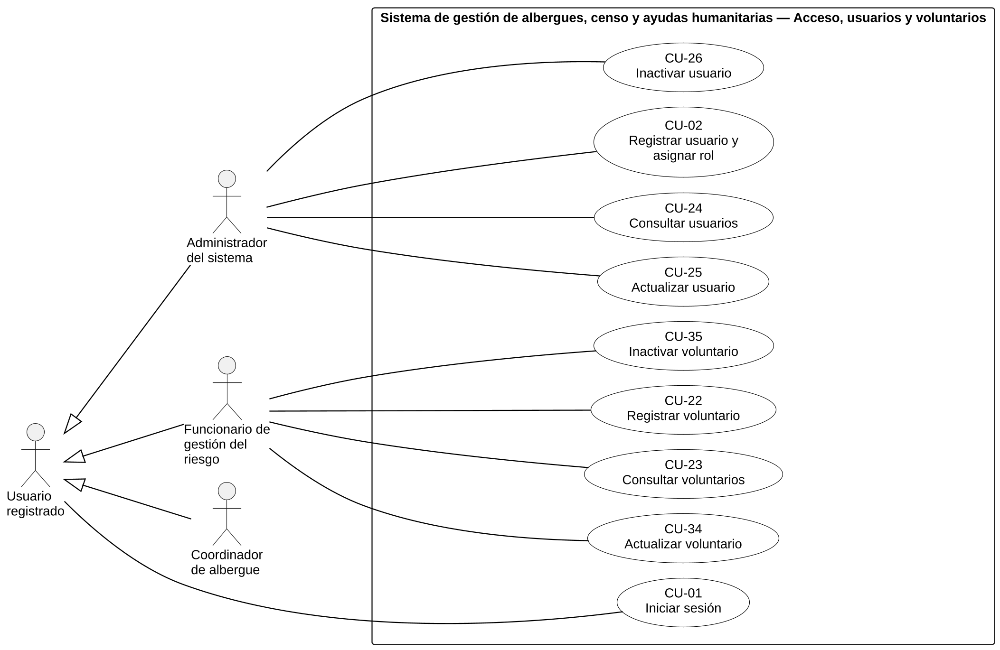
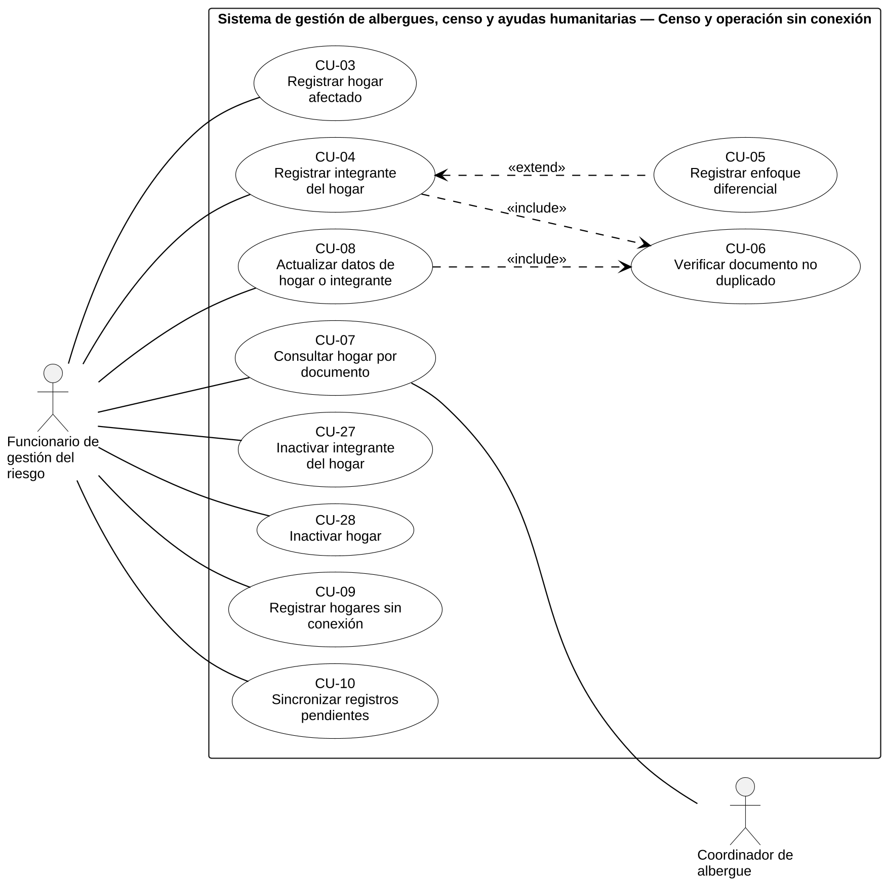
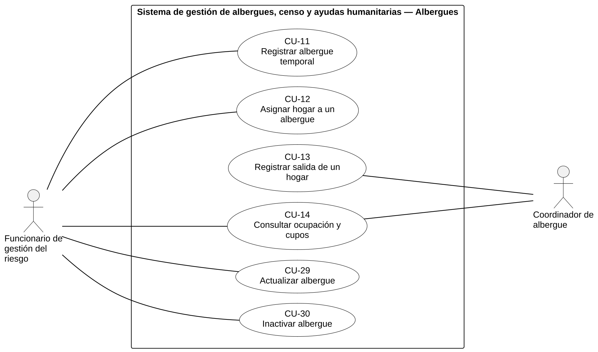
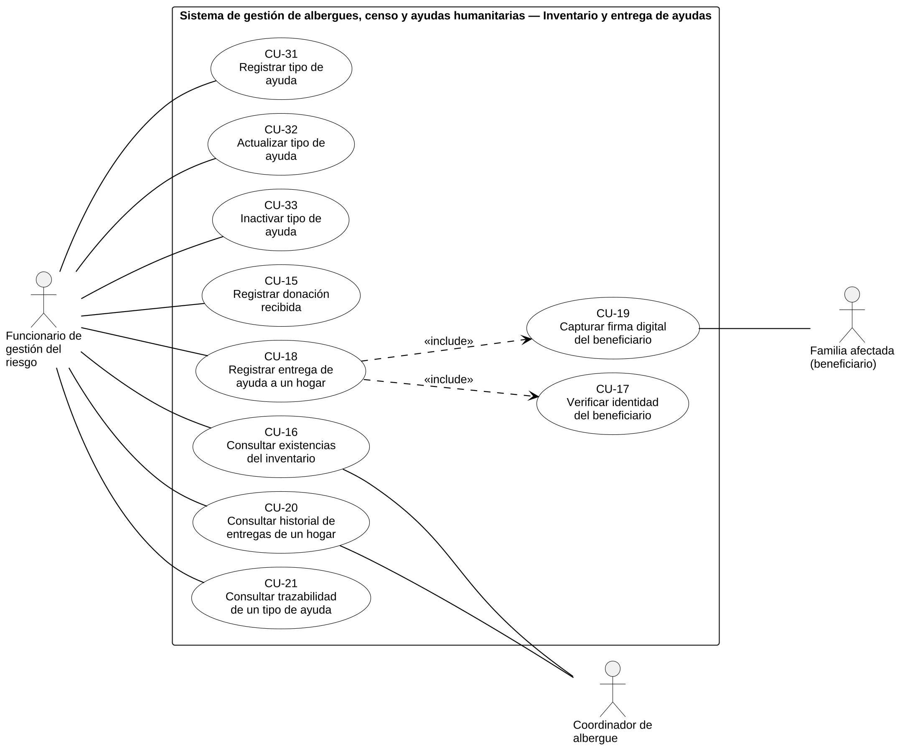

> Versión 1.2 (12 de noviembre de 2026). Las tablas y figuras conservan la numeración del documento Word de docs/entregas.

## 2.3 Modelo general de casos de uso

El modelo tiene 35 casos de uso y cinco actores: los tres roles de las historias, el actor general Usuario registrado, del que los tres heredan el inicio de sesión, y la Familia afectada, actor secundario que firma al recibir la ayuda. Para que el diagrama se lea sin ampliar y sin líneas cruzadas, el modelo general se presenta en cuatro figuras, una por subsistema, todas dentro del mismo límite del sistema: Figura 9, Figura 10, Figura 11 y Figura 12. Las asociaciones entre actor y caso de uso se dibujan como líneas sin punta de flecha; «include» y «extend» usan línea discontinua con la flecha en la dirección que fija el estándar (Object Management Group, 2017).

**Figura 9**  
*Diagrama general de casos de uso: acceso, usuarios y voluntarios*

*Nota.* La generalización indica que Funcionario, Coordinador y Administrador son usuarios registrados y heredan CU-01. Elaboración propia.

**Figura 10**  
*Diagrama general de casos de uso: censo y operación sin conexión*

*Nota.* «include» apunta del caso base al incluido; «extend» apunta de la extensión al caso base. Elaboración propia.

**Figura 11**  
*Diagrama general de casos de uso: albergues*

*Nota.* El Coordinador registra la salida de los hogares de su albergue y consulta la ocupación. Elaboración propia.

**Figura 12**  
*Diagrama general de casos de uso: inventario y entrega de ayudas*

*Nota.* CU-17 y CU-19 no tienen actor principal porque los ejecuta CU-18; la Familia afectada participa en la firma. Elaboración propia.

La Tabla 154 lista los casos de uso con su actor, la historia de la que nacen y los requisitos que implementan. Hay un óvalo por historia, con dos excepciones justificadas: HU-03 (usar solo las funciones del rol) se cumple dentro de CU-01 y como precondición de todos los demás, y HU-20 (descontar del inventario) es un paso interno de CU-18, no una meta que el actor persiga por separado.

**Tabla 154**  
*Casos de uso con su actor, historia de origen y requisitos que implementan*

| **CU** | **Nombre**                                  | **Actor**                | **Nace de**  | **Implementa**                           | **Tipo**                    |
|--------|---------------------------------------------|--------------------------|--------------|------------------------------------------|-----------------------------|
| CU-01  | Iniciar sesión                              | Usuario                  | HU-01, HU-03 | RF-01, RF-02, RF-05, RF-06               | Base                        |
| CU-02  | Registrar usuario y asignar rol             | Administrador            | HU-02        | RF-03, RF-04, RF-06                      | Base                        |
| CU-03  | Registrar hogar afectado                    | Funcionario              | HU-04        | RF-07, RF-11                             | Base                        |
| CU-04  | Registrar integrante del hogar              | Funcionario              | HU-05, HU-06 | RF-08, RF-09                             | Base; incluye CU-06         |
| CU-05  | Registrar enfoque diferencial               | (sin actor)              | HU-07        | RF-10                                    | Extiende CU-04              |
| CU-06  | Verificar documento no duplicado            | (sin actor)              | HU-06, HU-09 | RF-09                                    | Incluido en CU-04 y CU-08   |
| CU-07  | Consultar hogar por documento               | Funcionario, Coordinador | HU-08        | RF-11                                    | Base                        |
| CU-08  | Actualizar datos de hogar o integrante      | Funcionario              | HU-09        | RF-09, RF-12                             | Base; incluye CU-06         |
| CU-09  | Registrar hogares sin conexión              | Funcionario              | HU-10        | RF-13, RF-14                             | Base                        |
| CU-10  | Sincronizar registros pendientes            | Funcionario              | HU-11        | RF-14, RF-15, RF-16                      | Base                        |
| CU-11  | Registrar albergue temporal                 | Funcionario              | HU-12        | RF-17                                    | Base                        |
| CU-12  | Asignar hogar a un albergue                 | Funcionario              | HU-13        | RF-18, RF-19                             | Base                        |
| CU-13  | Registrar salida de un hogar                | Coordinador              | HU-14        | RF-18, RF-20                             | Base                        |
| CU-14  | Consultar ocupación y cupos                 | Funcionario, Coordinador | HU-15        | RF-21                                    | Base                        |
| CU-15  | Registrar donación recibida                 | Funcionario              | HU-16        | RF-22, RF-23                             | Base                        |
| CU-16  | Consultar existencias del inventario        | Funcionario, Coordinador | HU-17        | RF-24                                    | Base                        |
| CU-17  | Verificar identidad del beneficiario        | (sin actor)              | HU-18        | RF-25                                    | Incluido en CU-18           |
| CU-18  | Registrar entrega de ayuda a un hogar       | Funcionario              | HU-19, HU-20 | RF-25, RF-26, RF-27, RF-28, RF-29, RF-30 | Base; incluye CU-17 y CU-19 |
| CU-19  | Capturar firma digital del beneficiario     | (sin actor)              | HU-21        | RF-29, RF-30                             | Incluido en CU-18           |
| CU-20  | Consultar historial de entregas de un hogar | Funcionario, Coordinador | HU-22        | RF-31                                    | Base                        |
| CU-21  | Consultar trazabilidad de un tipo de ayuda  | Funcionario              | HU-23        | RF-32                                    | Base                        |
| CU-22  | Registrar voluntario                        | Funcionario              | HU-24        | RF-33                                    | Base                        |
| CU-23  | Consultar voluntarios                       | Funcionario              | HU-35        | RF-34                                    | Base                        |
| CU-24  | Consultar usuarios                          | Administrador            | HU-25        | RF-06, RF-35                             | Base                        |
| CU-25  | Actualizar usuario                          | Administrador            | HU-26        | RF-04, RF-36                             | Base                        |
| CU-26  | Inactivar usuario                           | Administrador            | HU-27        | RF-37                                    | Base                        |
| CU-27  | Inactivar integrante del hogar              | Funcionario              | HU-28        | RF-38                                    | Base                        |
| CU-28  | Inactivar hogar                             | Funcionario              | HU-29        | RF-39                                    | Base                        |
| CU-29  | Actualizar albergue                         | Funcionario              | HU-30        | RF-40                                    | Base                        |
| CU-30  | Inactivar albergue                          | Funcionario              | HU-31        | RF-41                                    | Base                        |
| CU-31  | Registrar tipo de ayuda                     | Funcionario              | HU-32        | RF-42                                    | Base                        |
| CU-32  | Actualizar tipo de ayuda                    | Funcionario              | HU-33        | RF-43                                    | Base                        |
| CU-33  | Inactivar tipo de ayuda                     | Funcionario              | HU-34        | RF-44                                    | Base                        |
| CU-34  | Actualizar voluntario                       | Funcionario              | HU-36        | RF-45                                    | Base                        |
| CU-35  | Inactivar voluntario                        | Funcionario              | HU-37        | RF-46                                    | Base                        |

*Nota.* Un caso de uso implementa los requisitos de las historias de las que nace. Elaboración propia.

La Tabla 155 justifica cada relación del modelo.

**Tabla 155**  
*Relaciones del modelo de casos de uso y su justificación*

| **Relación**                 | **Elementos**                                                 | **Justificación**                                                                                                                                                                                                            |
|------------------------------|---------------------------------------------------------------|------------------------------------------------------------------------------------------------------------------------------------------------------------------------------------------------------------------------------|
| Generalización               | Funcionario, Coordinador y Administrador → Usuario registrado | Los tres roles inician sesión de la misma manera (HU-01; RF-01), por lo que CU-01 se asocia una sola vez al actor general.                                                                                                   |
| «include»                    | CU-04 → CU-06                                                 | El documento de un integrante se verifica siempre antes de registrarlo (CA-06.1 y CA-06.2; RF-09; RN-07).                                                                                                                    |
| «include»                    | CU-08 → CU-06                                                 | El cambio de documento repite la misma verificación (CA-09.3; RF-09; RN-07). CU-06 existe para no duplicar esa lógica.                                                                                                       |
| «include»                    | CU-18 → CU-17                                                 | Ninguna entrega se registra sin verificar la identidad del beneficiario (CA-19.4; RF-25; RN-22).                                                                                                                             |
| «include»                    | CU-18 → CU-19                                                 | La firma es obligatoria para completar la entrega (CA-21.2; RF-30; RN-24). En la entrega anterior era «extend» porque la obligatoriedad estaba por validar; el hallazgo H-08 (el 70 % ya firma en papel) cerró esa decisión. |
| «extend»                     | CU-05 → CU-04                                                 | El enfoque diferencial se registra solo cuando el integrante lo presenta (CA-07.2; RF-10; RN-10): es una ampliación opcional.                                                                                                |
| Asociación secundaria        | CU-19 — Familia afectada                                      | El beneficiario es quien firma (CA-21.1).                                                                                                                                                                                    |
| Asociaciones del Coordinador | CU-07, CU-13, CU-14, CU-16, CU-20                             | Funciones que la matriz de permisos (Tabla 24) autoriza al Coordinador.                                                                                                                                                      |

*Nota.* Lo que no se dibuja: el inicio de sesión como paso previo de cada caso (es precondición) y los flujos alternativos (están en la documentación de la sección 2.4). Elaboración propia.

## 2.4 Casos de uso documentados

Se documentan seis casos de uso críticos. Se eligieron los que validan más reglas de negocio, los que tienen relaciones «include» o «extend» y los que cubren los procesos centrales del proyecto; el sexto se agregó para documentar una inactivación. La Tabla 156 presenta la justificación.

**Tabla 156**  
*Casos de uso críticos seleccionados y justificación*

| **CU** | **Nombre**                            | **Reglas que valida**              | **Por qué es crítico**                                                                             | **Objetivo del proyecto**   |
|--------|---------------------------------------|------------------------------------|----------------------------------------------------------------------------------------------------|-----------------------------|
| CU-04  | Registrar integrante del hogar        | RN-06, RN-07, RN-08, RN-09         | Núcleo del censo; concentra la unicidad del documento y tiene «include» y «extend».                | Censo sin duplicados        |
| CU-10  | Sincronizar registros pendientes      | RN-07, RN-26                       | Diferenciador del proyecto; el mayor riesgo de pérdida o duplicación de datos.                     | Operación sin conexión      |
| CU-12  | Asignar hogar a un albergue           | RN-12, RN-13, RN-14, RN-15, RN-34  | Evita el sobrecupo y la doble asignación; responde a la función más votada (H-11).                 | Gestión de albergues        |
| CU-15  | Registrar donación recibida           | RN-17, RN-18, RN-19, RN-20         | Origen del inventario; sin él no hay existencias ni trazabilidad.                                  | Integridad del inventario   |
| CU-18  | Registrar entrega de ayuda a un hogar | RN-06, RN-17, RN-20 a RN-24, RN-34 | El de mayor riesgo operacional: identidad, existencias, firma y trazabilidad; tiene dos «include». | Trazabilidad de ayudas      |
| CU-28  | Inactivar hogar                       | RN-27, RN-29, RN-34                | Representa las bajas por inactivación, con aviso que explica la consecuencia.                      | Trazabilidad y conservación |

*Nota.* Los demás casos de uso son registros o consultas de flujo directo; sus flujos alternativos son los criterios de rechazo de sus historias. Elaboración propia.

Cada caso se documenta con la plantilla del curso: los antecedentes de la historia son la precondición; el criterio de éxito dicta el final del flujo básico y la postcondición; y cada criterio de rechazo es un flujo alternativo que cita su criterio, su requisito y su regla. Las fichas van de la Tabla 157 a la Tabla 162.

**Tabla 157**  
*Caso de uso documentado CU-04: Registrar integrante del hogar*

<table>
<colgroup>
<col style="width: 22%" />
<col style="width: 77%" />
</colgroup>
<thead>
<tr class="header">
<th><strong>Código y nombre</strong></th>
<th><strong>CU-04 — Registrar integrante del hogar</strong></th>
</tr>
</thead>
<tbody>
<tr class="odd">
<td><strong>Objetivo</strong></td>
<td>Registrar a una persona como integrante de un hogar censado, garantizando que su documento no esté registrado.</td>
</tr>
<tr class="even">
<td><strong>Actor principal</strong></td>
<td>Funcionario de gestión del riesgo</td>
</tr>
<tr class="odd">
<td><strong>Actores secundarios</strong></td>
<td>Ninguno. Incluye CU-06; puede ser extendido por CU-05.</td>
</tr>
<tr class="even">
<td><strong>Historias de usuario</strong></td>
<td>HU-05, HU-06</td>
</tr>
<tr class="odd">
<td><strong>Requisitos funcionales</strong></td>
<td>RF-08, RF-09</td>
</tr>
<tr class="even">
<td><strong>Reglas de negocio</strong></td>
<td>RN-06, RN-07, RN-08, RN-09</td>
</tr>
<tr class="odd">
<td><strong>Precondiciones</strong></td>
<td>El Funcionario ha iniciado sesión (antecedentes de HU-05) y el hogar existe y está activo (CU-03).</td>
</tr>
<tr class="even">
<td><strong>Disparador</strong></td>
<td>El Funcionario abre la ficha de un hogar y elige agregar un integrante (MK-01).</td>
</tr>
<tr class="odd">
<td><strong>Flujo básico</strong></td>
<td>
1. <strong>Funcionario:</strong> Selecciona el hogar y solicita agregar un integrante.

2. <strong>Sistema:</strong> Presenta el formulario de integrante (MK-02).

3. <strong>Funcionario:</strong> Ingresa tipo y número de documento, nombres, apellidos y fecha de nacimiento.

4. <strong>Sistema:</strong> Verifica que los datos obligatorios estén completos (RN-06).

5. <strong>Sistema:</strong> Verifica que el número respete el formato de su tipo de documento (RN-08).

6. <strong>Sistema:</strong> Verifica que el documento no esté registrado, mediante CU-06 (RN-07, RF-09).

7. <strong>Sistema:</strong> Registra al integrante activo, lo asocia al hogar y muestra el nuevo total de integrantes (RN-09). Es el CA-05.1.
</td>
</tr>
<tr class="even">
<td><strong>Flujos alternativos</strong></td>
<td>
<strong>FA-01. Dato obligatorio faltante</strong> (en el paso 4). Respaldo: CA-05.2; RF-08; RN-06.

El sistema no registra y señala el dato faltante. Vuelve al paso 3.

<strong>FA-02. Formato de documento inválido</strong> (en el paso 5). Respaldo: CA-05.3; RF-08; RN-08.

El sistema no registra y muestra el formato esperado para ese tipo de documento. Vuelve al paso 3.

<strong>FA-03. Documento registrado en otro hogar</strong> (en el paso 6). Respaldo: CA-06.1; RF-09; RN-07.

El sistema no registra y muestra la alerta con el hogar donde figura el documento. Si el Funcionario cancela, nada cambia (CA-06.3). Fin.

<strong>FA-04. Documento registrado en el mismo hogar</strong> (en el paso 6). Respaldo: CA-06.2; RF-09; RN-07.

El sistema no crea un segundo registro y muestra la alerta de documento ya registrado. Fin.
</td>
</tr>
<tr class="odd">
<td><strong>Postcondiciones</strong></td>
<td>Éxito: el integrante queda activo y asociado al hogar, y el total de integrantes se actualiza. Rechazo: no se crea ni se modifica ningún registro.</td>
</tr>
<tr class="even">
<td><strong>Mockup</strong></td>
<td>MK-02</td>
</tr>
</tbody>
</table>

*Nota.* Cada flujo alternativo corresponde a un criterio de aceptación de rechazo de las historias del caso. Elaboración propia.

**Tabla 158**  
*Caso de uso documentado CU-10: Sincronizar registros pendientes*

<table>
<colgroup>
<col style="width: 22%" />
<col style="width: 77%" />
</colgroup>
<thead>
<tr class="header">
<th><strong>Código y nombre</strong></th>
<th><strong>CU-10 — Sincronizar registros pendientes</strong></th>
</tr>
</thead>
<tbody>
<tr class="odd">
<td><strong>Objetivo</strong></td>
<td>Enviar al sistema central los registros guardados sin conexión y consolidarlos sin perder ni duplicar información.</td>
</tr>
<tr class="even">
<td><strong>Actor principal</strong></td>
<td>Funcionario de gestión del riesgo</td>
</tr>
<tr class="odd">
<td><strong>Actores secundarios</strong></td>
<td>Ninguno.</td>
</tr>
<tr class="even">
<td><strong>Historias de usuario</strong></td>
<td>HU-11</td>
</tr>
<tr class="odd">
<td><strong>Requisitos funcionales</strong></td>
<td>RF-14, RF-15, RF-16</td>
</tr>
<tr class="even">
<td><strong>Reglas de negocio</strong></td>
<td>RN-07, RN-26</td>
</tr>
<tr class="odd">
<td><strong>Precondiciones</strong></td>
<td>El Funcionario ha iniciado sesión, existen registros pendientes creados con CU-09 y el dispositivo recuperó la conexión.</td>
</tr>
<tr class="even">
<td><strong>Disparador</strong></td>
<td>El sistema detecta la conexión o el Funcionario solicita sincronizar (MK-03).</td>
</tr>
<tr class="odd">
<td><strong>Flujo básico</strong></td>
<td>
1. <strong>Sistema / Funcionario:</strong> El sistema detecta la conexión, o el Funcionario solicita «Sincronizar ahora» (MK-03).

2. <strong>Sistema:</strong> Envía los registros pendientes al sistema central.

3. <strong>Sistema:</strong> Verifica, por cada registro, que su documento no exista en el sistema central (RN-07).

4. <strong>Sistema:</strong> Almacena los registros válidos y los cambia a estado sincronizado (RN-26). Es el CA-11.1.

5. <strong>Sistema:</strong> Informa cuántos registros se sincronizaron, cuántos quedaron en conflicto y cuántos siguen pendientes (RF-14). Es el CA-11.4.

6. <strong>Funcionario:</strong> Revisa el resultado.
</td>
</tr>
<tr class="even">
<td><strong>Flujos alternativos</strong></td>
<td>
<strong>FA-01. Documento ya existente en el sistema central</strong> (en el paso 3). Respaldo: CA-11.2; RF-16; RN-07, RN-26.

El sistema no crea el duplicado, deja el registro en estado de conflicto y lo lista para revisión. Continúa en el paso 4 con los demás registros.

<strong>FA-02. Interrupción de la conexión</strong> (en el paso 2). Respaldo: CA-11.3; RF-15; RN-26.

Los registros no confirmados siguen pendientes; al reintentar no se pierden ni se duplican. El sistema informa el estado (paso 5).
</td>
</tr>
<tr class="odd">
<td><strong>Postcondiciones</strong></td>
<td>Éxito: los registros válidos quedan en el sistema central como sincronizados. Rechazo: los registros en conflicto y los pendientes se conservan en el dispositivo; nada se pierde ni se duplica.</td>
</tr>
<tr class="even">
<td><strong>Mockup</strong></td>
<td>MK-03</td>
</tr>
</tbody>
</table>

*Nota.* Cada flujo alternativo corresponde a un criterio de aceptación de rechazo de las historias del caso. Elaboración propia.

**Tabla 159**  
*Caso de uso documentado CU-12: Asignar hogar a un albergue*

<table>
<colgroup>
<col style="width: 22%" />
<col style="width: 77%" />
</colgroup>
<thead>
<tr class="header">
<th><strong>Código y nombre</strong></th>
<th><strong>CU-12 — Asignar hogar a un albergue</strong></th>
</tr>
</thead>
<tbody>
<tr class="odd">
<td><strong>Objetivo</strong></td>
<td>Alojar un hogar censado en un albergue con cupos suficientes y actualizar la ocupación.</td>
</tr>
<tr class="even">
<td><strong>Actor principal</strong></td>
<td>Funcionario de gestión del riesgo</td>
</tr>
<tr class="odd">
<td><strong>Actores secundarios</strong></td>
<td>Ninguno.</td>
</tr>
<tr class="even">
<td><strong>Historias de usuario</strong></td>
<td>HU-13</td>
</tr>
<tr class="odd">
<td><strong>Requisitos funcionales</strong></td>
<td>RF-18, RF-19</td>
</tr>
<tr class="even">
<td><strong>Reglas de negocio</strong></td>
<td>RN-12, RN-13, RN-14, RN-15, RN-34</td>
</tr>
<tr class="odd">
<td><strong>Precondiciones</strong></td>
<td>El Funcionario ha iniciado sesión; existe al menos un albergue activo (CU-11) y el hogar está censado y activo.</td>
</tr>
<tr class="even">
<td><strong>Disparador</strong></td>
<td>El Funcionario elige «Asignar a albergue» en la ficha del hogar (MK-01).</td>
</tr>
<tr class="odd">
<td><strong>Flujo básico</strong></td>
<td>
1. <strong>Funcionario:</strong> Solicita asignar el hogar a un albergue.

2. <strong>Sistema:</strong> Presenta los albergues activos con su capacidad, ocupación y cupos (MK-04).

3. <strong>Funcionario:</strong> Selecciona el albergue de destino y confirma.

4. <strong>Sistema:</strong> Verifica que el hogar esté censado (RN-12) y que el hogar y el albergue estén activos (RN-34).

5. <strong>Sistema:</strong> Verifica que el hogar no esté alojado en otro albergue (RN-13).

6. <strong>Sistema:</strong> Verifica que los cupos disponibles sean iguales o mayores que el número de integrantes (RN-15, RF-19).

7. <strong>Sistema:</strong> Registra la asignación; la ocupación aumenta y los cupos disminuyen en el número de integrantes (RN-14). Es el CA-13.1.
</td>
</tr>
<tr class="even">
<td><strong>Flujos alternativos</strong></td>
<td>
<strong>FA-01. Hogar no censado</strong> (en el paso 4). Respaldo: CA-13.3; RF-18; RN-12.

El sistema no asigna e indica que el hogar debe estar censado. Fin.

<strong>FA-02. Hogar o albergue inactivo</strong> (en el paso 4). Respaldo: CA-13.5; RF-18; RN-34.

El sistema no asigna e indica cuál de los dos está inactivo. Fin.

<strong>FA-03. Hogar ya alojado</strong> (en el paso 5). Respaldo: CA-13.4; RF-18; RN-13.

El sistema no asigna e informa en qué albergue se encuentra el hogar. Fin.

<strong>FA-04. Cupos insuficientes</strong> (en el paso 6). Respaldo: CA-13.2; RF-19; RN-15.

El sistema no asigna y muestra los cupos disponibles del albergue. Vuelve al paso 3.
</td>
</tr>
<tr class="odd">
<td><strong>Postcondiciones</strong></td>
<td>Éxito: el hogar queda alojado en un solo albergue; ocupación y cupos actualizados. Rechazo: la asignación, la ocupación y los cupos no cambian.</td>
</tr>
<tr class="even">
<td><strong>Mockup</strong></td>
<td>MK-04</td>
</tr>
</tbody>
</table>

*Nota.* Cada flujo alternativo corresponde a un criterio de aceptación de rechazo de las historias del caso. Elaboración propia.

**Tabla 160**  
*Caso de uso documentado CU-15: Registrar donación recibida*

<table>
<colgroup>
<col style="width: 22%" />
<col style="width: 77%" />
</colgroup>
<thead>
<tr class="header">
<th><strong>Código y nombre</strong></th>
<th><strong>CU-15 — Registrar donación recibida</strong></th>
</tr>
</thead>
<tbody>
<tr class="odd">
<td><strong>Objetivo</strong></td>
<td>Ingresar una donación al inventario con su procedencia y acumularla en las existencias de su tipo de ayuda.</td>
</tr>
<tr class="even">
<td><strong>Actor principal</strong></td>
<td>Funcionario de gestión del riesgo</td>
</tr>
<tr class="odd">
<td><strong>Actores secundarios</strong></td>
<td>Ninguno.</td>
</tr>
<tr class="even">
<td><strong>Historias de usuario</strong></td>
<td>HU-16</td>
</tr>
<tr class="odd">
<td><strong>Requisitos funcionales</strong></td>
<td>RF-22, RF-23</td>
</tr>
<tr class="even">
<td><strong>Reglas de negocio</strong></td>
<td>RN-17, RN-18, RN-19, RN-20</td>
</tr>
<tr class="odd">
<td><strong>Precondiciones</strong></td>
<td>El Funcionario ha iniciado sesión y el tipo de ayuda existe y está activo (CU-31).</td>
</tr>
<tr class="even">
<td><strong>Disparador</strong></td>
<td>El Funcionario elige «Registrar donación» en el inventario (MK-10).</td>
</tr>
<tr class="odd">
<td><strong>Flujo básico</strong></td>
<td>
1. <strong>Funcionario:</strong> Solicita registrar una donación.

2. <strong>Sistema:</strong> Presenta el formulario de donación (MK-05).

3. <strong>Funcionario:</strong> Selecciona el tipo de ayuda e ingresa la cantidad y el origen.

4. <strong>Sistema:</strong> Verifica que el tipo de ayuda y el origen estén completos (RN-18).

5. <strong>Sistema:</strong> Verifica que la cantidad sea un número mayor que cero (RN-17).

6. <strong>Sistema:</strong> Registra la donación con la fecha de recepción y el usuario, y la acumula en las existencias del tipo sin crear un tipo duplicado (RN-19, RN-20). Son los CA-16.1 y CA-16.4.
</td>
</tr>
<tr class="even">
<td><strong>Flujos alternativos</strong></td>
<td>
<strong>FA-01. Tipo de ayuda u origen faltante</strong> (en el paso 4). Respaldo: CA-16.3; RF-22; RN-18.

El sistema no registra y señala el dato faltante. Vuelve al paso 3.

<strong>FA-02. Cantidad inválida</strong> (en el paso 5). Respaldo: CA-16.2; RF-22; RN-17.

El sistema no registra y muestra «La cantidad debe ser un número mayor que cero.» Vuelve al paso 3.
</td>
</tr>
<tr class="odd">
<td><strong>Postcondiciones</strong></td>
<td>Éxito: la donación queda registrada y las existencias del tipo aumentan en la cantidad recibida. Rechazo: no se registra la donación y las existencias no cambian.</td>
</tr>
<tr class="even">
<td><strong>Mockup</strong></td>
<td>MK-05</td>
</tr>
</tbody>
</table>

*Nota.* Cada flujo alternativo corresponde a un criterio de aceptación de rechazo de las historias del caso. Elaboración propia.

**Tabla 161**  
*Caso de uso documentado CU-18: Registrar entrega de ayuda a un hogar*

<table>
<colgroup>
<col style="width: 22%" />
<col style="width: 77%" />
</colgroup>
<thead>
<tr class="header">
<th><strong>Código y nombre</strong></th>
<th><strong>CU-18 — Registrar entrega de ayuda a un hogar</strong></th>
</tr>
</thead>
<tbody>
<tr class="odd">
<td><strong>Objetivo</strong></td>
<td>Registrar la ayuda entregada a un hogar, verificando la identidad del beneficiario, controlando las existencias y dejando la firma como constancia.</td>
</tr>
<tr class="even">
<td><strong>Actor principal</strong></td>
<td>Funcionario de gestión del riesgo</td>
</tr>
<tr class="odd">
<td><strong>Actores secundarios</strong></td>
<td>Familia afectada (beneficiario), que firma en CU-19. Incluye CU-17 y CU-19.</td>
</tr>
<tr class="even">
<td><strong>Historias de usuario</strong></td>
<td>HU-19, HU-20, HU-18, HU-21</td>
</tr>
<tr class="odd">
<td><strong>Requisitos funcionales</strong></td>
<td>RF-25, RF-26, RF-27, RF-28, RF-29, RF-30</td>
</tr>
<tr class="even">
<td><strong>Reglas de negocio</strong></td>
<td>RN-06, RN-17, RN-20, RN-21, RN-22, RN-23, RN-24, RN-34</td>
</tr>
<tr class="odd">
<td><strong>Precondiciones</strong></td>
<td>El Funcionario ha iniciado sesión; el beneficiario es integrante activo de un hogar activo; existen tipos de ayuda con existencias (CU-15).</td>
</tr>
<tr class="even">
<td><strong>Disparador</strong></td>
<td>Un beneficiario se presenta a recibir ayuda y el Funcionario inicia el registro de la entrega (MK-06).</td>
</tr>
<tr class="odd">
<td><strong>Flujo básico</strong></td>
<td>
1. <strong>Funcionario:</strong> Inicia el registro de una entrega.

2. <strong>Funcionario:</strong> Ingresa el tipo y el número de documento del beneficiario.

3. <strong>Sistema:</strong> Verifica la identidad mediante CU-17: el documento corresponde a un integrante activo de un hogar activo (RN-22, RN-34). Es el CA-18.1.

4. <strong>Funcionario:</strong> Selecciona el tipo de ayuda e ingresa la cantidad.

5. <strong>Sistema:</strong> Verifica que se haya seleccionado el tipo de ayuda (RN-23) y que la cantidad sea mayor que cero (RN-17).

6. <strong>Sistema:</strong> Verifica que las existencias cubran la cantidad (RN-21, RF-28).

7. <strong>Beneficiario / Funcionario:</strong> El beneficiario firma en el dispositivo y el Funcionario confirma, mediante CU-19 (RN-24). Es el CA-21.1.

8. <strong>Sistema:</strong> Registra la entrega con beneficiario y hogar, tipo, cantidad, fecha y hora, usuario y firma (RN-23), y descuenta la cantidad de las existencias (RN-20, RF-27). Son los CA-19.1 y CA-20.1.
</td>
</tr>
<tr class="even">
<td><strong>Flujos alternativos</strong></td>
<td>
<strong>FA-01. Documento no ingresado</strong> (en el paso 2). Respaldo: CA-18.3; RF-25; RN-06.

El sistema no habilita la entrega y solicita el documento. Vuelve al paso 2.

<strong>FA-02. Persona no censada</strong> (en el paso 3). Respaldo: CA-18.2; RF-25; RN-22.

El sistema no habilita la entrega y muestra «La persona no figura en el censo.» Fin.

<strong>FA-03. Integrante u hogar inactivo</strong> (en el paso 3). Respaldo: CA-18.4; RF-25; RN-34.

El sistema no habilita la entrega e indica que el registro está inactivo. Fin.

<strong>FA-04. Beneficiario no verificado</strong> (en el paso 4). Respaldo: CA-19.4; RF-25; RN-22.

Si se intenta registrar sin la verificación, el sistema no registra e indica que primero debe verificarse la identidad. Vuelve al paso 2.

<strong>FA-05. Tipo de ayuda faltante</strong> (en el paso 5). Respaldo: CA-19.3; RF-26; RN-23.

El sistema no registra y señala el dato faltante. Vuelve al paso 4.

<strong>FA-06. Cantidad inválida</strong> (en el paso 5). Respaldo: CA-19.2; RF-26; RN-17.

El sistema no registra y muestra «La cantidad debe ser un número mayor que cero.» Vuelve al paso 4.

<strong>FA-07. Existencias insuficientes</strong> (en el paso 6). Respaldo: CA-20.2; RF-28; RN-21.

El sistema no registra, no cambia las existencias y muestra las unidades disponibles. Vuelve al paso 4.

<strong>FA-08. Tipo de ayuda agotado</strong> (en el paso 6). Respaldo: CA-20.3; RF-28; RN-21.

El sistema no registra e informa que el tipo de ayuda está agotado. Vuelve al paso 4.

<strong>FA-09. Entrega sin firma</strong> (en el paso 7). Respaldo: CA-21.2; RF-30; RN-24.

El sistema no completa la entrega, no descuenta existencias y solicita la firma. Vuelve al paso 7.
</td>
</tr>
<tr class="odd">
<td><strong>Postcondiciones</strong></td>
<td>Éxito: la entrega queda registrada con todos sus datos de trazabilidad y su firma, y las existencias disminuyen en la cantidad entregada. Rechazo: no se registra la entrega y las existencias no cambian.</td>
</tr>
<tr class="even">
<td><strong>Mockup</strong></td>
<td>MK-06</td>
</tr>
</tbody>
</table>

*Nota.* Cada flujo alternativo corresponde a un criterio de aceptación de rechazo de las historias del caso. Elaboración propia.

**Tabla 162**  
*Caso de uso documentado CU-28: Inactivar hogar*

<table>
<colgroup>
<col style="width: 22%" />
<col style="width: 77%" />
</colgroup>
<thead>
<tr class="header">
<th><strong>Código y nombre</strong></th>
<th><strong>CU-28 — Inactivar hogar</strong></th>
</tr>
</thead>
<tbody>
<tr class="odd">
<td><strong>Objetivo</strong></td>
<td>Retirar un hogar del censo activo sin perder sus datos, sus integrantes ni su historial de ayudas.</td>
</tr>
<tr class="even">
<td><strong>Actor principal</strong></td>
<td>Funcionario de gestión del riesgo</td>
</tr>
<tr class="odd">
<td><strong>Actores secundarios</strong></td>
<td>Ninguno.</td>
</tr>
<tr class="even">
<td><strong>Historias de usuario</strong></td>
<td>HU-29</td>
</tr>
<tr class="odd">
<td><strong>Requisitos funcionales</strong></td>
<td>RF-39</td>
</tr>
<tr class="even">
<td><strong>Reglas de negocio</strong></td>
<td>RN-27, RN-29, RN-34</td>
</tr>
<tr class="odd">
<td><strong>Precondiciones</strong></td>
<td>El Funcionario ha iniciado sesión y el hogar existe y está activo.</td>
</tr>
<tr class="even">
<td><strong>Disparador</strong></td>
<td>El Funcionario elige «Inactivar hogar» en la ficha del hogar (MK-01).</td>
</tr>
<tr class="odd">
<td><strong>Flujo básico</strong></td>
<td>
1. <strong>Funcionario:</strong> Consulta el hogar por documento y solicita inactivarlo (MK-01).

2. <strong>Sistema:</strong> Verifica que el hogar no esté alojado en un albergue (RN-29).

3. <strong>Sistema:</strong> Muestra el aviso que explica la consecuencia: qué deja de verse y qué se conserva (MK-07). Es el CA-29.1.

4. <strong>Funcionario:</strong> Confirma la inactivación.

5. <strong>Sistema:</strong> Cambia el hogar a inactivo y conserva sus datos, sus integrantes y su historial de entregas; el hogar deja de aparecer en las búsquedas y no admite asignaciones ni entregas (RN-27, RN-34). Es el CA-29.2.
</td>
</tr>
<tr class="even">
<td><strong>Flujos alternativos</strong></td>
<td>
<strong>FA-01. Hogar alojado en un albergue</strong> (en el paso 2). Respaldo: CA-29.4; RF-39; RN-29.

El sistema no inactiva y muestra «El hogar está alojado en [albergue]. Registre primero su salida.» Fin.

<strong>FA-02. El Funcionario desiste</strong> (en el paso 4). Respaldo: CA-29.3; RF-39; RN-27.

El sistema cierra el aviso y el hogar continúa activo. Fin.
</td>
</tr>
<tr class="odd">
<td><strong>Postcondiciones</strong></td>
<td>Éxito: el hogar queda inactivo y su registro completo se conserva. Rechazo o desistimiento: el hogar continúa activo y sin cambios.</td>
</tr>
<tr class="even">
<td><strong>Mockup</strong></td>
<td>MK-01, MK-07</td>
</tr>
</tbody>
</table>

*Nota.* Cada flujo alternativo corresponde a un criterio de aceptación de rechazo de las historias del caso. Elaboración propia.
