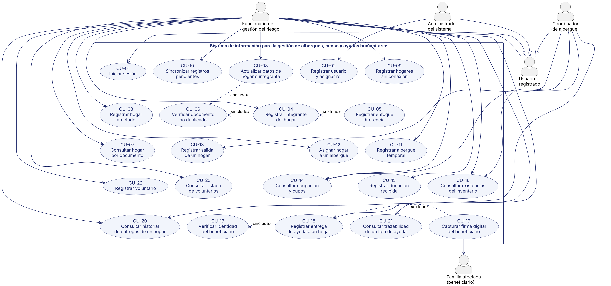

> Versión 0.2 (entrega parcial de octubre de 2026). Se corrige en las semanas 13 y 14; ver BITACORA.md.

# 11. Casos de Uso

Esta sección deriva los Casos de Uso (CU) del sistema a partir de la Fase 0, de las Historias de Usuario con sus Criterios de Aceptación (secciones 1 a 3), de los Requisitos Funcionales y Reglas de Negocio (secciones 4 a 6) y de los Requisitos No Funcionales. No se crean nuevas HU, RF, RN ni RNF; únicamente se agrupan y se detallan los comportamientos ya definidos. Los puntos que dependen de decisiones pendientes se identifican con las validaciones V-xx del documento y se resumen en 11.9.

## 11.1 Actores del sistema

| **Actor**                         | **Tipo**                                          | **Descripción y fundamento**                                                                                                                                       |
|-----------------------------------|---------------------------------------------------|--------------------------------------------------------------------------------------------------------------------------------------------------------------------|
| Usuario registrado                | Actor abstracto                                   | Generaliza a los tres roles con cuenta en el sistema. Es quien inicia sesión (HU-01) y accede según su rol (HU-03).                                                |
| Funcionario de gestión del riesgo | Principal (especialización de Usuario registrado) | Rol operativo que registra hogares, integrantes, albergues, donaciones, entregas y voluntarios (HU-04 a HU-24).                                                    |
| Coordinador de albergue           | Principal (especialización de Usuario registrado) | Registra la salida de hogares (HU-14) y consulta ocupación, existencias e historial según los permisos de su rol (RF-06).                                          |
| Administrador del sistema         | Principal (especialización de Usuario registrado) | Registra usuarios y asigna roles (HU-02).                                                                                                                          |
| Familia afectada (beneficiario)   | Secundario                                        | No opera el sistema. Interviene al firmar digitalmente la recepción de la ayuda (CA-21.1) y es la persona cuya identidad se verifica en la entrega (HU-18, HU-19). |

**Actores no modelados.** Donante, Voluntario y Organismo de socorro aparecen en la Fase 0 como figuras del contexto, pero ninguna HU ni RF define una interacción directa de ellos con el sistema; por eso no se dibujan como actores. El voluntario figura como dato que registra y consulta el Funcionario (HU-24).

## 11.2 Lista de Casos de Uso

| **CU** | **Nombre**                                  | **Actor**                                                        | **HU**       | **RF de origen**                   | **Tipo**                  |
|--------|---------------------------------------------|------------------------------------------------------------------|--------------|------------------------------------|---------------------------|
| CU-01  | Iniciar sesión                              | Usuario registrado                                               | HU-01, HU-03 | RF-01, RF-02, RF-05                | Base                      |
| CU-02  | Registrar usuario y asignar rol             | Administrador del sistema                                        | HU-02        | RF-03, RF-04, RF-06                | Base                      |
| CU-03  | Registrar hogar afectado                    | Funcionario de gestión del riesgo                                | HU-04        | RF-07                              | Base                      |
| CU-04  | Registrar integrante del hogar              | Funcionario de gestión del riesgo                                | HU-05, HU-06 | RF-08, RF-09                       | Base; incluye CU-06       |
| CU-05  | Registrar enfoque diferencial               | Funcionario de gestión del riesgo                                | HU-07        | RF-10                              | Extiende CU-04            |
| CU-06  | Verificar documento no duplicado            | (sin actor; lo invocan CU-04 y CU-08)                            | HU-06, HU-09 | RF-09                              | Incluido en CU-04 y CU-08 |
| CU-07  | Consultar hogar por documento               | Funcionario de gestión del riesgo                                | HU-08        | RF-11                              | Base                      |
| CU-08  | Actualizar datos de hogar o integrante      | Funcionario de gestión del riesgo                                | HU-09        | RF-12, RF-09                       | Base; incluye CU-06       |
| CU-09  | Registrar hogares sin conexión              | Funcionario de gestión del riesgo                                | HU-10        | RF-13, RF-14                       | Base                      |
| CU-10  | Sincronizar registros pendientes            | Funcionario de gestión del riesgo                                | HU-11        | RF-14, RF-15, RF-16                | Base                      |
| CU-11  | Registrar albergue temporal                 | Funcionario de gestión del riesgo                                | HU-12        | RF-17                              | Base                      |
| CU-12  | Asignar hogar a un albergue                 | Funcionario de gestión del riesgo                                | HU-13        | RF-18, RF-19                       | Base                      |
| CU-13  | Registrar salida de un hogar                | Coordinador de albergue                                          | HU-14        | RF-20, RF-18                       | Base                      |
| CU-14  | Consultar ocupación y cupos                 | Funcionario de gestión del riesgo / Coordinador de albergue      | HU-15        | RF-21                              | Base                      |
| CU-15  | Registrar donación recibida                 | Funcionario de gestión del riesgo                                | HU-16        | RF-22, RF-23                       | Base                      |
| CU-16  | Consultar existencias del inventario        | Funcionario de gestión del riesgo / Coordinador de albergue      | HU-17        | RF-24                              | Base                      |
| CU-17  | Verificar identidad del beneficiario        | (sin actor; lo invoca CU-18)                                     | HU-18, HU-19 | RF-25                              | Incluido en CU-18         |
| CU-18  | Registrar entrega de ayuda a un hogar       | Funcionario de gestión del riesgo                                | HU-19, HU-20 | RF-26, RF-27, RF-28                | Base; incluye CU-17       |
| CU-19  | Capturar firma digital del beneficiario     | Funcionario de gestión del riesgo (secundario: Familia afectada) | HU-21        | RF-29, RF-30 (condicionado a V-10) | Extiende CU-18            |
| CU-20  | Consultar historial de entregas de un hogar | Funcionario de gestión del riesgo / Coordinador de albergue      | HU-22        | RF-31                              | Base                      |
| CU-21  | Consultar trazabilidad de un tipo de ayuda  | Funcionario de gestión del riesgo                                | HU-23        | RF-32                              | Base                      |
| CU-22  | Registrar voluntario                        | Funcionario de gestión del riesgo                                | HU-24        | RF-33                              | Base                      |
| CU-23  | Consultar listado de voluntarios            | Funcionario de gestión del riesgo                                | HU-24        | RF-34                              | Base                      |

Todos los CU tienen al menos un RF de origen y los 34 RF quedan cubiertos por al menos un CU (ver 11.8).

## 11.3 Modelo general de Casos de Uso

El modelo contiene 5 actores, 23 casos de uso, las asociaciones actor–CU, una generalización de actores, tres relaciones «include» y dos «extend». La Figura 1 (página siguiente) presenta el diagrama y la sección 11.4 incluye su código fuente PlantUML.

**Relaciones y justificación**

| **Relación**          | **Elementos**                                                 | **Justificación**                                                                                                                                                                                  |
|-----------------------|---------------------------------------------------------------|----------------------------------------------------------------------------------------------------------------------------------------------------------------------------------------------------|
| Generalización        | Funcionario, Coordinador y Administrador → Usuario registrado | Los tres roles comparten el inicio de sesión y el acceso según rol (HU-01, HU-03; RF-01, RF-05), por lo que CU-01 se asocia una sola vez al actor general.                                         |
| «include»             | CU-04 → CU-06                                                 | El documento del integrante debe verificarse siempre antes de registrarlo (CA-06.1 a CA-06.3; RF-09; RN-07). No es opcional.                                                                       |
| «include»             | CU-08 → CU-06                                                 | La actualización de datos debe repetir la misma verificación de duplicados (HU-09; RF-09; RN-07). Evita duplicar la lógica en dos CU.                                                              |
| «include»             | CU-18 → CU-17                                                 | No puede registrarse una entrega sin verificar la identidad del beneficiario (CA-19.4; RF-25; RN-22).                                                                                              |
| «extend»              | CU-05 → CU-04                                                 | El enfoque diferencial se registra solo cuando el integrante lo presenta (HU-07; RF-10; RN-10). Es una ampliación opcional del registro.                                                           |
| «extend»              | CU-19 → CU-18                                                 | La firma digital amplía la entrega (HU-21; RF-29). Se modela como «extend» porque RF-30 (firma obligatoria) está condicionado a la validación V-10; si V-10 la hace obligatoria, pasa a «include». |
| Asociación secundaria | CU-19 — Familia afectada                                      | El beneficiario es quien firma (CA-21.1).                                                                                                                                                          |
| Asociación compartida | Funcionario y Coordinador — CU-14, CU-16, CU-20               | Ambos roles consultan ocupación, existencias e historial; el alcance exacto por rol depende de RF-06 y de V-01.                                                                                    |

**Lo que no se dibuja**

> • Iniciar sesión como paso previo de los demás CU: se trata como precondición para no llenar el diagrama de relaciones.
>
> • La denegación de acceso por rol (RF-06) es transversal; se verifica en cada CU como precondición y se detalla en CU-02.
>
> • Los pasos internos de descuento y validación de existencias (RF-27, RF-28) y de manejo de conflictos (RF-16) se muestran dentro del flujo de CU-18 y CU-10, no como CU separados.

*Figura 1. Modelo general de casos de uso. Las líneas punteadas con «include» y «extend» se leen desde el caso de uso que incluye o extiende hacia el caso de uso base o incluido.*

## 11.4 Código PlantUML del diagrama

El siguiente código genera la Figura 1. Las líneas «hidden» solo controlan la disposición visual y no representan relaciones del modelo.

@startuml

top to bottom direction

skinparam shadowing false

skinparam dpi 200

skinparam ranksep 34

skinparam nodesep 22

skinparam actorStyle awesome

skinparam defaultFontName Calibri

skinparam ArrowColor \#1F2A6B

skinparam usecase {

BackgroundColor \#F2F5FC

BorderColor \#1F2A6B

FontColor \#1F2A6B

}

skinparam rectangle {

BorderColor \#1F2A6B

FontColor \#1F2A6B

}

actor "Usuario\nregistrado" as UR

actor "Funcionario de\ngestión del riesgo" as FUN

actor "Coordinador\nde albergue" as COO

actor "Administrador\ndel sistema" as ADM

actor "Familia afectada\n(beneficiario)" as FAM

FUN --\|\> UR

COO --\|\> UR

ADM --\|\> UR

rectangle "Sistema de información para la gestión de albergues, censo y ayudas humanitarias" {

usecase "CU-01\nIniciar sesión" as CU01

usecase "CU-02\nRegistrar usuario\ny asignar rol" as CU02

usecase "CU-03\nRegistrar hogar\nafectado" as CU03

usecase "CU-04\nRegistrar integrante\ndel hogar" as CU04

usecase "CU-05\nRegistrar enfoque\ndiferencial" as CU05

usecase "CU-06\nVerificar documento\nno duplicado" as CU06

usecase "CU-07\nConsultar hogar\npor documento" as CU07

usecase "CU-08\nActualizar datos de\nhogar o integrante" as CU08

usecase "CU-09\nRegistrar hogares\nsin conexión" as CU09

usecase "CU-10\nSincronizar registros\npendientes" as CU10

usecase "CU-11\nRegistrar albergue\ntemporal" as CU11

usecase "CU-12\nAsignar hogar\na un albergue" as CU12

usecase "CU-13\nRegistrar salida\nde un hogar" as CU13

usecase "CU-14\nConsultar ocupación\ny cupos" as CU14

usecase "CU-15\nRegistrar donación\nrecibida" as CU15

usecase "CU-16\nConsultar existencias\ndel inventario" as CU16

usecase "CU-17\nVerificar identidad\ndel beneficiario" as CU17

usecase "CU-18\nRegistrar entrega\nde ayuda a un hogar" as CU18

usecase "CU-19\nCapturar firma digital\ndel beneficiario" as CU19

usecase "CU-20\nConsultar historial\nde entregas de un hogar" as CU20

usecase "CU-21\nConsultar trazabilidad\nde un tipo de ayuda" as CU21

usecase "CU-22\nRegistrar voluntario" as CU22

usecase "CU-23\nConsultar listado\nde voluntarios" as CU23

}

' Asociaciones

UR --\> CU01

ADM --\> CU02

FUN --\> CU03

FUN --\> CU04

FUN --\> CU07

FUN --\> CU08

FUN --\> CU09

FUN --\> CU10

FUN --\> CU11

FUN --\> CU12

FUN --\> CU14

FUN --\> CU15

FUN --\> CU16

FUN --\> CU18

FUN --\> CU20

FUN --\> CU21

FUN --\> CU22

FUN --\> CU23

COO --\> CU13

COO --\> CU14

COO --\> CU16

COO --\> CU20

CU19 --\> FAM

' Relaciones entre casos de uso

CU04 .\> CU06 : \<\<include\>\>

CU08 ..\> CU06 : \<\<include\>\>

CU18 .\> CU17 : \<\<include\>\>

CU05 .\> CU04 : \<\<extend\>\>

CU19 .\> CU18 : \<\<extend\>\>

' --- ordenamiento visual (no son relaciones UML) ---

CU01 -\[hidden\]-\> CU03

CU02 -\[hidden\]-\> CU04

CU09 -\[hidden\]-\> CU05

CU10 -\[hidden\]-\> CU06

CU03 -\[hidden\]-\> CU07

CU04 -\[hidden\]-\> CU11

CU05 -\[hidden\]-\> CU12

CU06 -\[hidden\]-\> CU13

CU07 -\[hidden\]-\> CU14

CU11 -\[hidden\]-\> CU15

CU12 -\[hidden\]-\> CU16

CU13 -\[hidden\]-\> CU22

CU13 -\[hidden\]-\> CU23

CU14 -\[hidden\]-\> CU17

CU15 -\[hidden\]-\> CU18

CU16 -\[hidden\]-\> CU19

CU22 -\[hidden\]-\> CU20

CU23 -\[hidden\]-\> CU21

@enduml

## 11.5 Selección de Casos de Uso críticos

Se documentan en detalle cinco casos de uso. Se priorizó que, en conjunto, cubran los cuatro procesos centrales de la Fase 0 (censo, offline y sincronización, albergues, ayudas) y los mecanismos de validación más relevantes.

| **CU** | **Nombre**                            | **Razón principal**                                                                                                            |
|--------|---------------------------------------|--------------------------------------------------------------------------------------------------------------------------------|
| CU-04  | Registrar integrante del hogar        | Núcleo del censo; concentra la regla de no duplicidad de documento (RN-07) y su relación «include» con CU-06.                  |
| CU-10  | Sincronizar registros pendientes      | Diferenciador del proyecto: operación sin conexión y consolidación posterior, con riesgo de conflictos y pérdida de datos.     |
| CU-12  | Asignar hogar a un albergue           | Controla cupos y ocupación; evita sobrecupo y doble asignación (RN-12 a RN-15).                                                |
| CU-15  | Registrar donación recibida           | Origen del inventario; sin él no hay existencias que entregar ni trazabilidad de ayudas.                                       |
| CU-18  | Registrar entrega de ayuda a un hogar | Proceso de mayor riesgo operacional: combina verificación de identidad, control de existencias y trazabilidad (RN-20 a RN-23). |

## 11.6 Justificación de la selección

| **CU** | **Importancia** | **Valor para el usuario**                            | **Riesgo operacional**                                 | **Relación con objetivos**          |
|--------|-----------------|------------------------------------------------------|--------------------------------------------------------|-------------------------------------|
| CU-04  | Alta            | Hogar completo y sin personas duplicadas en el censo | Duplicidad de personas y de ayudas                     | Censo de familias afectadas         |
| CU-10  | Alta            | Los datos tomados en campo no se pierden             | Conflictos y pérdida de datos al unir registros        | Operación con conectividad limitada |
| CU-12  | Alta            | Saber dónde está cada hogar y cuántos cupos quedan   | Sobrecupo o hogares sin ubicación                      | Gestión de albergues                |
| CU-15  | Alta            | Inventario confiable de lo recibido                  | Existencias erróneas                                   | Trazabilidad de ayudas              |
| CU-18  | Muy alta        | Entrega justa, verificada y registrada               | Entregas duplicadas, sin existencias o sin responsable | Trazabilidad de ayudas              |

**Por qué no se eligieron otros.** CU-03, CU-07, CU-11, CU-13, CU-14, CU-16, CU-20 a CU-23 son registros o consultas de flujo directo con pocas bifurcaciones. CU-02 y CU-01 son de acceso y seguridad, ya cubiertos por las secciones de roles. CU-06 y CU-17 quedan documentados dentro de CU-04 y CU-18 como pasos incluidos. CU-19 depende de la validación V-10 y se describe como extensión en CU-18.

## 11.7 Documentación de Casos de Uso críticos

### CU-04 — Registrar integrante del hogar

| **Elemento**           | **Descripción**                                                                                                               |
|------------------------|-------------------------------------------------------------------------------------------------------------------------------|
| Objetivo               | Registrar a una persona como integrante de un hogar ya censado, garantizando que su documento no esté registrado previamente. |
| Actor principal        | Funcionario de gestión del riesgo                                                                                             |
| Actores secundarios    | Ninguno. Incluye CU-06; puede ser extendido por CU-05.                                                                        |
| Historias de Usuario   | HU-05, HU-06                                                                                                                  |
| Requisitos Funcionales | RF-08, RF-09                                                                                                                  |
| Reglas de Negocio      | RN-06, RN-07, RN-08, RN-09                                                                                                    |
| Precondiciones         | 1\) El funcionario inició sesión (CU-01) y su rol permite registrar integrantes. 2) El hogar existe en el sistema (CU-03).    |
| Disparador             | El funcionario selecciona un hogar y elige registrar un integrante.                                                           |

**Flujo básico**

| **Paso** | **Actor/Sistema** | **Acción**                                                                                  |
|----------|-------------------|---------------------------------------------------------------------------------------------|
| 1        | Funcionario       | Selecciona el hogar al que pertenece el integrante.                                         |
| 2        | Sistema           | Muestra el formulario de registro de integrante.                                            |
| 3        | Funcionario       | Ingresa el documento de identidad y los demás datos del integrante.                         |
| 4        | Sistema           | Verifica que los datos obligatorios estén completos (RN-06).                                |
| 5        | Sistema           | Verifica que los datos tengan el formato válido (RN-08).                                    |
| 6        | Sistema           | Verifica que el documento no esté registrado, mediante CU-06 (RN-07).                       |
| 7        | Sistema           | Registra al integrante, lo asocia al hogar y muestra el nuevo total de integrantes (RN-09). |

**Flujos alternativos**

### FA-01 — Dato obligatorio faltante

**Condición:** En el paso 4 falta un dato obligatorio.

**Respaldo:** CA-05.2; RF-08; RN-06.

| **Paso** | **Actor/Sistema** | **Acción**                                                   |
|----------|-------------------|--------------------------------------------------------------|
| FA-01.1  | Sistema           | Rechaza el registro e informa que faltan datos obligatorios. |
| FA-01.2  | Funcionario       | Completa el dato; el flujo retoma en el paso 4.              |

### FA-02 — Formato de dato inválido

**Condición:** En el paso 5 un dato no cumple el formato.

**Respaldo:** CA-05.3; RF-08; RN-08; RNF-10.

| **Paso** | **Actor/Sistema** | **Acción**                                                        |
|----------|-------------------|-------------------------------------------------------------------|
| FA-02.1  | Sistema           | Rechaza el registro e informa qué dato tiene un formato inválido. |
| FA-02.2  | Funcionario       | Corrige el dato; el flujo retoma en el paso 5.                    |

### FA-03 — Documento registrado en otro hogar

**Condición:** En el paso 6 el documento ya pertenece a un integrante de otro hogar.

**Respaldo:** CA-06.1 y CA-06.3; RF-09; RN-07.

| **Paso** | **Actor/Sistema** | **Acción**                                                              |
|----------|-------------------|-------------------------------------------------------------------------|
| FA-03.1  | Sistema           | No crea el registro e informa que el documento ya figura en otro hogar. |
| FA-03.2  | Sistema           | El caso de uso termina sin cambios en los datos.                        |

### FA-04 — Documento registrado en el mismo hogar

**Condición:** En el paso 6 el documento ya pertenece a un integrante de este mismo hogar.

**Respaldo:** CA-06.2 y CA-06.3; RF-09; RN-07.

| **Paso** | **Actor/Sistema** | **Acción**                                                            |
|----------|-------------------|-----------------------------------------------------------------------|
| FA-04.1  | Sistema           | No crea el registro e informa que la persona ya figura en este hogar. |
| FA-04.2  | Sistema           | El caso de uso termina sin cambios en los datos.                      |

**Postcondiciones**

> • Éxito: el integrante queda registrado y asociado al hogar, y el total de integrantes del hogar queda actualizado.
>
> • Fallo: no se crea ni modifica ningún registro.

### CU-10 — Sincronizar registros pendientes

| **Elemento**           | **Descripción**                                                                                                                                |
|------------------------|------------------------------------------------------------------------------------------------------------------------------------------------|
| Objetivo               | Enviar al servidor central los registros capturados sin conexión y consolidarlos sin duplicar documentos.                                      |
| Actor principal        | Funcionario de gestión del riesgo                                                                                                              |
| Actores secundarios    | Ninguno (el proceso lo ejecuta el sistema).                                                                                                    |
| Historias de Usuario   | HU-11                                                                                                                                          |
| Requisitos Funcionales | RF-14, RF-15, RF-16                                                                                                                            |
| Reglas de Negocio      | RN-07, RN-26                                                                                                                                   |
| Precondiciones         | 1\) Existen registros pendientes creados con CU-09. 2) Hay conexión disponible con el servidor central. 3) El funcionario tiene sesión activa. |
| Disparador             | El sistema detecta conexión con registros pendientes. HU-11 no precisa si el inicio es manual o automático (validación V-12).                  |

**Flujo básico**

| **Paso** | **Actor/Sistema** | **Acción**                                                                          |
|----------|-------------------|-------------------------------------------------------------------------------------|
| 1        | Sistema           | Inicia la sincronización de los registros pendientes.                               |
| 2        | Sistema           | Envía los registros pendientes al servidor central.                                 |
| 3        | Sistema           | Verifica, por cada registro, que su documento no exista en la base central (RN-07). |
| 4        | Sistema           | Almacena los registros válidos y los marca como sincronizados.                      |
| 5        | Sistema           | Muestra los totales de registros sincronizados y pendientes (RF-14).                |
| 6        | Funcionario       | Revisa el resultado de la sincronización.                                           |

**Flujos alternativos**

### FA-01 — Documento ya existente en la base central

**Condición:** En el paso 3 el documento de un registro ya existe en la base central.

**Respaldo:** CA-11.2; RF-16; RN-07, RN-26; validación V-12.

| **Paso** | **Actor/Sistema** | **Acción**                                                                                        |
|----------|-------------------|---------------------------------------------------------------------------------------------------|
| FA-01.1  | Sistema           | No almacena el registro como nuevo y lo marca como conflicto.                                     |
| FA-01.2  | Sistema           | Continúa con los demás registros desde el paso 4 e informa el conflicto en el resultado (paso 5). |

### FA-02 — Interrupción de la conexión

**Condición:** Durante los pasos 2 a 4 se pierde la conexión.

**Respaldo:** CA-11.3; RF-15; RN-26; RNF-08.

| **Paso** | **Actor/Sistema** | **Acción**                                                                               |
|----------|-------------------|------------------------------------------------------------------------------------------|
| FA-02.1  | Sistema           | Conserva como pendientes los registros no confirmados, sin pérdida de datos.             |
| FA-02.2  | Sistema           | Informa los totales y deja la sincronización lista para reanudarse cuando haya conexión. |

**Postcondiciones**

> • Éxito: los registros válidos quedan en la base central marcados como sincronizados; los demás permanecen pendientes o en conflicto.
>
> • Fallo: ningún registro local se pierde ni se duplica en la base central.

### CU-12 — Asignar hogar a un albergue

| **Elemento**           | **Descripción**                                                                                                |
|------------------------|----------------------------------------------------------------------------------------------------------------|
| Objetivo               | Asignar un hogar censado a un albergue con cupos suficientes y actualizar su ocupación.                        |
| Actor principal        | Funcionario de gestión del riesgo                                                                              |
| Actores secundarios    | Ninguno.                                                                                                       |
| Historias de Usuario   | HU-13                                                                                                          |
| Requisitos Funcionales | RF-18, RF-19                                                                                                   |
| Reglas de Negocio      | RN-12, RN-13, RN-14, RN-15                                                                                     |
| Precondiciones         | 1\) Sesión iniciada con rol autorizado. 2) El albergue existe (CU-11). 3) Existe al menos un hogar registrado. |
| Disparador             | El funcionario selecciona un hogar y un albergue para asignarlo.                                               |

**Flujo básico**

| **Paso** | **Actor/Sistema** | **Acción**                                                                                                     |
|----------|-------------------|----------------------------------------------------------------------------------------------------------------|
| 1        | Funcionario       | Selecciona el hogar y el albergue de destino.                                                                  |
| 2        | Sistema           | Verifica que el hogar esté censado (RN-12).                                                                    |
| 3        | Sistema           | Verifica que el hogar no tenga ya un albergue asignado (RN-13).                                                |
| 4        | Sistema           | Verifica que los cupos disponibles sean mayores o iguales al número de integrantes N del hogar (RN-15; RF-19). |
| 5        | Sistema           | Asigna el hogar al albergue, aumenta la ocupación en N y reduce los cupos en N (RN-14).                        |

**Flujos alternativos**

### FA-01 — Hogar no censado

**Condición:** En el paso 2 el hogar no figura en el censo.

**Respaldo:** CA-13.3; RF-18; RN-12.

| **Paso** | **Actor/Sistema** | **Acción**                                                    |
|----------|-------------------|---------------------------------------------------------------|
| FA-01.1  | Sistema           | Rechaza la asignación e informa que el hogar no está censado. |
| FA-01.2  | Sistema           | El caso de uso termina sin cambios.                           |

### FA-02 — Hogar ya asignado a un albergue

**Condición:** En el paso 3 el hogar ya tiene un albergue asignado.

**Respaldo:** CA-13.4; RF-18; RN-13.

| **Paso** | **Actor/Sistema** | **Acción**                                                     |
|----------|-------------------|----------------------------------------------------------------|
| FA-02.1  | Sistema           | Rechaza la asignación e informa que el hogar ya está asignado. |
| FA-02.2  | Sistema           | El caso de uso termina sin cambios.                            |

### FA-03 — Cupos insuficientes

**Condición:** En el paso 4 los cupos disponibles son menores que N.

**Respaldo:** CA-13.2; RF-19; RN-15; RNF-10.

| **Paso** | **Actor/Sistema** | **Acción**                                                                  |
|----------|-------------------|-----------------------------------------------------------------------------|
| FA-03.1  | Sistema           | Rechaza la asignación e informa que el albergue no tiene cupos suficientes. |
| FA-03.2  | Sistema           | El caso de uso termina sin cambios en ocupación ni cupos.                   |

**Postcondiciones**

> • Éxito: el hogar queda asignado a un único albergue; la ocupación aumenta en N y los cupos disminuyen en N.
>
> • Fallo: la asignación, la ocupación y los cupos no se modifican.

### CU-15 — Registrar donación recibida

| **Elemento**           | **Descripción**                                                             |
|------------------------|-----------------------------------------------------------------------------|
| Objetivo               | Registrar una donación recibida y sumarla a las existencias del inventario. |
| Actor principal        | Funcionario de gestión del riesgo                                           |
| Actores secundarios    | Ninguno.                                                                    |
| Historias de Usuario   | HU-16                                                                       |
| Requisitos Funcionales | RF-22, RF-23                                                                |
| Reglas de Negocio      | RN-17, RN-18, RN-19                                                         |
| Precondiciones         | 1\) Sesión iniciada con rol autorizado (validación V-01 sobre qué roles).   |
| Disparador             | El funcionario elige registrar una donación recibida.                       |

**Flujo básico**

| **Paso** | **Actor/Sistema** | **Acción**                                                                                                     |
|----------|-------------------|----------------------------------------------------------------------------------------------------------------|
| 1        | Funcionario       | Abre el formulario de registro de donación.                                                                    |
| 2        | Funcionario       | Ingresa el tipo de ayuda, la cantidad y el origen.                                                             |
| 3        | Sistema           | Verifica que el tipo y el origen estén completos (RN-18).                                                      |
| 4        | Sistema           | Verifica que la cantidad sea mayor que cero (RN-17).                                                           |
| 5        | Sistema           | Registra la donación con su fecha y suma la cantidad a las existencias del tipo, sin duplicar el tipo (RN-19). |

**Flujos alternativos**

### FA-01 — Falta tipo u origen

**Condición:** En el paso 3 no se indicó el tipo de ayuda o el origen.

**Respaldo:** CA-16.3; RF-22; RN-18.

| **Paso** | **Actor/Sistema** | **Acción**                                         |
|----------|-------------------|----------------------------------------------------|
| FA-01.1  | Sistema           | Rechaza el registro e informa los datos faltantes. |
| FA-01.2  | Funcionario       | Completa los datos; el flujo retoma en el paso 3.  |

### FA-02 — Cantidad inválida

**Condición:** En el paso 4 la cantidad es cero o negativa.

**Respaldo:** CA-16.2; RF-22; RN-17; RNF-10.

| **Paso** | **Actor/Sistema** | **Acción**                                                             |
|----------|-------------------|------------------------------------------------------------------------|
| FA-02.1  | Sistema           | Rechaza el registro e informa que la cantidad debe ser mayor que cero. |
| FA-02.2  | Funcionario       | Corrige la cantidad; el flujo retoma en el paso 4.                     |

**Postcondiciones**

> • Éxito: la donación queda registrada con fecha y las existencias del tipo aumentan en la cantidad recibida.
>
> • Fallo: no se registra la donación y las existencias no cambian.

**Puntos por validar:** el catálogo de tipos de ayuda (V-09) y los roles autorizados (V-01).

### CU-18 — Registrar entrega de ayuda a un hogar

| **Elemento**           | **Descripción**                                                                                                                       |
|------------------------|---------------------------------------------------------------------------------------------------------------------------------------|
| Objetivo               | Registrar la entrega de ayuda a un hogar censado, verificando la identidad del beneficiario y descontando las existencias entregadas. |
| Actor principal        | Funcionario de gestión del riesgo                                                                                                     |
| Actores secundarios    | Familia afectada (beneficiario), cuando interviene la firma digital (CU-19). Incluye CU-17.                                           |
| Historias de Usuario   | HU-19, HU-20 (y HU-18 mediante CU-17)                                                                                                 |
| Requisitos Funcionales | RF-26, RF-27, RF-28 (y RF-25 mediante CU-17)                                                                                          |
| Reglas de Negocio      | RN-17, RN-20, RN-21, RN-22, RN-23                                                                                                     |
| Precondiciones         | 1\) Sesión iniciada con rol autorizado. 2) El hogar del beneficiario está censado. 3) Hay existencias registradas (CU-15).            |
| Disparador             | Un beneficiario se presenta a recibir ayuda y el funcionario inicia el registro de la entrega.                                        |

**Flujo básico**

| **Paso** | **Actor/Sistema** | **Acción**                                                                                                                                               |
|----------|-------------------|----------------------------------------------------------------------------------------------------------------------------------------------------------|
| 1        | Funcionario       | Inicia el registro de una entrega de ayuda.                                                                                                              |
| 2        | Sistema           | Solicita el documento del beneficiario.                                                                                                                  |
| 3        | Funcionario       | Ingresa el documento del beneficiario.                                                                                                                   |
| 4        | Sistema           | Verifica que el documento figure en el censo, mediante CU-17 (RN-22).                                                                                    |
| 5        | Funcionario       | Indica el tipo de ayuda y la cantidad a entregar.                                                                                                        |
| 6        | Sistema           | Verifica que se haya indicado el tipo de ayuda.                                                                                                          |
| 7        | Sistema           | Verifica que la cantidad sea mayor que cero (RN-17).                                                                                                     |
| 8        | Sistema           | Verifica que la cantidad no supere las existencias y que el tipo no esté agotado (RN-21; RF-28).                                                         |
| 9        | Sistema           | Registra la entrega con hogar, beneficiario, tipo, cantidad, fecha y hora, y usuario (RN-23), y descuenta la cantidad de las existencias (RN-20; RF-27). |

**Nota.** Si la firma digital resulta obligatoria (validación V-10), el flujo incluye CU-19 entre los pasos 8 y 9; en caso contrario es una extensión opcional.

**Flujos alternativos**

### FA-01 — Beneficiario no figura en el censo

**Condición:** En el paso 4 el documento no corresponde a un hogar censado.

**Respaldo:** CA-18.2; RF-25; RN-22.

| **Paso** | **Actor/Sistema** | **Acción**                                                              |
|----------|-------------------|-------------------------------------------------------------------------|
| FA-01.1  | Sistema           | Rechaza la entrega e informa que el beneficiario no figura en el censo. |
| FA-01.2  | Sistema           | El caso de uso termina sin registrar entrega.                           |

### FA-02 — Documento no ingresado

**Condición:** En el paso 3 el funcionario no ingresa el documento.

**Respaldo:** CA-18.3; RF-25. Sin RN identificada: requiere validación.

| **Paso** | **Actor/Sistema** | **Acción**                                                 |
|----------|-------------------|------------------------------------------------------------|
| FA-02.1  | Sistema           | Impide continuar y solicita el documento del beneficiario. |
| FA-02.2  | Funcionario       | Ingresa el documento; el flujo retoma en el paso 3.        |

### FA-03 — Beneficiario no verificado

**Condición:** Se intenta registrar la entrega sin haber verificado al beneficiario.

**Respaldo:** CA-19.4; RF-25, RF-26; RN-22.

| **Paso** | **Actor/Sistema** | **Acción**                                                               |
|----------|-------------------|--------------------------------------------------------------------------|
| FA-03.1  | Sistema           | Rechaza el registro e informa que primero debe verificarse la identidad. |
| FA-03.2  | Funcionario       | Verifica al beneficiario; el flujo retoma en el paso 2.                  |

### FA-04 — Tipo de ayuda no indicado

**Condición:** En el paso 6 no se indicó el tipo de ayuda.

**Respaldo:** CA-19.3; RF-26; RN-23.

| **Paso** | **Actor/Sistema** | **Acción**                                                         |
|----------|-------------------|--------------------------------------------------------------------|
| FA-04.1  | Sistema           | Rechaza el registro e informa que debe indicarse el tipo de ayuda. |
| FA-04.2  | Funcionario       | Indica el tipo; el flujo retoma en el paso 5.                      |

### FA-05 — Cantidad inválida

**Condición:** En el paso 7 la cantidad es cero o negativa.

**Respaldo:** CA-19.2; RF-26; RN-17; RNF-10.

| **Paso** | **Actor/Sistema** | **Acción**                                                             |
|----------|-------------------|------------------------------------------------------------------------|
| FA-05.1  | Sistema           | Rechaza el registro e informa que la cantidad debe ser mayor que cero. |
| FA-05.2  | Funcionario       | Corrige la cantidad; el flujo retoma en el paso 5.                     |

### FA-06 — Cantidad superior a las existencias

**Condición:** En el paso 8 la cantidad supera las existencias del tipo.

**Respaldo:** CA-20.2; RF-28; RN-21.

| **Paso** | **Actor/Sistema** | **Acción**                                                                   |
|----------|-------------------|------------------------------------------------------------------------------|
| FA-06.1  | Sistema           | Rechaza la entrega, informa las existencias disponibles y no descuenta nada. |
| FA-06.2  | Funcionario       | Ajusta la cantidad; el flujo retoma en el paso 5.                            |

### FA-07 — Tipo de ayuda agotado

**Condición:** En el paso 8 las existencias del tipo son cero.

**Respaldo:** CA-20.3; RF-28; RN-21.

| **Paso** | **Actor/Sistema** | **Acción**                                             |
|----------|-------------------|--------------------------------------------------------|
| FA-07.1  | Sistema           | Rechaza la entrega e informa que el tipo está agotado. |
| FA-07.2  | Sistema           | El caso de uso termina sin registrar entrega.          |

**Postcondiciones**

> • Éxito: la entrega queda registrada con hogar, beneficiario, tipo, cantidad, fecha y hora y usuario responsable, y las existencias del tipo disminuyen en la cantidad entregada.
>
> • Fallo: no se registra la entrega y las existencias no cambian.

## 11.8 Trazabilidad

**a) Caso de uso → HU, RF y RN**

| **CU** | **HU**       | **RF**                             | **RN**                            |
|--------|--------------|------------------------------------|-----------------------------------|
| CU-01  | HU-01, HU-03 | RF-01, RF-02, RF-05                | RN-01, RN-05                      |
| CU-02  | HU-02        | RF-03, RF-04, RF-06                | RN-02, RN-03, RN-04               |
| CU-03  | HU-04        | RF-07                              | RN-06                             |
| CU-04  | HU-05, HU-06 | RF-08, RF-09                       | RN-06, RN-07, RN-08, RN-09        |
| CU-05  | HU-07        | RF-10                              | RN-10                             |
| CU-06  | HU-06, HU-09 | RF-09                              | RN-07                             |
| CU-07  | HU-08        | RF-11                              | —                                 |
| CU-08  | HU-09        | RF-12, RF-09                       | RN-06, RN-07, RN-08               |
| CU-09  | HU-10        | RF-13, RF-14                       | RN-06, RN-25                      |
| CU-10  | HU-11        | RF-14, RF-15, RF-16                | RN-07, RN-26                      |
| CU-11  | HU-12        | RF-17                              | RN-06, RN-11                      |
| CU-12  | HU-13        | RF-18, RF-19                       | RN-12, RN-13, RN-14, RN-15        |
| CU-13  | HU-14        | RF-20, RF-18                       | RN-13, RN-14, RN-16               |
| CU-14  | HU-15        | RF-21                              | RN-14                             |
| CU-15  | HU-16        | RF-22, RF-23                       | RN-17, RN-18, RN-19               |
| CU-16  | HU-17        | RF-24                              | RN-20                             |
| CU-17  | HU-18, HU-19 | RF-25                              | RN-22                             |
| CU-18  | HU-19, HU-20 | RF-26, RF-27, RF-28                | RN-17, RN-20, RN-21, RN-22, RN-23 |
| CU-19  | HU-21        | RF-29, RF-30 (condicionado a V-10) | RN-24 (condicional)               |
| CU-20  | HU-22        | RF-31                              | RN-23                             |
| CU-21  | HU-23        | RF-32                              | RN-23                             |
| CU-22  | HU-24        | RF-33                              | RN-06                             |
| CU-23  | HU-24        | RF-34                              | —                                 |

**b) Requisito funcional → caso de uso**

| **RF** | **Caso(s) de uso**  | **Observación**                                                                |
|--------|---------------------|--------------------------------------------------------------------------------|
| RF-01  | CU-01               |                                                                                |
| RF-02  | CU-01               |                                                                                |
| RF-03  | CU-02               |                                                                                |
| RF-04  | CU-02               |                                                                                |
| RF-05  | CU-01               |                                                                                |
| RF-06  | CU-02               | Transversal: la denegación por rol aplica a todos los CU; se detalla en CU-02. |
| RF-07  | CU-03               |                                                                                |
| RF-08  | CU-04               |                                                                                |
| RF-09  | CU-04, CU-06, CU-08 | Implementado como CU-06, incluido por CU-04 y CU-08.                           |
| RF-10  | CU-05               |                                                                                |
| RF-11  | CU-07               |                                                                                |
| RF-12  | CU-08               |                                                                                |
| RF-13  | CU-09               |                                                                                |
| RF-14  | CU-09, CU-10        | Compartido por CU-09 (captura) y CU-10 (totales tras sincronizar).             |
| RF-15  | CU-10               |                                                                                |
| RF-16  | CU-10               |                                                                                |
| RF-17  | CU-11               |                                                                                |
| RF-18  | CU-12, CU-13        |                                                                                |
| RF-19  | CU-12               |                                                                                |
| RF-20  | CU-13               |                                                                                |
| RF-21  | CU-14               |                                                                                |
| RF-22  | CU-15               |                                                                                |
| RF-23  | CU-15               |                                                                                |
| RF-24  | CU-16               |                                                                                |
| RF-25  | CU-17               | Implementado como CU-17, incluido por CU-18.                                   |
| RF-26  | CU-18               |                                                                                |
| RF-27  | CU-18               |                                                                                |
| RF-28  | CU-18               |                                                                                |
| RF-29  | CU-19               |                                                                                |
| RF-30  | CU-19               | Condicionado a la validación V-10 (firma obligatoria).                         |
| RF-31  | CU-20               |                                                                                |
| RF-32  | CU-21               |                                                                                |
| RF-33  | CU-22               |                                                                                |
| RF-34  | CU-23               |                                                                                |

**c) Flujos de los CU críticos → CA, RF y RN**

| **Flujo**    | **CA**                    | **RF**                     | **RN**                                |
|--------------|---------------------------|----------------------------|---------------------------------------|
| CU-04 básico | CA-05.1                   | RF-08, RF-09               | RN-06, RN-07, RN-08, RN-09            |
| CU-04 FA-01  | CA-05.2                   | RF-08                      | RN-06                                 |
| CU-04 FA-02  | CA-05.3                   | RF-08                      | RN-08                                 |
| CU-04 FA-03  | CA-06.1, CA-06.3          | RF-09                      | RN-07                                 |
| CU-04 FA-04  | CA-06.2, CA-06.3          | RF-09                      | RN-07                                 |
| CU-10 básico | CA-11.1                   | RF-14, RF-15, RF-16        | RN-07, RN-26                          |
| CU-10 FA-01  | CA-11.2                   | RF-16                      | RN-07, RN-26                          |
| CU-10 FA-02  | CA-11.3                   | RF-15                      | RN-26                                 |
| CU-12 básico | CA-13.1                   | RF-18, RF-19               | RN-12 a RN-15                         |
| CU-12 FA-01  | CA-13.3                   | RF-18                      | RN-12                                 |
| CU-12 FA-02  | CA-13.4                   | RF-18                      | RN-13                                 |
| CU-12 FA-03  | CA-13.2                   | RF-19                      | RN-15                                 |
| CU-15 básico | CA-16.1                   | RF-22, RF-23               | RN-17, RN-18, RN-19                   |
| CU-15 FA-01  | CA-16.3                   | RF-22                      | RN-18                                 |
| CU-15 FA-02  | CA-16.2                   | RF-22                      | RN-17                                 |
| CU-18 básico | CA-18.1, CA-19.1, CA-20.1 | RF-25, RF-26, RF-27, RF-28 | RN-17, RN-20 a RN-23                  |
| CU-18 FA-01  | CA-18.2                   | RF-25                      | RN-22                                 |
| CU-18 FA-02  | CA-18.3                   | RF-25                      | No identificado / requiere validación |
| CU-18 FA-03  | CA-19.4                   | RF-25, RF-26               | RN-22                                 |
| CU-18 FA-04  | CA-19.3                   | RF-26                      | RN-23                                 |
| CU-18 FA-05  | CA-19.2                   | RF-26                      | RN-17                                 |
| CU-18 FA-06  | CA-20.2                   | RF-28                      | RN-21                                 |
| CU-18 FA-07  | CA-20.3                   | RF-28                      | RN-21                                 |

## 11.9 Revisión de consistencia

| **N.°** | **Control**                                                | **Estado** | **Observación**                                                                                         |
|---------|------------------------------------------------------------|------------|---------------------------------------------------------------------------------------------------------|
| 1       | Todo CU tiene al menos un RF de origen                     | Cumple     | Verificado en 11.2 para los 23 CU.                                                                      |
| 2       | Todo RF está cubierto por al menos un CU                   | Cumple     | RF-01 a RF-34 mapeados en 11.8 b).                                                                      |
| 3       | Todo flujo alternativo tiene CA, RF y RN                   | Parcial    | CU-18 FA-02 (CA-18.3) no tiene RN identificada; se marca como "requiere validación".                    |
| 4       | No se inventaron actores                                   | Cumple     | Cinco actores, todos con fundamento en HU/CA; Donante, Voluntario y Organismo de socorro no se modelan. |
| 5       | No se crearon HU, RF, RN ni RNF nuevos                     | Cumple     | Solo se referencian los existentes.                                                                     |
| 6       | Cada «include», «extend» y generalización está justificada | Cumple     | Ver 11.3.                                                                                               |
| 7       | El diagrama coincide con la lista de CU y sus relaciones   | Cumple     | 23 CU, 3 «include», 2 «extend», 1 generalización.                                                       |
| 8       | No se incluyen clases, métodos ni código de la aplicación  | Cumple     | El único código es la notación PlantUML del diagrama.                                                   |

**Puntos por validar con el equipo**

> • **V-10:** si la firma digital es obligatoria; en ese caso CU-19 pasa de «extend» a «include» y RF-30 se vuelve exigible.
>
> • **V-12:** si la sincronización (CU-10) se inicia de forma manual o automática, y cómo se resuelve un conflicto.
>
> • **V-01:** roles autorizados para donaciones, existencias y consultas compartidas.
>
> • **V-03, V-05, V-06, V-09, V-02:** validaciones pendientes del documento de requisitos; los CU las heredan sin modificarlas (por ejemplo, V-09 para el catálogo de tipos de ayuda en CU-15).
>
> • **HU-25 a HU-30:** retiradas de esta línea base; los CU de coordinación de voluntarios, bitácora de auditoría, reportes y exportación deberán definirse cuando se completen esas HU.
