> Versión 1.2 (12 de noviembre de 2026). Las tablas y figuras conservan la numeración del documento Word de docs/entregas.

## 2.5 Mockups

Los mockups son de baja fidelidad y cumplen cinco condiciones: cada uno tiene un código MK; cada botón indica bajo su nombre el caso de uso al que pertenece y el método que llama; los campos llevan debajo el nombre del atributo del diccionario de datos; las pantallas muestran el camino de rechazo con el mensaje de la regla de negocio; y los avisos de inactivación explican qué deja de verse y qué se conserva, en lugar de preguntar solo «¿Está seguro?».

Los seis casos de uso documentados tienen su pantalla: CU-04 en MK-02, CU-10 en MK-03, CU-12 en MK-04, CU-15 en MK-05, CU-18 en MK-06 y CU-28 en MK-07. Los otros seis mockups (MK-01 y MK-08 a MK-12) completan la cobertura de las operaciones de todas las entidades. Cada figura va seguida de su ficha.

La Figura 13 presenta la pantalla MK-01 y la Tabla 163 la describe.

**Figura 13**  
*MK-01: Censo — Consulta y ficha del hogar*

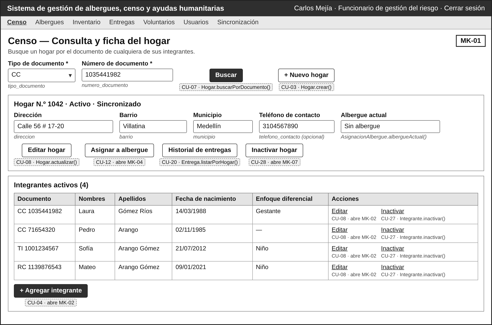

*Nota.* Bajo cada botón se indica el caso de uso y el método que llama; bajo cada campo, el atributo del diccionario. Elaboración propia.

**Tabla 163**  
*Ficha del mockup MK-01*

<table>
<colgroup>
<col style="width: 22%" />
<col style="width: 77%" />
</colgroup>
<thead>
<tr class="header">
<th><strong>Código</strong></th>
<th><strong>MK-01</strong></th>
</tr>
</thead>
<tbody>
<tr class="odd">
<td><strong>Pantalla</strong></td>
<td>Censo — Consulta y ficha del hogar</td>
</tr>
<tr class="even">
<td><strong>Atiende (HU / CU)</strong></td>
<td>HU-08 / CU-07; da entrada a CU-03, CU-04, CU-05, CU-08, CU-12, CU-20, CU-27 y CU-28</td>
</tr>
<tr class="odd">
<td><strong>Campos ↔︎ diccionario</strong></td>
<td>Filtro: tipo_documento (ENUM, lista) y numero_documento. Ficha: id_hogar, direccion, barrio, municipio, telefono_contacto, fecha_registro. Tabla: tipo_documento, numero_documento, nombres, apellidos, fecha_nacimiento y condiciones (INTEGRANTE_CONDICION)</td>
</tr>
<tr class="even">
<td><strong>Botones ↔︎ eventos</strong></td>
<td>
<strong>Buscar</strong> → CU-07 · Hogar.buscarPorDocumento() (RF-11)

<strong>+ Nuevo hogar</strong> → CU-03 · Hogar.crear() (RF-07)

<strong>Editar hogar</strong> → CU-08 · Hogar.actualizar() (RF-12)

<strong>Inactivar hogar</strong> → CU-28 · Hogar.inactivar() — abre MK-07 (RF-39)

<strong>Asignar a albergue</strong> → CU-12 · abre MK-04 (RF-18)

<strong>Historial de entregas</strong> → CU-20 · Entrega.listarPorHogar() (RF-31)

<strong>+ Agregar integrante</strong> → CU-04 · abre MK-02 en modo registrar (RF-08)

<strong>Editar (fila)</strong> → CU-08 · abre MK-02 en modo actualizar (RF-12)

<strong>Inactivar (fila)</strong> → CU-27 · Integrante.inactivar() (RF-38)
</td>
</tr>
<tr class="odd">
<td><strong>RN visibles</strong></td>
<td>RN-06 (la búsqueda exige el número de documento); el mensaje «No se encontró ningún hogar» es el CA-08.2</td>
</tr>
</tbody>
</table>

*Nota.* Elaboración propia.

La Figura 14 presenta la pantalla MK-02 y la Tabla 164 la describe.

**Figura 14**  
*MK-02: Censo — Registrar / actualizar integrante (misma pantalla, dos modos)*

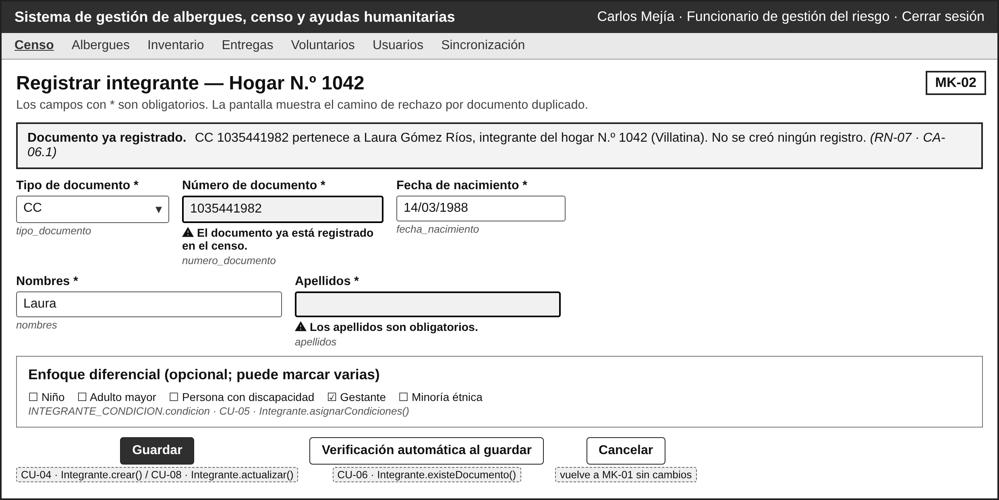

*Nota.* Bajo cada botón se indica el caso de uso y el método que llama; bajo cada campo, el atributo del diccionario. Elaboración propia.

**Tabla 164**  
*Ficha del mockup MK-02*

<table>
<colgroup>
<col style="width: 22%" />
<col style="width: 77%" />
</colgroup>
<thead>
<tr class="header">
<th><strong>Código</strong></th>
<th><strong>MK-02</strong></th>
</tr>
</thead>
<tbody>
<tr class="odd">
<td><strong>Pantalla</strong></td>
<td>Censo — Registrar / actualizar integrante (misma pantalla, dos modos)</td>
</tr>
<tr class="even">
<td><strong>Atiende (HU / CU)</strong></td>
<td>HU-05 y HU-06 / CU-04 (modo registrar); HU-09 / CU-08 (modo actualizar); HU-07 / CU-05; incluye CU-06</td>
</tr>
<tr class="odd">
<td><strong>Campos ↔︎ diccionario</strong></td>
<td>tipo_documento (ENUM, lista), numero_documento, nombres, apellidos, fecha_nacimiento y condiciones de enfoque diferencial (INTEGRANTE_CONDICION.condicion, casillas con los cinco valores del ENUM)</td>
</tr>
<tr class="even">
<td><strong>Botones ↔︎ eventos</strong></td>
<td>
<strong>Guardar</strong> → CU-04 / CU-08 · Integrante.crear() o Integrante.actualizar(); antes llama a Integrante.existeDocumento() (CU-06) (RF-08, RF-12, RF-09)

<strong>Guardar (condiciones)</strong> → CU-05 · Integrante.asignarCondiciones() (RF-10)

<strong>Cancelar</strong> → CU-04 · vuelve a MK-01 sin cambios (CA-06.3) (RF-09)
</td>
</tr>
<tr class="odd">
<td><strong>RN visibles</strong></td>
<td>RN-06 (asteriscos: datos obligatorios), RN-07 (alerta de documento ya registrado, con el hogar donde está), RN-08 (formato del documento), RN-09 (el integrante se crea dentro del hogar abierto), RN-10 (solo las cinco condiciones de la lista)</td>
</tr>
</tbody>
</table>

*Nota.* Elaboración propia.

La Figura 15 presenta la pantalla MK-03 y la Tabla 165 la describe.

**Figura 15**  
*MK-03: Sincronización de registros pendientes*

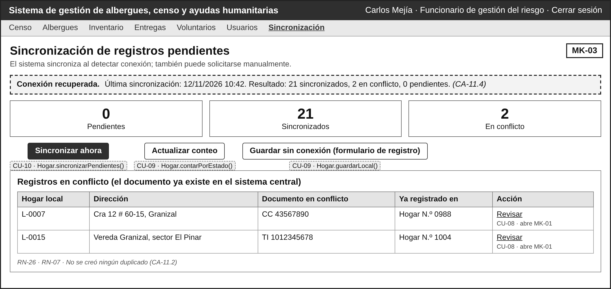

*Nota.* Bajo cada botón se indica el caso de uso y el método que llama; bajo cada campo, el atributo del diccionario. Elaboración propia.

**Tabla 165**  
*Ficha del mockup MK-03*

<table>
<colgroup>
<col style="width: 22%" />
<col style="width: 77%" />
</colgroup>
<thead>
<tr class="header">
<th><strong>Código</strong></th>
<th><strong>MK-03</strong></th>
</tr>
</thead>
<tbody>
<tr class="odd">
<td><strong>Pantalla</strong></td>
<td>Sincronización de registros pendientes</td>
</tr>
<tr class="even">
<td><strong>Atiende (HU / CU)</strong></td>
<td>HU-11 / CU-10; muestra el resultado de HU-10 / CU-09</td>
</tr>
<tr class="odd">
<td><strong>Campos ↔︎ diccionario</strong></td>
<td>Contadores por HOGAR.estado_sincronizacion (PENDIENTE, SINCRONIZADO, CONFLICTO). Tabla de conflictos: id_hogar, direccion, tipo_documento y numero_documento del integrante en conflicto</td>
</tr>
<tr class="even">
<td><strong>Botones ↔︎ eventos</strong></td>
<td>
<strong>Sincronizar ahora</strong> → CU-10 · Hogar.sincronizarPendientes() (RF-15, RF-16)

<strong>Actualizar conteo</strong> → CU-09 · Hogar.contarPorEstado() (RF-14)

<strong>Guardar sin conexión</strong> → CU-09 · Hogar.guardarLocal() (el mismo formulario de registro, sin conexión) (RF-13)

<strong>Revisar (fila)</strong> → CU-08 · abre MK-01 con el registro existente (RF-12)
</td>
</tr>
<tr class="odd">
<td><strong>RN visibles</strong></td>
<td>RN-26 (ningún registro se pierde ni se duplica; los conflictos quedan para revisión), RN-07 (documento ya existente en el sistema central), RN-25 (las mismas validaciones sin conexión)</td>
</tr>
</tbody>
</table>

*Nota.* Elaboración propia.

La Figura 16 presenta la pantalla MK-04 y la Tabla 166 la describe.

**Figura 16**  
*MK-04: Albergues — Asignar hogar a un albergue*

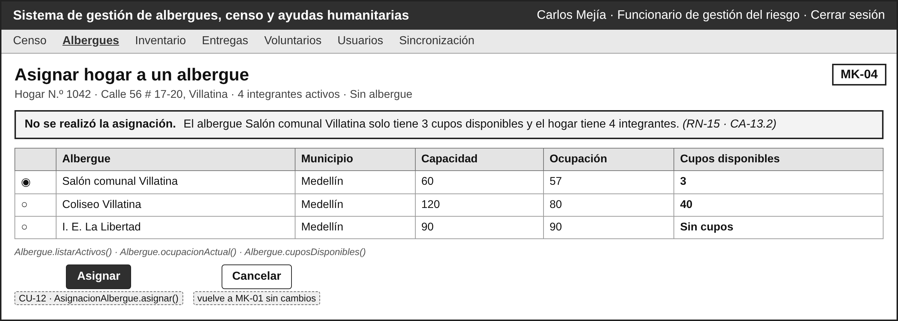

*Nota.* Bajo cada botón se indica el caso de uso y el método que llama; bajo cada campo, el atributo del diccionario. Elaboración propia.

**Tabla 166**  
*Ficha del mockup MK-04*

<table>
<colgroup>
<col style="width: 22%" />
<col style="width: 77%" />
</colgroup>
<thead>
<tr class="header">
<th><strong>Código</strong></th>
<th><strong>MK-04</strong></th>
</tr>
</thead>
<tbody>
<tr class="odd">
<td><strong>Pantalla</strong></td>
<td>Albergues — Asignar hogar a un albergue</td>
</tr>
<tr class="even">
<td><strong>Atiende (HU / CU)</strong></td>
<td>HU-13 / CU-12</td>
</tr>
<tr class="odd">
<td><strong>Campos ↔︎ diccionario</strong></td>
<td>Hogar: id_hogar, direccion y total de integrantes activos. Tabla: ALBERGUE.nombre, municipio, capacidad_maxima; ocupación y cupos son valores calculados (RN-14)</td>
</tr>
<tr class="even">
<td><strong>Botones ↔︎ eventos</strong></td>
<td>
<strong>Asignar</strong> → CU-12 · AsignacionAlbergue.asignar(); antes llama a Albergue.cuposDisponibles() y AsignacionAlbergue.albergueActual() (RF-18, RF-19)

<strong>Cancelar</strong> → CU-12 · vuelve a MK-01 sin cambios (RF-18)
</td>
</tr>
<tr class="odd">
<td><strong>RN visibles</strong></td>
<td>RN-15 (mensaje de cupos insuficientes), RN-13 (hogar ya alojado), RN-12 (hogar censado), RN-14 (cada hogar ocupa tantos cupos como integrantes), RN-34 (solo albergues activos)</td>
</tr>
</tbody>
</table>

*Nota.* Elaboración propia.

La Figura 17 presenta la pantalla MK-05 y la Tabla 167 la describe.

**Figura 17**  
*MK-05: Inventario — Registrar donación recibida*

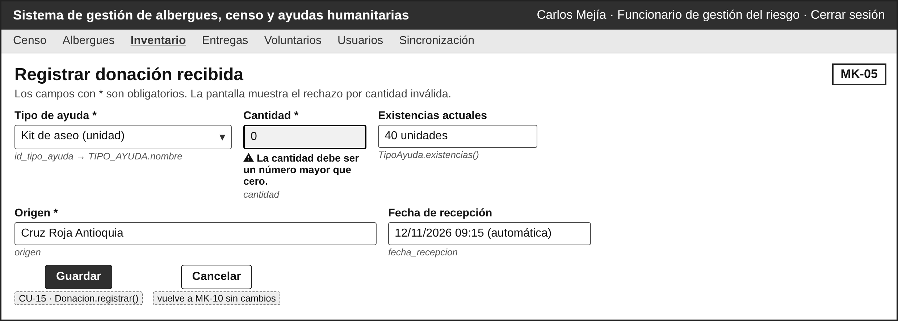

*Nota.* Bajo cada botón se indica el caso de uso y el método que llama; bajo cada campo, el atributo del diccionario. Elaboración propia.

**Tabla 167**  
*Ficha del mockup MK-05*

<table>
<colgroup>
<col style="width: 22%" />
<col style="width: 77%" />
</colgroup>
<thead>
<tr class="header">
<th><strong>Código</strong></th>
<th><strong>MK-05</strong></th>
</tr>
</thead>
<tbody>
<tr class="odd">
<td><strong>Pantalla</strong></td>
<td>Inventario — Registrar donación recibida</td>
</tr>
<tr class="even">
<td><strong>Atiende (HU / CU)</strong></td>
<td>HU-16 / CU-15</td>
</tr>
<tr class="odd">
<td><strong>Campos ↔︎ diccionario</strong></td>
<td>id_tipo_ayuda (lista de TIPO_AYUDA activos: nombre y unidad_medida), cantidad, origen; fecha_recepcion e id_usuario_registro los asigna el sistema</td>
</tr>
<tr class="even">
<td><strong>Botones ↔︎ eventos</strong></td>
<td>
<strong>Guardar</strong> → CU-15 · Donacion.registrar() (RF-22, RF-23)

<strong>Cancelar</strong> → CU-15 · vuelve a MK-10 sin cambios (RF-22)
</td>
</tr>
<tr class="odd">
<td><strong>RN visibles</strong></td>
<td>RN-17 (cantidad mayor que cero), RN-18 (tipo de ayuda y origen obligatorios), RN-19 y RN-20 (la donación se acumula en el mismo tipo), RN-34 (solo tipos de ayuda activos)</td>
</tr>
</tbody>
</table>

*Nota.* Elaboración propia.

La Figura 18 presenta la pantalla MK-06 y la Tabla 168 la describe.

**Figura 18**  
*MK-06: Entregas — Registrar entrega de ayuda*

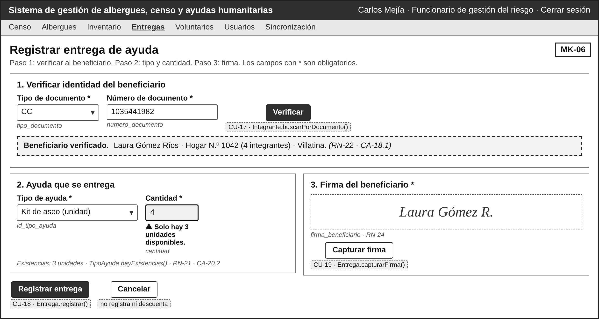

*Nota.* Bajo cada botón se indica el caso de uso y el método que llama; bajo cada campo, el atributo del diccionario. Elaboración propia.

**Tabla 168**  
*Ficha del mockup MK-06*

<table>
<colgroup>
<col style="width: 22%" />
<col style="width: 77%" />
</colgroup>
<thead>
<tr class="header">
<th><strong>Código</strong></th>
<th><strong>MK-06</strong></th>
</tr>
</thead>
<tbody>
<tr class="odd">
<td><strong>Pantalla</strong></td>
<td>Entregas — Registrar entrega de ayuda</td>
</tr>
<tr class="even">
<td><strong>Atiende (HU / CU)</strong></td>
<td>HU-19 y HU-20 / CU-18; HU-18 / CU-17; HU-21 / CU-19</td>
</tr>
<tr class="odd">
<td><strong>Campos ↔︎ diccionario</strong></td>
<td>Verificación: tipo_documento y numero_documento del INTEGRANTE. Entrega: id_tipo_ayuda (lista), cantidad, firma_beneficiario; fecha_hora e id_usuario_responsable los asigna el sistema</td>
</tr>
<tr class="even">
<td><strong>Botones ↔︎ eventos</strong></td>
<td>
<strong>Verificar</strong> → CU-17 · Integrante.buscarPorDocumento() (RF-25)

<strong>Capturar firma</strong> → CU-19 · Entrega.capturarFirma() (RF-29, RF-30)

<strong>Registrar entrega</strong> → CU-18 · Entrega.registrar(); antes llama a TipoAyuda.hayExistencias() (RF-26, RF-27, RF-28)

<strong>Cancelar</strong> → CU-18 · no registra ni descuenta (RF-26)
</td>
</tr>
<tr class="odd">
<td><strong>RN visibles</strong></td>
<td>RN-22 (entrega solo a beneficiario verificado), RN-17 (cantidad mayor que cero), RN-21 (mensaje de existencias insuficientes), RN-23 (datos de trazabilidad), RN-24 (firma obligatoria), RN-20 (descuento automático)</td>
</tr>
</tbody>
</table>

*Nota.* Elaboración propia.

La Figura 19 presenta la pantalla MK-07 y la Tabla 169 la describe.

**Figura 19**  
*MK-07: Aviso de inactivación de hogar (ventana sobre MK-01)*

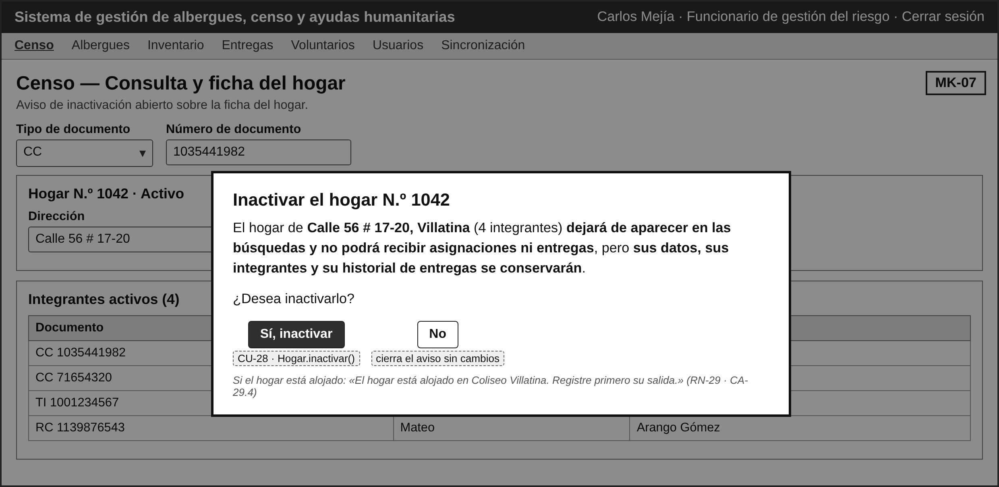

*Nota.* Bajo cada botón se indica el caso de uso y el método que llama; bajo cada campo, el atributo del diccionario. Elaboración propia.

**Tabla 169**  
*Ficha del mockup MK-07*

<table>
<colgroup>
<col style="width: 22%" />
<col style="width: 77%" />
</colgroup>
<thead>
<tr class="header">
<th><strong>Código</strong></th>
<th><strong>MK-07</strong></th>
</tr>
</thead>
<tbody>
<tr class="odd">
<td><strong>Pantalla</strong></td>
<td>Aviso de inactivación de hogar (ventana sobre MK-01)</td>
</tr>
<tr class="even">
<td><strong>Atiende (HU / CU)</strong></td>
<td>HU-29 / CU-28</td>
</tr>
<tr class="odd">
<td><strong>Campos ↔︎ diccionario</strong></td>
<td>Muestra id_hogar, direccion, barrio y número de integrantes activos; al confirmar cambia HOGAR.activo a FALSE</td>
</tr>
<tr class="even">
<td><strong>Botones ↔︎ eventos</strong></td>
<td>
<strong>Sí, inactivar</strong> → CU-28 · Hogar.inactivar(); antes llama a AsignacionAlbergue.albergueActual() (RF-39)

<strong>No</strong> → CU-28 · cierra el aviso sin cambios (CA-29.3) (RF-39)
</td>
</tr>
<tr class="odd">
<td><strong>RN visibles</strong></td>
<td>RN-27 (el aviso explica qué deja de verse y qué se conserva), RN-29 (si el hogar está alojado, el aviso se reemplaza por «Registre primero su salida»), RN-34 (un hogar inactivo no admite asignaciones ni entregas)</td>
</tr>
</tbody>
</table>

*Nota.* Elaboración propia.

La Figura 20 presenta la pantalla MK-08 y la Tabla 170 la describe.

**Figura 20**  
*MK-08: Usuarios — Listado y formulario*

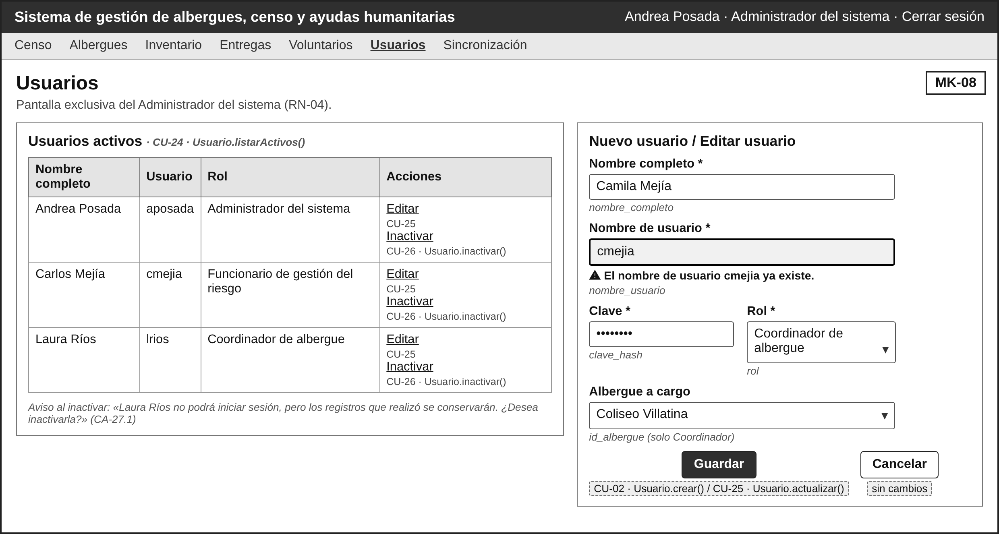

*Nota.* Bajo cada botón se indica el caso de uso y el método que llama; bajo cada campo, el atributo del diccionario. Elaboración propia.

**Tabla 170**  
*Ficha del mockup MK-08*

<table>
<colgroup>
<col style="width: 22%" />
<col style="width: 77%" />
</colgroup>
<thead>
<tr class="header">
<th><strong>Código</strong></th>
<th><strong>MK-08</strong></th>
</tr>
</thead>
<tbody>
<tr class="odd">
<td><strong>Pantalla</strong></td>
<td>Usuarios — Listado y formulario</td>
</tr>
<tr class="even">
<td><strong>Atiende (HU / CU)</strong></td>
<td>HU-25 / CU-24; HU-02 / CU-02; HU-26 / CU-25; HU-27 / CU-26</td>
</tr>
<tr class="odd">
<td><strong>Campos ↔︎ diccionario</strong></td>
<td>Tabla: nombre_completo, nombre_usuario, rol. Formulario: nombre_completo, nombre_usuario, clave (se guarda en clave_hash), rol (ENUM, lista), id_albergue (lista de ALBERGUE; solo Coordinador)</td>
</tr>
<tr class="even">
<td><strong>Botones ↔︎ eventos</strong></td>
<td>
<strong>Guardar</strong> → CU-02 / CU-25 · Usuario.crear() o Usuario.actualizar(); antes llama a Usuario.existeNombreUsuario() (RF-03, RF-36, RF-04)

<strong>Editar (fila)</strong> → CU-25 · carga el formulario con los datos (RF-36)

<strong>Inactivar (fila)</strong> → CU-26 · Usuario.inactivar(), con aviso de consecuencia (RF-37)

<strong>Listado</strong> → CU-24 · Usuario.listarActivos() (RF-35)
</td>
</tr>
<tr class="odd">
<td><strong>RN visibles</strong></td>
<td>RN-02 (nombre de usuario único), RN-03 (rol obligatorio), RN-04 (pantalla exclusiva del Administrador), RN-28 (no se inactiva ni se cambia el rol del único Administrador), RN-27 (aviso de inactivación)</td>
</tr>
</tbody>
</table>

*Nota.* Elaboración propia.

La Figura 21 presenta la pantalla MK-09 y la Tabla 171 la describe.

**Figura 21**  
*MK-09: Albergues — Ocupación, cupos y formulario*

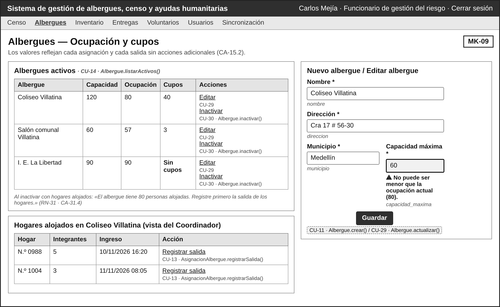

*Nota.* Bajo cada botón se indica el caso de uso y el método que llama; bajo cada campo, el atributo del diccionario. Elaboración propia.

**Tabla 171**  
*Ficha del mockup MK-09*

<table>
<colgroup>
<col style="width: 22%" />
<col style="width: 77%" />
</colgroup>
<thead>
<tr class="header">
<th><strong>Código</strong></th>
<th><strong>MK-09</strong></th>
</tr>
</thead>
<tbody>
<tr class="odd">
<td><strong>Pantalla</strong></td>
<td>Albergues — Ocupación, cupos y formulario</td>
</tr>
<tr class="even">
<td><strong>Atiende (HU / CU)</strong></td>
<td>HU-15 / CU-14; HU-12 / CU-11; HU-30 / CU-29; HU-31 / CU-30; HU-14 / CU-13</td>
</tr>
<tr class="odd">
<td><strong>Campos ↔︎ diccionario</strong></td>
<td>Tabla: nombre, municipio, capacidad_maxima; ocupación y cupos calculados. Formulario: nombre, direccion, municipio, capacidad_maxima. Hogares alojados: id_hogar, integrantes, fecha_ingreso</td>
</tr>
<tr class="even">
<td><strong>Botones ↔︎ eventos</strong></td>
<td>
<strong>Guardar</strong> → CU-11 / CU-29 · Albergue.crear() o Albergue.actualizar() (RF-17, RF-40)

<strong>Editar (fila)</strong> → CU-29 · carga el formulario con los datos (RF-40)

<strong>Inactivar (fila)</strong> → CU-30 · Albergue.inactivar(), con aviso de consecuencia (RF-41)

<strong>Registrar salida (fila de hogar)</strong> → CU-13 · AsignacionAlbergue.registrarSalida() (RF-20)

<strong>Tabla</strong> → CU-14 · Albergue.listarActivos(), ocupacionActual(), cuposDisponibles() (RF-21)
</td>
</tr>
<tr class="odd">
<td><strong>RN visibles</strong></td>
<td>RN-11 (capacidad mayor que cero), RN-32 (capacidad no menor que la ocupación), RN-31 (no se inactiva un albergue con hogares alojados), RN-14 (ocupación y cupos calculados), RN-16 (la salida la registra el Coordinador de ese albergue)</td>
</tr>
</tbody>
</table>

*Nota.* Elaboración propia.

La Figura 22 presenta la pantalla MK-10 y la Tabla 172 la describe.

**Figura 22**  
*MK-10: Inventario — Tipos de ayuda y existencias*

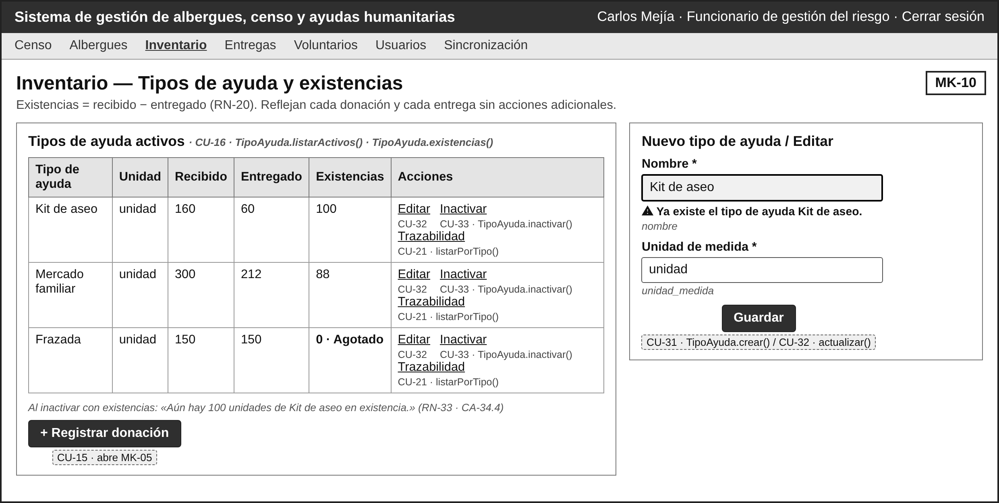

*Nota.* Bajo cada botón se indica el caso de uso y el método que llama; bajo cada campo, el atributo del diccionario. Elaboración propia.

**Tabla 172**  
*Ficha del mockup MK-10*

<table>
<colgroup>
<col style="width: 22%" />
<col style="width: 77%" />
</colgroup>
<thead>
<tr class="header">
<th><strong>Código</strong></th>
<th><strong>MK-10</strong></th>
</tr>
</thead>
<tbody>
<tr class="odd">
<td><strong>Pantalla</strong></td>
<td>Inventario — Tipos de ayuda y existencias</td>
</tr>
<tr class="even">
<td><strong>Atiende (HU / CU)</strong></td>
<td>HU-17 / CU-16; HU-32 / CU-31; HU-33 / CU-32; HU-34 / CU-33; HU-23 / CU-21; da entrada a CU-15</td>
</tr>
<tr class="odd">
<td><strong>Campos ↔︎ diccionario</strong></td>
<td>Tabla: TIPO_AYUDA.nombre, unidad_medida; recibido, entregado y existencias son valores calculados (RN-20). Formulario: nombre, unidad_medida</td>
</tr>
<tr class="even">
<td><strong>Botones ↔︎ eventos</strong></td>
<td>
<strong>Guardar</strong> → CU-31 / CU-32 · TipoAyuda.crear() o TipoAyuda.actualizar(); antes llama a TipoAyuda.existeNombre() (RF-42, RF-43)

<strong>Editar (fila)</strong> → CU-32 · carga el formulario con los datos (RF-43)

<strong>Inactivar (fila)</strong> → CU-33 · TipoAyuda.inactivar(), con aviso de consecuencia (RF-44)

<strong>Trazabilidad (fila)</strong> → CU-21 · Donacion.listarPorTipo() y Entrega.listarPorTipo() (RF-32)

<strong>+ Registrar donación</strong> → CU-15 · abre MK-05 (RF-22)

<strong>Tabla</strong> → CU-16 · TipoAyuda.listarActivos() y TipoAyuda.existencias() (RF-24)
</td>
</tr>
<tr class="odd">
<td><strong>RN visibles</strong></td>
<td>RN-19 (nombre de tipo de ayuda único), RN-20 (existencias calculadas), RN-33 (no se inactiva un tipo con existencias), RN-27 (aviso de inactivación)</td>
</tr>
</tbody>
</table>

*Nota.* Elaboración propia.

La Figura 23 presenta la pantalla MK-11 y la Tabla 173 la describe.

**Figura 23**  
*MK-11: Voluntarios — Listado y formulario*

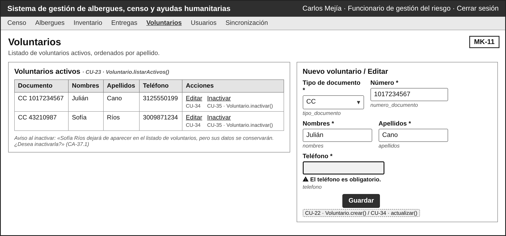

*Nota.* Bajo cada botón se indica el caso de uso y el método que llama; bajo cada campo, el atributo del diccionario. Elaboración propia.

**Tabla 173**  
*Ficha del mockup MK-11*

<table>
<colgroup>
<col style="width: 22%" />
<col style="width: 77%" />
</colgroup>
<thead>
<tr class="header">
<th><strong>Código</strong></th>
<th><strong>MK-11</strong></th>
</tr>
</thead>
<tbody>
<tr class="odd">
<td><strong>Pantalla</strong></td>
<td>Voluntarios — Listado y formulario</td>
</tr>
<tr class="even">
<td><strong>Atiende (HU / CU)</strong></td>
<td>HU-35 / CU-23; HU-24 / CU-22; HU-36 / CU-34; HU-37 / CU-35</td>
</tr>
<tr class="odd">
<td><strong>Campos ↔︎ diccionario</strong></td>
<td>Tabla y formulario: tipo_documento (ENUM, lista), numero_documento, nombres, apellidos, telefono</td>
</tr>
<tr class="even">
<td><strong>Botones ↔︎ eventos</strong></td>
<td>
<strong>Guardar</strong> → CU-22 / CU-34 · Voluntario.crear() o Voluntario.actualizar() (RF-33, RF-45)

<strong>Editar (fila)</strong> → CU-34 · carga el formulario con los datos (RF-45)

<strong>Inactivar (fila)</strong> → CU-35 · Voluntario.inactivar(), con aviso de consecuencia (RF-46)

<strong>Listado</strong> → CU-23 · Voluntario.listarActivos() (RF-34)
</td>
</tr>
<tr class="odd">
<td><strong>RN visibles</strong></td>
<td>RN-06 (asteriscos: datos obligatorios), RN-27 (aviso de inactivación que explica la consecuencia)</td>
</tr>
</tbody>
</table>

*Nota.* Elaboración propia.

La Figura 24 presenta la pantalla MK-12 y la Tabla 174 la describe.

**Figura 24**  
*MK-12: Inicio de sesión*

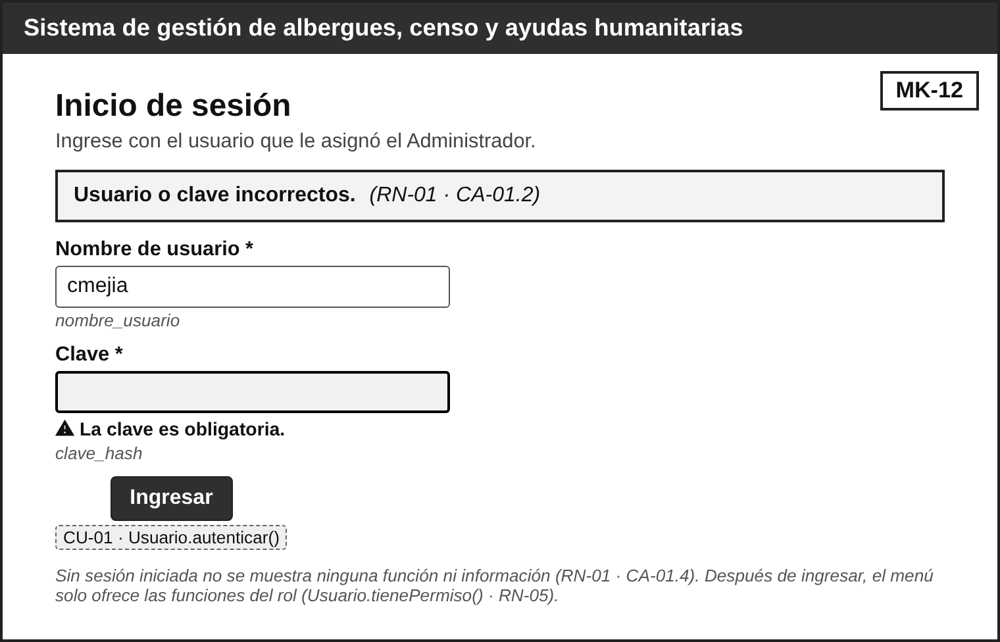

*Nota.* Bajo cada botón se indica el caso de uso y el método que llama; bajo cada campo, el atributo del diccionario. Elaboración propia.

**Tabla 174**  
*Ficha del mockup MK-12*

| **Código**               | **MK-12**                                                                                                                                    |
|--------------------------|----------------------------------------------------------------------------------------------------------------------------------------------|
| **Pantalla**             | Inicio de sesión                                                                                                                             |
| **Atiende (HU / CU)**    | HU-01 y HU-03 / CU-01                                                                                                                        |
| **Campos ↔ diccionario** | nombre_usuario y clave (se compara con clave_hash)                                                                                           |
| **Botones ↔ eventos**    | **Ingresar** → CU-01 · Usuario.autenticar(); después Usuario.tienePermiso() decide las funciones que se ofrecen (RF-01, RF-02, RF-05, RF-06) |
| **RN visibles**          | RN-01 (solo usuarios activos con sesión), RN-06 (dato faltante), RN-34 (usuario inactivo), RN-05 (funciones según el rol)                    |

*Nota.* Elaboración propia.

### 2.5.1 Cobertura de los métodos en las pantallas

La Tabla 175 hace la verificación en reversa: cada uno de los 47 métodos públicos del diagrama de clases aterriza en un botón o en un elemento de alguna pantalla, o queda declarado como interno porque se dispara dentro de otro. No hay métodos sin pantalla ni botones sin caso de uso.

**Tabla 175**  
*Cobertura de los métodos del diagrama de clases en los mockups*

| **Método**                           | **Padre (HU / RF)**                                     | **CRUD**         | **Dónde aterriza**                                                                           |
|--------------------------------------|---------------------------------------------------------|------------------|----------------------------------------------------------------------------------------------|
| Usuario.autenticar()                 | HU-01 / RF-01, RF-02                                    | Acceso           | MK-12: Ingresar                                                                              |
| Usuario.tienePermiso()               | HU-01, HU-02, HU-03, HU-25 / RF-05, RF-06               | Apoyo            | Interno: se dispara dentro de otra operación. MK-12: Ingresar                                |
| Usuario.crear()                      | HU-02 / RF-03                                           | C                | MK-08: Guardar                                                                               |
| Usuario.existeNombreUsuario()        | HU-02, HU-26 / RF-04                                    | Apoyo            | Interno: se dispara dentro de otra operación. MK-08: Guardar                                 |
| Usuario.listarActivos()              | HU-25 / RF-35                                           | R                | MK-08: Listado                                                                               |
| Usuario.actualizar()                 | HU-26 / RF-36                                           | U                | MK-08: Guardar                                                                               |
| Usuario.inactivar()                  | HU-27 / RF-37                                           | D lógico         | MK-08: Inactivar (fila)                                                                      |
| Hogar.crear()                        | HU-04 / RF-07                                           | C                | MK-01: + Nuevo hogar                                                                         |
| Hogar.buscarPorDocumento()           | HU-04, HU-08, HU-22 / RF-11                             | R                | MK-01: Buscar                                                                                |
| Hogar.actualizar()                   | HU-09 / RF-12                                           | U                | MK-01: Editar hogar                                                                          |
| Hogar.inactivar()                    | HU-29 / RF-39                                           | D lógico         | MK-01: Inactivar hogar; MK-07: Sí, inactivar                                                 |
| Hogar.totalIntegrantes()             | HU-05, HU-13, HU-28 / RF-08, RF-18                      | Apoyo            | Interno: se dispara dentro de otra operación.                                                |
| Hogar.guardarLocal()                 | HU-10 / RF-13                                           | C (sin conexión) | MK-03: Guardar sin conexión                                                                  |
| Hogar.contarPorEstado()              | HU-10, HU-11 / RF-14                                    | R                | MK-03: Actualizar conteo                                                                     |
| Hogar.sincronizarPendientes()        | HU-11 / RF-15, RF-16                                    | U                | MK-03: Sincronizar ahora                                                                     |
| Integrante.crear()                   | HU-05 / RF-08                                           | C                | MK-02: Guardar                                                                               |
| Integrante.existeDocumento()         | HU-06, HU-09, HU-11 / RF-09, RF-16                      | Apoyo            | Interno: se dispara dentro de otra operación. MK-02: Guardar                                 |
| Integrante.buscarPorDocumento()      | HU-18, HU-19 / RF-25                                    | R                | MK-06: Verificar                                                                             |
| Integrante.actualizar()              | HU-09 / RF-12                                           | U                | MK-02: Guardar                                                                               |
| Integrante.asignarCondiciones()      | HU-07 / RF-10                                           | U                | MK-02: Guardar (condiciones)                                                                 |
| Integrante.inactivar()               | HU-28 / RF-38                                           | D lógico         | MK-01: Inactivar (fila)                                                                      |
| Albergue.crear()                     | HU-12 / RF-17                                           | C                | MK-09: Guardar                                                                               |
| Albergue.listarActivos()             | HU-15 / RF-21                                           | R                | MK-04: se muestra en la pantalla; MK-09: Tabla                                               |
| Albergue.ocupacionActual()           | HU-15, HU-30, HU-31 / RF-21, RF-41                      | Apoyo            | Interno: se dispara dentro de otra operación. MK-04: se muestra en la pantalla; MK-09: Tabla |
| Albergue.cuposDisponibles()          | HU-13, HU-15, HU-30 / RF-19, RF-21                      | Apoyo            | Interno: se dispara dentro de otra operación. MK-04: Asignar; MK-09: Tabla                   |
| Albergue.actualizar()                | HU-30 / RF-40                                           | U                | MK-09: Guardar                                                                               |
| Albergue.inactivar()                 | HU-31 / RF-41                                           | D lógico         | MK-07: Sí, inactivar; MK-09: Inactivar (fila)                                                |
| AsignacionAlbergue.asignar()         | HU-13, HU-14 / RF-18                                    | C                | MK-04: Asignar                                                                               |
| AsignacionAlbergue.registrarSalida() | HU-14 / RF-20                                           | U                | MK-09: Registrar salida (fila de hogar)                                                      |
| AsignacionAlbergue.albergueActual()  | HU-08, HU-13, HU-29 / RF-11, RF-18, RF-39               | R (apoyo)        | MK-01: se muestra en la pantalla; MK-04: Asignar; MK-07: Sí, inactivar                       |
| TipoAyuda.crear()                    | HU-32 / RF-42                                           | C                | MK-10: Guardar                                                                               |
| TipoAyuda.existeNombre()             | HU-16, HU-32, HU-33 / RF-23, RF-42, RF-43               | Apoyo            | Interno: se dispara dentro de otra operación. MK-10: Guardar                                 |
| TipoAyuda.listarActivos()            | HU-17 / RF-24                                           | R                | MK-10: Tabla                                                                                 |
| TipoAyuda.existencias()              | HU-16, HU-17, HU-20, HU-23, HU-34 / RF-24, RF-27, RF-44 | Apoyo            | Interno: se dispara dentro de otra operación. MK-05: se muestra en la pantalla; MK-10: Tabla |
| TipoAyuda.hayExistencias()           | HU-20 / RF-28                                           | Apoyo            | Interno: se dispara dentro de otra operación. MK-06: Registrar entrega                       |
| TipoAyuda.actualizar()               | HU-33 / RF-43                                           | U                | MK-10: Guardar                                                                               |
| TipoAyuda.inactivar()                | HU-34 / RF-44                                           | D lógico         | MK-10: Inactivar (fila)                                                                      |
| Donacion.registrar()                 | HU-16 / RF-22, RF-23                                    | C                | MK-05: Guardar                                                                               |
| Donacion.listarPorTipo()             | HU-23 / RF-32                                           | R                | MK-10: Trazabilidad (fila)                                                                   |
| Entrega.registrar()                  | HU-19, HU-20 / RF-26, RF-27                             | C                | MK-06: Registrar entrega                                                                     |
| Entrega.capturarFirma()              | HU-21 / RF-29, RF-30                                    | Apoyo            | Interno: se dispara dentro de otra operación. MK-06: Capturar firma                          |
| Entrega.listarPorHogar()             | HU-22 / RF-31                                           | R                | MK-01: Historial de entregas                                                                 |
| Entrega.listarPorTipo()              | HU-23 / RF-32                                           | R                | MK-10: Trazabilidad (fila)                                                                   |
| Voluntario.crear()                   | HU-24 / RF-33                                           | C                | MK-11: Guardar                                                                               |
| Voluntario.listarActivos()           | HU-35 / RF-34                                           | R                | MK-11: Listado                                                                               |
| Voluntario.actualizar()              | HU-36 / RF-45                                           | U                | MK-11: Guardar                                                                               |
| Voluntario.inactivar()               | HU-37 / RF-46                                           | D lógico         | MK-11: Inactivar (fila)                                                                      |

*Nota.* Los métodos de apoyo no necesitan botón propio: los ejecuta la operación que los requiere. Elaboración propia.
