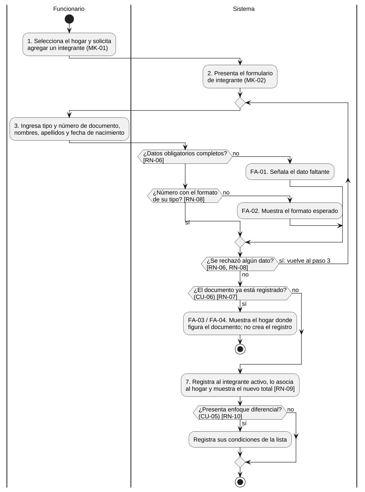
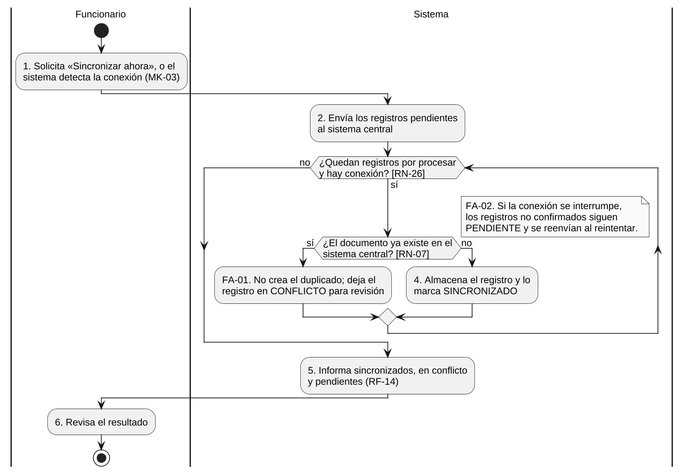
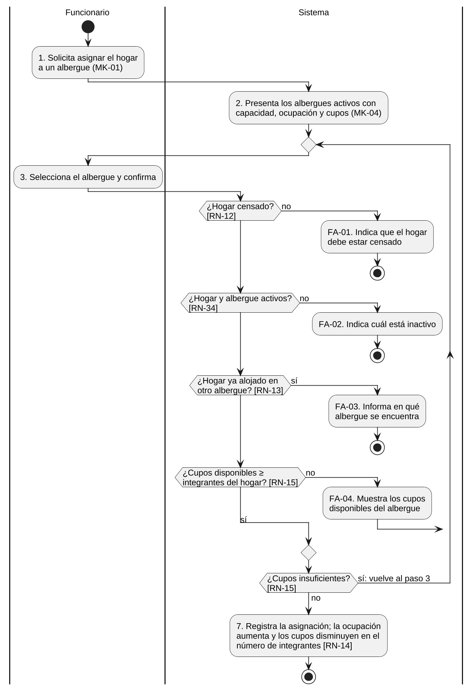
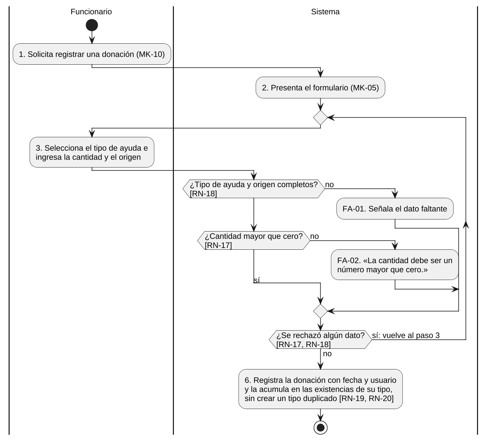
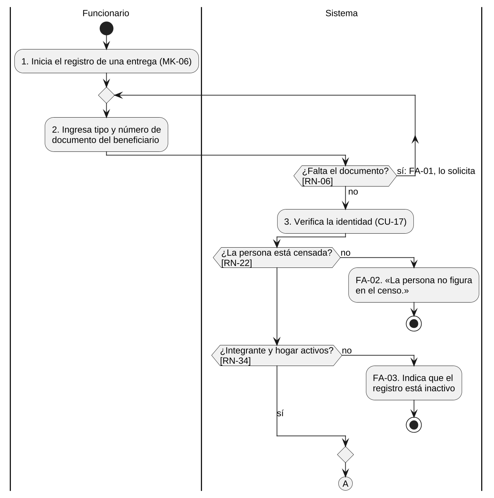
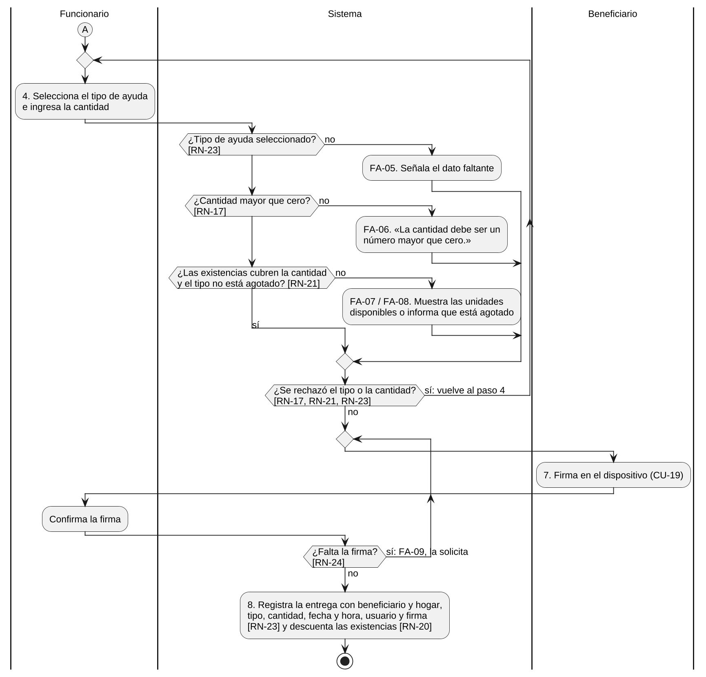
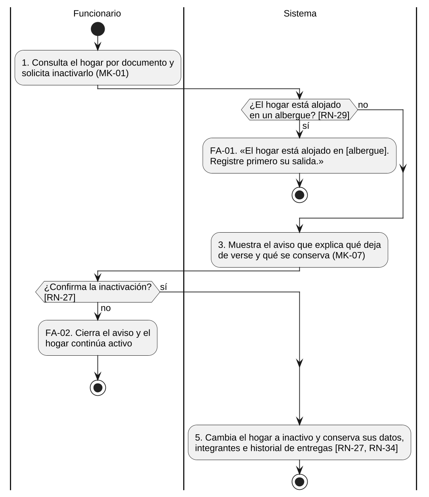

> Versión 1.2 (12 de noviembre de 2026). Las tablas y figuras conservan la numeración del documento Word de docs/entregas.

## 3.3 Diagramas de actividades

Se elaboró un diagrama de actividades por cada caso de uso documentado en la sección 2.4. Los carriles separan lo que hace cada actor de lo que hace el sistema; los números de las acciones son los pasos del flujo básico, y las acciones que empiezan con FA son los flujos alternativos. La regla del curso se cumple en todos: cada rombo de decisión cita entre corchetes la regla de negocio que decide el camino. Los rombos que devuelven el flujo a un paso anterior corresponden a los flujos alternativos que dicen «vuelve al paso n».

**Figura 25**  
*Diagrama de actividades de CU-04: Registrar integrante del hogar*

*Nota.* Flujo básico y flujos alternativos de la Tabla 157. Elaboración propia.

**Figura 26**  
*Diagrama de actividades de CU-10: Sincronizar registros pendientes*

*Nota.* Flujo básico y flujos alternativos de la Tabla 158. Elaboración propia.

**Figura 27**  
*Diagrama de actividades de CU-12: Asignar hogar a un albergue*

*Nota.* Flujo básico y flujos alternativos de la Tabla 159. Elaboración propia.

**Figura 28**  
*Diagrama de actividades de CU-15: Registrar donación recibida*

*Nota.* Flujo básico y flujos alternativos de la Tabla 160. Elaboración propia.

**Figura 29**  
*Diagrama de actividades de CU-18: Registrar entrega de ayuda a un hogar (parte 1 de 2: verificación de identidad)*

*Nota.* El conector A continúa en la Figura 30. Flujo básico y flujos alternativos de la Tabla 161. Elaboración propia.

**Figura 30**  
*Diagrama de actividades de CU-18: Registrar entrega de ayuda a un hogar (parte 2 de 2: ayuda, existencias y firma)*

*Nota.* Continúa desde el conector A de la Figura 29. Elaboración propia.

**Figura 31**  
*Diagrama de actividades de CU-28: Inactivar hogar*

*Nota.* Flujo básico y flujos alternativos de la Tabla 162. Elaboración propia.
