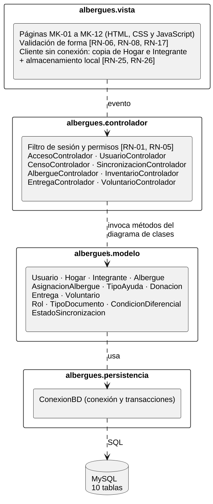
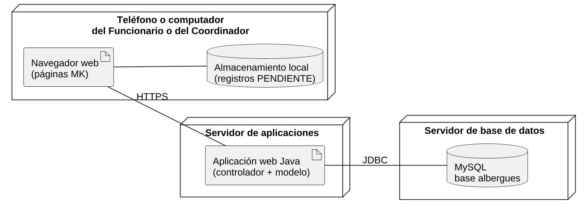

> Versión 1.2 (12 de noviembre de 2026). Las tablas y figuras conservan la numeración del documento Word de docs/entregas.

## 3.4 Documento de diseño arquitectónico

El documento de diseño arquitectónico (DDA) fija las decisiones que condicionan la construcción. El sistema es una aplicación web organizada en capas con el patrón Modelo-Vista-Controlador (MVC): la vista son las pantallas de los mockups, el controlador atiende los eventos de cada caso de uso y el modelo son las clases del diagrama de clases, que acceden a la base de datos por medio de la capa de persistencia.

### 3.4.1 Decisiones de arquitectura

**Tabla 183**  
*Decisiones de arquitectura y requisitos que las motivan*

| **Código** | **Decisión**                                                            | **Justificación**                                                                                                                                                                                                                                         | **Origen**                                                              |
|------------|-------------------------------------------------------------------------|-----------------------------------------------------------------------------------------------------------------------------------------------------------------------------------------------------------------------------------------------------------|-------------------------------------------------------------------------|
| DA-01      | Arquitectura por capas con el patrón MVC.                               | Separa las pantallas (MK) de las reglas de negocio y de la base de datos, de modo que cada capa se traza a su artefacto de análisis: vista → mockups, controlador → casos de uso, modelo → diagrama de clases.                                            | Ruta del curso; RNF-08                                                  |
| DA-02      | Aplicación web adaptable, usada desde el navegador.                     | El personal de campo usa teléfonos con navegador (supuesto de la sección 1.2); no se instala nada en el dispositivo.                                                                                                                                      | RNF-07                                                                  |
| DA-03      | Base de datos relacional MySQL; tipos Java en el modelo.                | El diccionario ya usa tipos ENUM, VARCHAR y DATETIME de MySQL y tipos Java; las llaves únicas y las restricciones CHECK hacen cumplir reglas en la base de datos.                                                                                         | RN-02, RN-07, RN-11, RN-17, RN-19; RNF-04                               |
| DA-04      | Operación sin conexión con almacenamiento local en el navegador.        | El cliente guarda los hogares e integrantes en estado PENDIENTE y los envía al recuperar la conexión; el servidor confirma registro por registro, así una interrupción no pierde ni duplica datos.                                                        | RN-25, RN-26; RNF-05, RNF-06                                            |
| DA-05      | Validación en dos niveles.                                              | La vista valida la forma (datos obligatorios, formato del documento, cantidades positivas) sin acceder a los datos, también sin conexión. El modelo valida las reglas que necesitan datos: documento único, cupos, existencias, estados activos.          | RN-06, RN-08, RN-17 (vista); RN-07, RN-13, RN-15, RN-21, RN-34 (modelo) |
| DA-06      | Control de acceso centralizado en el controlador.                       | Un filtro verifica la sesión y el permiso del rol antes de atender cualquier evento; la clave se guarda como hash.                                                                                                                                        | RN-01, RN-04, RN-05; RNF-01, RNF-02                                     |
| DA-07      | Datos de trazabilidad asignados por el sistema; existencias calculadas. | Las fechas y el usuario responsable no los digita nadie; las existencias se calculan como recibido menos entregado y no se almacenan, por lo que no pueden quedar desactualizadas.                                                                        | RN-20, RN-23; RNF-03, RNF-04                                            |
| DA-08      | Ninguna operación borra registros.                                      | Las bajas cambian el atributo activo a FALSE y las llaves foráneas se definen sin borrado en cascada.                                                                                                                                                     | RN-27                                                                   |
| DA-09      | Servidor HTTP incorporado en el JDK, sin frameworks.                    | El primer corte se ejecuta con Java 21 y solo dos dependencias externas: el conector de MySQL y, para las pruebas, H2 y JUnit. Así cada clase del código corresponde a un elemento del DDA o del diagrama de clases, sin capas añadidas por un framework. | RNF-07; alcance del curso                                               |

*Nota.* Herramientas fijadas en la Fase 3: Java 21, MySQL 8 con el conector mysql-connector-j 8.4, el servidor HTTP del JDK y, para las pruebas, H2 2.2 en modo MySQL y JUnit 5. Elaboración propia.

### 3.4.2 Vista lógica: paquetes

La Figura 32 presenta los cuatro paquetes y sus dependencias. Las dependencias van en un solo sentido: la vista conoce al controlador, el controlador al modelo y el modelo a la persistencia; ninguna capa inferior conoce a una superior. La Tabla 184 traza cada paquete a los artefactos del análisis que lo definen.

**Figura 32**  
*Diagrama de paquetes de la arquitectura MVC*

*Nota.* Las flechas discontinuas son dependencias. Elaboración propia.

**Tabla 184**  
*Paquetes de la arquitectura y artefactos que los definen*

| **Paquete**            | **Contenido**                                            | **Responsabilidad**                                                                                                                                    | **Se traza a**                              |
|------------------------|----------------------------------------------------------|--------------------------------------------------------------------------------------------------------------------------------------------------------|---------------------------------------------|
| albergues.vista        | Doce páginas, validación de forma y cliente sin conexión | Presentar las pantallas, capturar los eventos y validar la forma de los datos (DA-05); guardar y contar los registros pendientes sin conexión (DA-04). | MK-01 a MK-12; RN-06, RN-08, RN-17, RN-25   |
| albergues.controlador  | Ocho controladores y el filtro de sesión                 | Recibir cada evento, verificar sesión y permisos (DA-06), invocar los métodos del modelo y devolver el resultado a la vista.                           | Casos de uso (2.3); matriz de permisos      |
| albergues.modelo       | Nueve clases y cuatro enumeraciones                      | Hacer cumplir las reglas que requieren datos y ejecutar las operaciones del negocio.                                                                   | Diagrama de clases (1.8.3); métodos (1.8.4) |
| albergues.persistencia | Conexión y transacciones                                 | Abrir conexiones y agrupar en una transacción las operaciones que deben ser atómicas, como registrar una entrega.                                      | Modelo relacional (3.1); RNF-04             |

*Nota.* Elaboración propia.

La Tabla 185 lista los controladores. Cada uno atiende los eventos de los botones de sus pantallas; los eventos no son métodos del diagrama de clases, por eso en los diagramas de secuencia se marcan con el estereotipo «evento».

**Tabla 185**  
*Controladores, casos de uso que atienden y métodos del modelo que invocan*

| **Controlador**           | **Casos de uso**                   | **Pantallas**       | **Métodos del modelo que invoca**                                                  |
|---------------------------|------------------------------------|---------------------|------------------------------------------------------------------------------------|
| AccesoControlador         | CU-01                              | MK-12               | Usuario.autenticar(), Usuario.tienePermiso()                                       |
| UsuarioControlador        | CU-02, CU-24 a CU-26               | MK-08               | Usuario.crear(), existeNombreUsuario(), listarActivos(), actualizar(), inactivar() |
| CensoControlador          | CU-03 a CU-08, CU-27, CU-28        | MK-01, MK-02, MK-07 | Hogar e Integrante (crear, buscar, actualizar, inactivar, verificar documento)     |
| SincronizacionControlador | CU-09, CU-10                       | MK-03               | Integrante.existeDocumento(), Hogar.crear(), Integrante.crear()                    |
| AlbergueControlador       | CU-11 a CU-14, CU-29, CU-30        | MK-04, MK-09        | Albergue y AsignacionAlbergue                                                      |
| InventarioControlador     | CU-15, CU-16, CU-21, CU-31 a CU-33 | MK-05, MK-10        | TipoAyuda y Donacion; Entrega.listarPorTipo()                                      |
| EntregaControlador        | CU-17 a CU-20                      | MK-06, MK-01        | Integrante.buscarPorDocumento(), TipoAyuda.hayExistencias(), Entrega               |
| VoluntarioControlador     | CU-22, CU-23, CU-34, CU-35         | MK-11               | Voluntario (crear, listar, actualizar, inactivar)                                  |

*Nota.* Elaboración propia.

### 3.4.3 Vista física: despliegue

La Figura 33 presenta los tres nodos. El dispositivo del usuario ejecuta las páginas y guarda localmente los registros hechos sin conexión; el servidor de aplicaciones ejecuta el controlador y el modelo; el servidor de base de datos aloja las diez tablas. La comunicación con el servidor usa HTTPS, porque circulan datos personales (RNF-02).

**Figura 33**  
*Diagrama de despliegue*

*Nota.* Elaboración propia.
