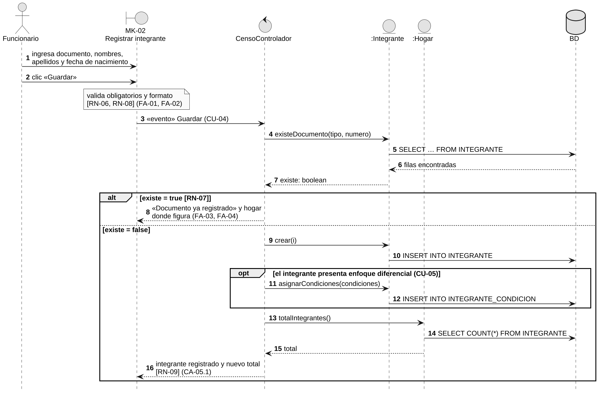
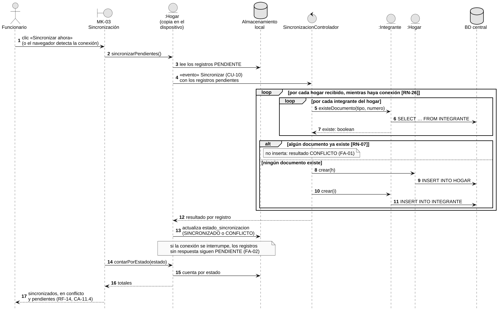
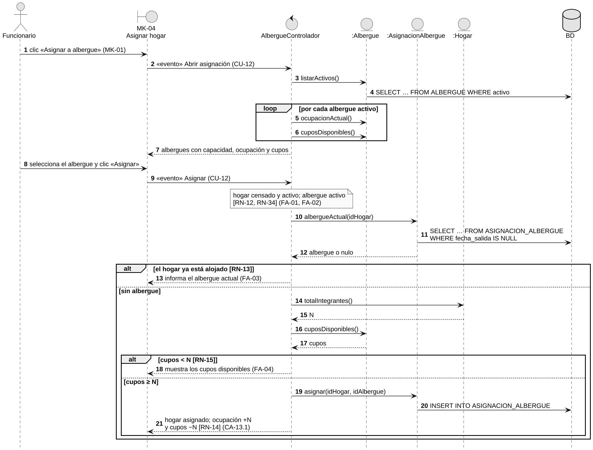
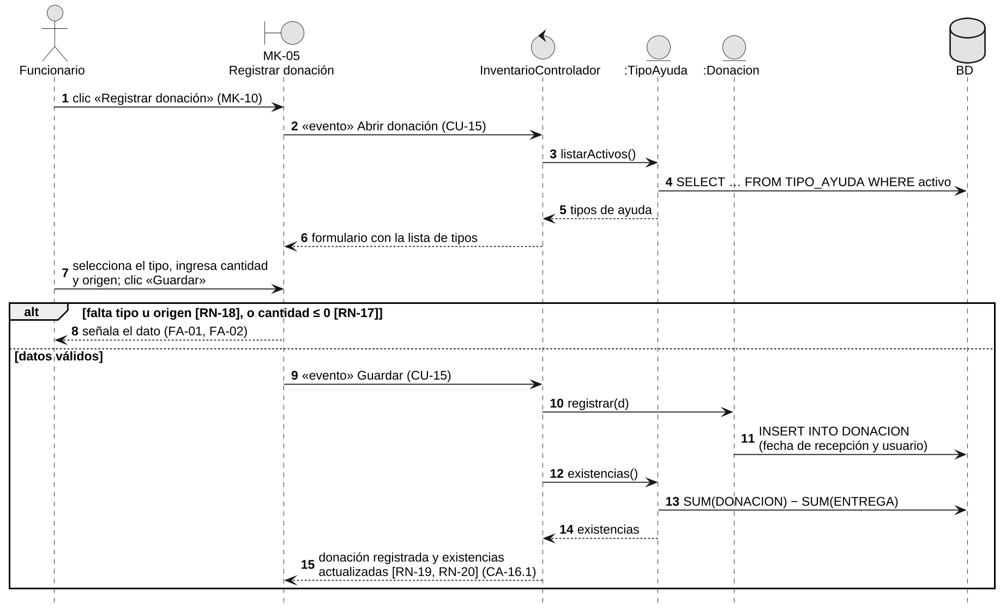
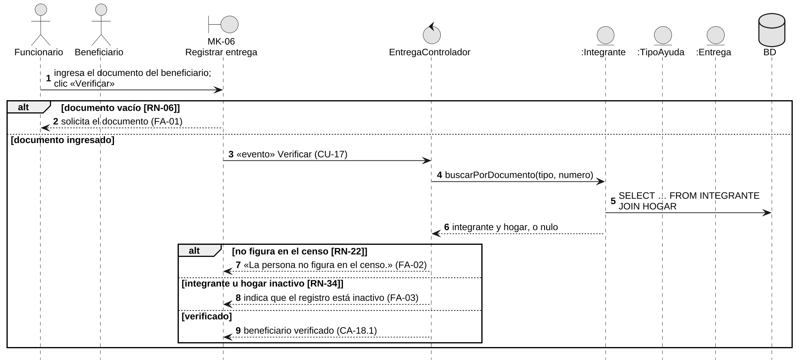
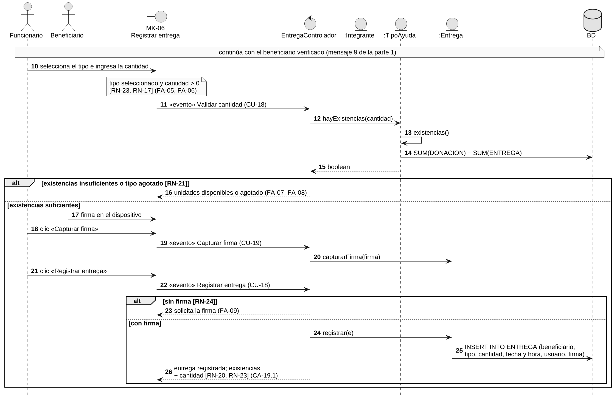
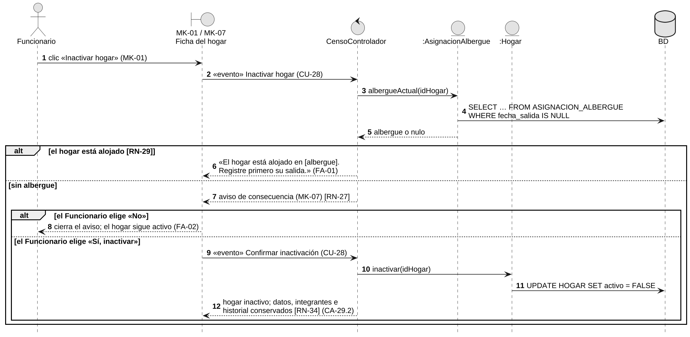

> Versión 1.2 (12 de noviembre de 2026). Las tablas y figuras conservan la numeración del documento Word de docs/entregas.

## 3.5 Diagramas de secuencia

Se elaboró un diagrama de secuencia (DS) por cada caso de uso documentado. Los participantes siguen las capas del DDA: el actor, la pantalla (frontera), el controlador (control), los objetos del modelo (entidad) y la base de datos. Los mensajes van numerados para que la matriz de la sección 3.7 pueda citarlos.

Se aplicó la regla de oro del curso: ningún mensaje invoca un método que no exista en el diagrama de clases. Los mensajes hacia una entidad usan exactamente el nombre y los parámetros de su firma; los mensajes de la pantalla al controlador son eventos de botón, marcados con «evento»; los mensajes hacia la base de datos son sentencias SQL sobre las tablas del modelo relacional. Las validaciones de forma aparecen como notas sobre la pantalla, porque las ejecuta la vista (DA-05).

**Figura 34**  
*DS-04. Diagrama de secuencia de CU-04: Registrar integrante del hogar*

*Nota.* Pasos del flujo básico y flujos alternativos de la Tabla 157. Elaboración propia.

**Figura 35**  
*DS-10. Diagrama de secuencia de CU-10: Sincronizar registros pendientes*

*Nota.* Pasos del flujo básico y flujos alternativos de la Tabla 158. Elaboración propia.

**Figura 36**  
*DS-12. Diagrama de secuencia de CU-12: Asignar hogar a un albergue*

*Nota.* Pasos del flujo básico y flujos alternativos de la Tabla 159. Elaboración propia.

**Figura 37**  
*DS-15. Diagrama de secuencia de CU-15: Registrar donación recibida*

*Nota.* Pasos del flujo básico y flujos alternativos de la Tabla 160. Elaboración propia.

**Figura 38**  
*DS-18. Diagrama de secuencia de CU-18: Registrar entrega de ayuda a un hogar (parte 1 de 2: verificación de identidad)*

*Nota.* Continúa en la Figura 39. Pasos del flujo básico y flujos alternativos de la Tabla 161. Elaboración propia.

**Figura 39**  
*DS-18. Diagrama de secuencia de CU-18: Registrar entrega de ayuda a un hogar (parte 2 de 2: existencias, firma y registro)*

*Nota.* La numeración continúa la de la Figura 38. Elaboración propia.

**Figura 40**  
*DS-28. Diagrama de secuencia de CU-28: Inactivar hogar*

*Nota.* Pasos del flujo básico y flujos alternativos de la Tabla 162. Elaboración propia.

La Tabla 186 resume la verificación: los 27 mensajes que invocan un método del modelo usan 21 métodos distintos, y todos existen en el diagrama de clases.

**Tabla 186**  
*Verificación de la regla de oro en los diagramas de secuencia*

| **DS** | **CU** | **Mensajes a métodos** | **Métodos invocados**                                                                                                                                                          | **Resultado** |
|--------|--------|------------------------|--------------------------------------------------------------------------------------------------------------------------------------------------------------------------------|---------------|
| DS-04  | CU-04  | 5                      | Integrante.existeDocumento(), Hogar.buscarPorDocumento(), Integrante.crear(), Integrante.asignarCondiciones(), Hogar.totalIntegrantes()                                        | Cumple        |
| DS-10  | CU-10  | 5                      | Hogar.sincronizarPendientes(), Integrante.existeDocumento(), Hogar.crear(), Integrante.crear(), Hogar.contarPorEstado()                                                        | Cumple        |
| DS-12  | CU-12  | 7                      | Albergue.listarActivos(), Albergue.ocupacionActual(), Albergue.cuposDisponibles(), AsignacionAlbergue.albergueActual(), Hogar.totalIntegrantes(), AsignacionAlbergue.asignar() | Cumple        |
| DS-15  | CU-15  | 3                      | TipoAyuda.listarActivos(), Donacion.registrar(), TipoAyuda.existencias()                                                                                                       | Cumple        |
| DS-18  | CU-18  | 5                      | Integrante.buscarPorDocumento(), TipoAyuda.hayExistencias(), TipoAyuda.existencias(), Entrega.capturarFirma(), Entrega.registrar()                                             | Cumple        |
| DS-28  | CU-28  | 2                      | AsignacionAlbergue.albergueActual(), Hogar.inactivar()                                                                                                                         | Cumple        |

*Nota.* Elaboración propia.
