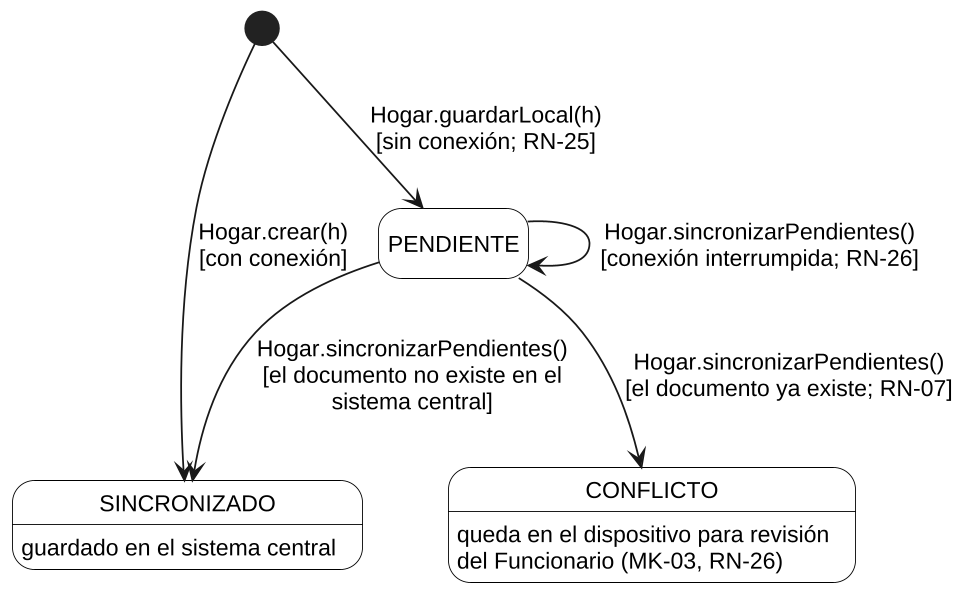
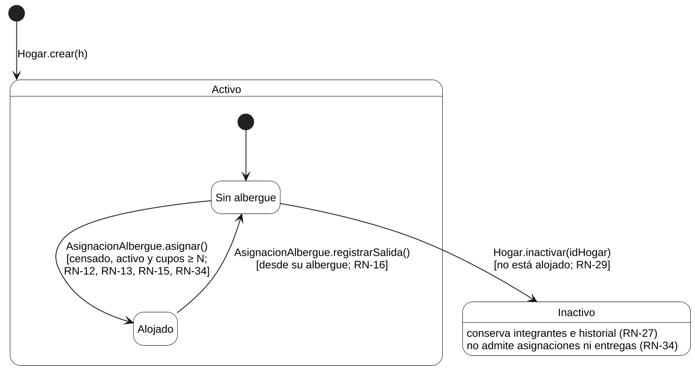
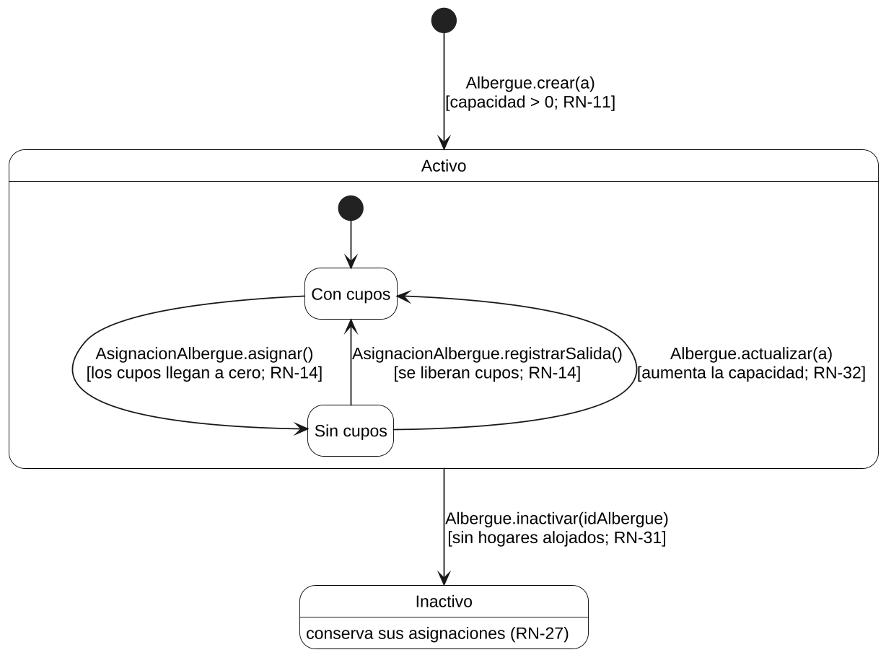
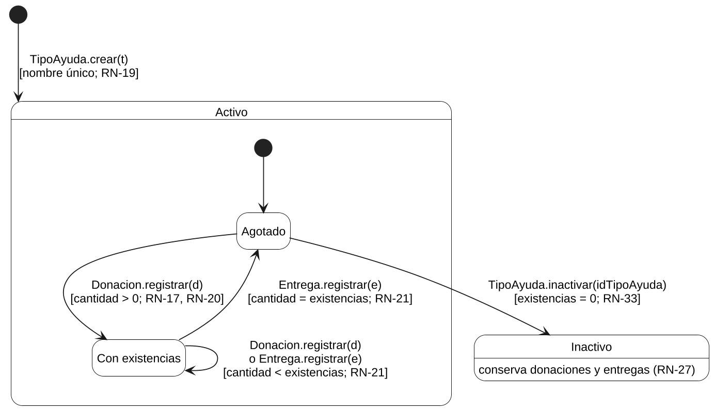

> Versión 1.2 (12 de noviembre de 2026). Las tablas y figuras conservan la numeración del documento Word de docs/entregas.

## 3.6 Diagramas de estados

Los diagramas de estados describen los objetos cuyo comportamiento depende de su estado. El único ENUM del modelo con transiciones es EstadoSincronizacion (Figura 41); las otras tres enumeraciones (Rol, TipoDocumento y CondicionDiferencial) son catálogos: su valor se elige al crear o actualizar el registro y no evoluciona. Se agregan los ciclos de vida del hogar, del albergue y del tipo de ayuda, porque sus estados derivados (alojado, sin cupos, agotado) gobiernan las reglas de los casos de uso críticos. Cada transición nombra el método del diagrama de clases que la produce y, entre corchetes, la condición y la regla de negocio.

**Figura 41**  
*Estados de sincronización de un hogar (ENUM EstadoSincronizacion)*

*Nota.* La salida del estado CONFLICTO no está definida en las historias de usuario: el Funcionario revisa el registro desde MK-03. Queda como punto por validar en la sección 3.8. Elaboración propia.

**Figura 42**  
*Ciclo de vida de un hogar: alojamiento e inactivación*

*Nota.* Elaboración propia.

**Figura 43**  
*Ciclo de vida de un albergue: cupos e inactivación*

*Nota.* Elaboración propia.

**Figura 44**  
*Ciclo de vida de un tipo de ayuda: existencias e inactivación*

*Nota.* Elaboración propia.

La Tabla 187 completa los ciclos de vida de las clases que solo tienen la transición de activo a inactivo, por lo que no requieren un diagrama propio.

**Tabla 187**  
*Transiciones de activo a inactivo de las demás clases*

| **Clase**  | **Método que la produce**          | **Condición**                                       | **Consecuencia**                                            |
|------------|------------------------------------|-----------------------------------------------------|-------------------------------------------------------------|
| Usuario    | Usuario.inactivar(idUsuario)       | Queda al menos otro Administrador activo (RN-28)    | No inicia sesión; sus registros se conservan (RN-34, RN-27) |
| Integrante | Integrante.inactivar(idIntegrante) | No es el último integrante activo del hogar (RN-30) | No recibe entregas; conserva su historial (RN-34, RN-27)    |
| Voluntario | Voluntario.inactivar(idVoluntario) | Ninguna adicional                                   | Sale del listado; sus datos se conservan (RN-27)            |

*Nota.* Donacion, Entrega y AsignacionAlbergue no tienen ciclo de vida: son registros inmutables de movimientos (RN-23). Elaboración propia.
