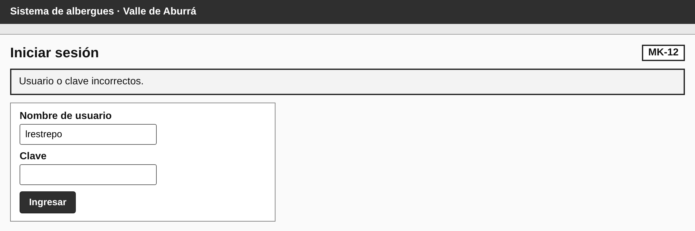
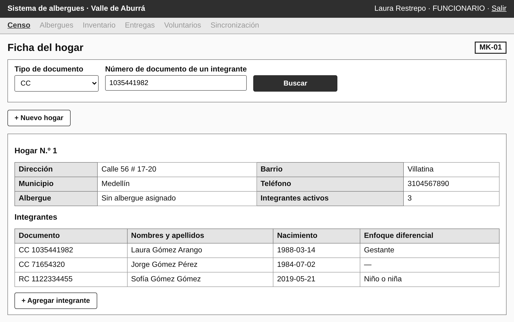
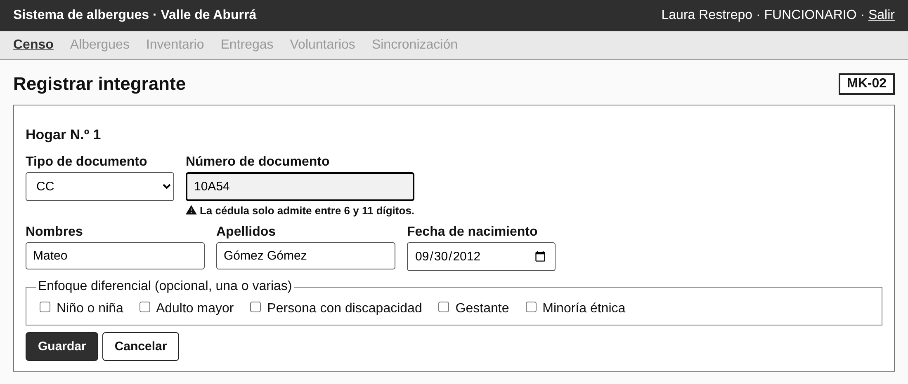
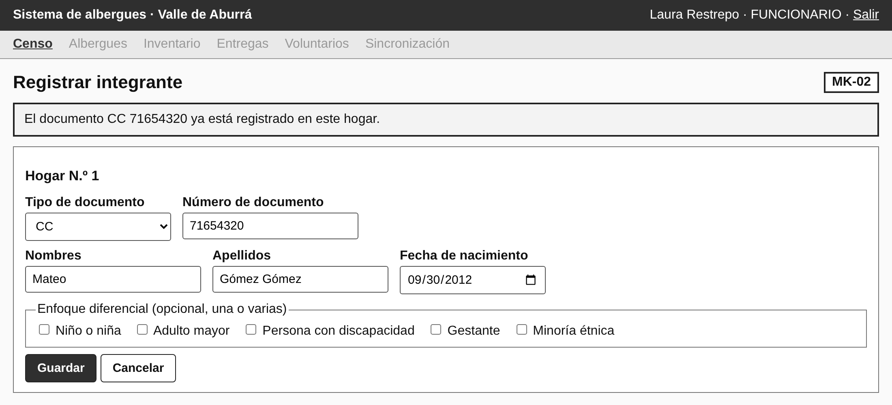
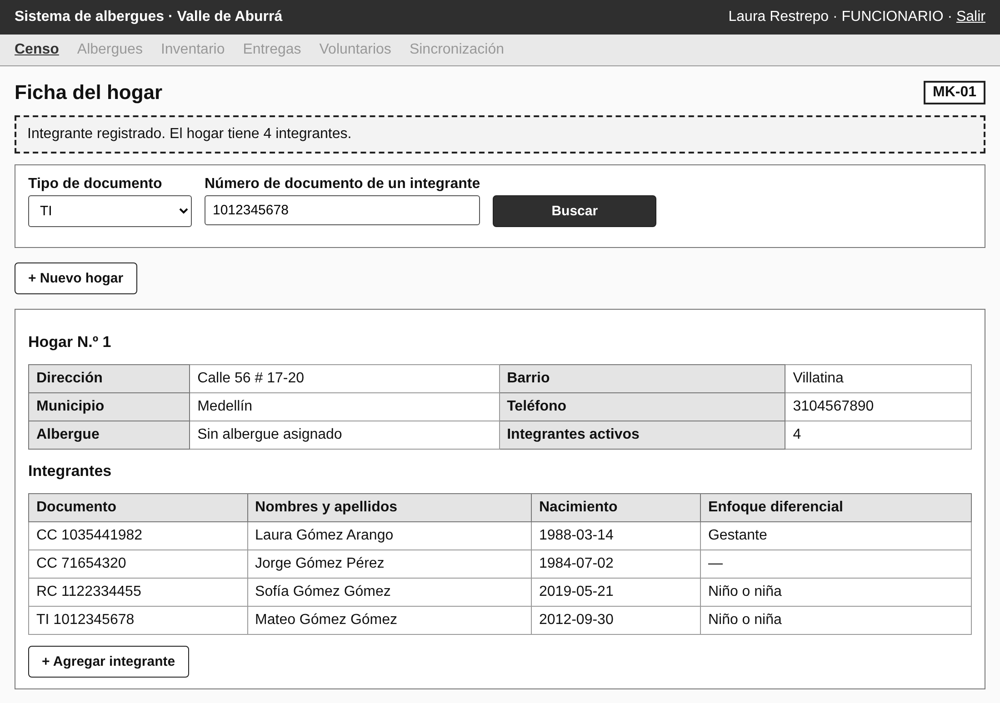

> Versión 1.2 (12 de noviembre de 2026). Las tablas y figuras conservan la numeración del documento Word de docs/entregas.

## 4.3 Primer corte vertical en MVC

El primer corte implementa el núcleo del censo, que es el proceso con más reglas de negocio de la Fase 0: iniciar sesión, registrar un hogar, registrar sus integrantes con la verificación de documento único y el enfoque diferencial, y consultar el hogar. La Tabla 194 lista los casos de uso del corte con su historia, su pantalla, su controlador y los métodos del modelo que invocan.

**Tabla 194**  
*Casos de uso del primer corte vertical*

| **CU** | **HU** | **Pantalla** | **Controlador**   | **Métodos del modelo**                                                                    |
|--------|--------|--------------|-------------------|-------------------------------------------------------------------------------------------|
| CU-01  | HU-01  | MK-12        | AccesoControlador | Usuario.autenticar(), Usuario.tienePermiso()                                              |
| CU-03  | HU-04  | MK-01        | CensoControlador  | Hogar.crear()                                                                             |
| CU-04  | HU-05  | MK-02        | CensoControlador  | Integrante.crear(), Hogar.totalIntegrantes()                                              |
| CU-05  | HU-07  | MK-02        | CensoControlador  | Integrante.asignarCondiciones()                                                           |
| CU-06  | HU-06  | MK-02        | CensoControlador  | Integrante.existeDocumento(), Hogar.buscarPorDocumento()                                  |
| CU-07  | HU-08  | MK-01        | CensoControlador  | Hogar.buscarPorDocumento(), AsignacionAlbergue.albergueActual(), Hogar.totalIntegrantes() |

*Nota.* Elaboración propia.

El código respeta la trazabilidad de las fases anteriores de tres maneras:

> • **El modelo se genera desde el diagrama de clases.** Las nueve clases y las cuatro enumeraciones del paquete albergues.modelo se producen desde la misma fuente que las figuras de la sección 1.8: los atributos, las asociaciones (cada llave foránea es una referencia al objeto asociado) y las firmas de los 50 métodos son idénticos. Cada método lleva en su comentario las HU, los RF y los CU que lo exigen.
>
> • **El controlador sigue el diagrama de secuencia.** CensoControlador ejecuta, en el mismo orden, los mensajes de DS-04 (Figura 34): la validación de forma en la vista, existeDocumento(), buscarPorDocumento() si el documento existe, crear(), asignarCondiciones() y totalIntegrantes(). Cada llamada está marcada en el código con el mensaje que implementa.
>
> • **Cada prueba es un criterio de aceptación.** El nombre de cada prueba cita el criterio y la regla que verifica (Tabla 196).

**Tabla 195**  
*Paquetes del código y su correspondencia con el DDA*

| **Paquete**            | **Clases**                                                                      | **Responsabilidad y trazabilidad**                                                                                                                                                                      |
|------------------------|---------------------------------------------------------------------------------|---------------------------------------------------------------------------------------------------------------------------------------------------------------------------------------------------------|
| albergues.vista        | MK12Acceso, MK01Hogar, MK02Integrante, ValidacionForma, Html                    | Pantallas MK-12, MK-01 y MK-02; validación de forma \[RN-06, RN-08, RN-10\] (DA-05).                                                                                                                    |
| albergues.controlador  | AccesoControlador, CensoControlador, Sesiones, Peticion                         | Eventos de los botones; filtro de sesión y permisos \[RN-01, RN-05\] (DA-06).                                                                                                                           |
| albergues.modelo       | 9 clases y 4 enumeraciones, más ReglaNegocioException                           | Generado desde el diagrama de clases: atributos, asociaciones y firmas idénticos a la sección 1.8. Implementa los 9 métodos del corte; los otros 41 lanzan «Pendiente para el siguiente corte (CU-xx)». |
| albergues.persistencia | ConexionBD, Claves, ErrorDatosException                                         | Conexión con MySQL; hash de claves PBKDF2 (RNF-01).                                                                                                                                                     |
| albergues (raíz)       | Aplicacion                                                                      | Servidor HTTP del JDK con las rutas del corte (DA-09).                                                                                                                                                  |
| src/test/java          | ValidacionFormaTest, UsuarioTest, CensoTest, CorteVerticalTest, BaseDatosPrueba | Una prueba por criterio de aceptación; base H2 en modo MySQL creada con albergues_ddl.sql.                                                                                                              |

*Nota.* Elaboración propia.

Las 19 pruebas automáticas pasan (19 de 19). Se ejecutan con «mvn test» sobre una base H2 en modo MySQL creada con el mismo albergues_ddl.sql; la prueba CorteVerticalTest levanta el servidor y recorre las pantallas por HTTP, de modo que verifica el corte completo de la pantalla a la base de datos.

**Tabla 196**  
*Pruebas automáticas del primer corte y criterios de aceptación que verifican*

| **Clase de prueba** | **Qué verifica**                                                         | **CA**                        | **Regla**    | **Resultado** |
|---------------------|--------------------------------------------------------------------------|-------------------------------|--------------|---------------|
| ValidacionFormaTest | Una condición fuera de la lista rechaza toda la selección                | CA-07.3                       | RN-10        | Pasa          |
| ValidacionFormaTest | Se señala el dato obligatorio faltante                                   | CA-05.2                       | RN-06        | Pasa          |
| ValidacionFormaTest | «10A54» con tipo CC se rechaza con el mensaje de la cédula               | CA-05.3                       | RN-08        | Pasa          |
| ValidacionFormaTest | Pasaporte y PPT admiten letras y dígitos; RC, TI, CC y CE solo dígitos   | —                             | RN-08        | Pasa          |
| ValidacionFormaTest | Hogar sin dirección, barrio o municipio                                  | CA-04.2                       | RN-06        | Pasa          |
| UsuarioTest         | Clave incorrecta                                                         | CA-01.2                       | RN-01        | Pasa          |
| UsuarioTest         | Nombre de usuario o clave vacíos                                         | CA-01.3                       | RN-06        | Pasa          |
| UsuarioTest         | Inicia sesión y solo ofrece las funciones del rol                        | CA-01.1                       | RN-01, RN-05 | Pasa          |
| UsuarioTest         | Un usuario inactivo no inicia sesión                                     | CA-01.5                       | RN-34        | Pasa          |
| CensoTest           | Consulta con y sin resultado                                             | CA-08.1, CA-08.2              | —            | Pasa          |
| CensoTest           | En el mismo hogar no se crea un segundo registro y el original no cambia | CA-06.2, CA-06.3              | RN-07        | Pasa          |
| CensoTest           | Un documento registrado en otro hogar se detecta y no se duplica         | CA-06.1                       | RN-07        | Pasa          |
| CensoTest           | Asignar condiciones o dejar al integrante sin ellas                      | CA-07.1, CA-07.2              | RN-10        | Pasa          |
| CensoTest           | No se registra un integrante en un hogar inexistente o inactivo          | —                             | RN-09        | Pasa          |
| CensoTest           | El hogar queda activo, con identificador, fecha y usuario                | CA-04.1                       | RNF-03       | Pasa          |
| CensoTest           | El integrante queda activo, asociado al hogar, y el total se actualiza   | CA-05.1                       | RN-09        | Pasa          |
| CorteVerticalTest   | El Coordinador consulta hogares pero no registra en el censo             | —                             | RN-05        | Pasa          |
| CorteVerticalTest   | Registrar hogar, integrante, duplicado y consulta                        | CU-03 → CU-04 → CU-06 → CU-07 | —            | Pasa          |
| CorteVerticalTest   | Sin sesión no se muestra información y se pide autenticación             | CA-01.4                       | RN-01        | Pasa          |

*Nota.* En esta verificación las pruebas se compilaron y ejecutaron con Java 21 y H2 2.2.224. Elaboración propia.

Las figuras siguientes son capturas de la aplicación en ejecución, no de los mockups: la Figura 45 rechaza una clave incorrecta (CA-01.2), la Figura 46 muestra la consulta de un hogar con sus integrantes y su enfoque diferencial (CA-08.1), la Figura 47 rechaza el formato de una cédula (CA-05.3), la Figura 48 detecta un documento ya registrado en el mismo hogar (CA-06.2) y la Figura 49 muestra el nuevo total después de registrar un integrante (CA-05.1).

**Figura 45**  
*Aplicación en ejecución: MK-12 rechaza una clave incorrecta*

*Nota.* Captura de la aplicación con datos de prueba ficticios. Elaboración propia.

**Figura 46**  
*Aplicación en ejecución: MK-01 consulta un hogar por documento*

*Nota.* Captura de la aplicación con datos de prueba ficticios. Elaboración propia.

**Figura 47**  
*Aplicación en ejecución: MK-02 rechaza el formato de la cédula*

*Nota.* Captura de la aplicación con datos de prueba ficticios. Elaboración propia.

**Figura 48**  
*Aplicación en ejecución: MK-02 detecta un documento ya registrado*

*Nota.* Captura de la aplicación con datos de prueba ficticios. Elaboración propia.

**Figura 49**  
*Aplicación en ejecución: MK-01 con el nuevo total de integrantes*

*Nota.* Captura de la aplicación con datos de prueba ficticios. Elaboración propia.
